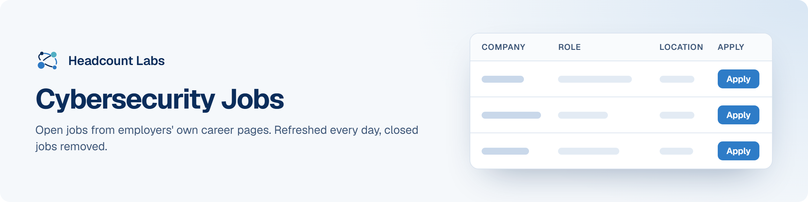

# Cybersecurity Jobs

Security engineer, security analyst and cybersecurity jobs at US employers.

**360 open jobs** · 199 new since the last update · 239 removed because they closed or left the employer's board · updated October 24, 2026 at 5:53 AM EDT

This list is built and refreshed every day by [Headcount Labs](https://headcountlabs.com/?utm_source=github&utm_medium=job-list&utm_campaign=cybersecurity-jobs), which reads jobs straight from employers' own career pages and job boards. Every job here was still listed on its source board when we last read that board, within the past 3 days, and was posted in the past 30 days. Copies of the same job are merged into one row, and jobs that close are removed at the next update.

Want this data in your own app or agent? Use the [Headcount Labs jobs API](https://headcountlabs.com/docs/?utm_source=github&utm_medium=job-list&utm_campaign=cybersecurity-jobs) (free tier), the [MCP server](https://headcountlabs.com/mcp/?utm_source=github&utm_medium=job-list&utm_campaign=cybersecurity-jobs) for Claude, ChatGPT and other AI assistants, or the [public dataset subsets](https://huggingface.co/HeadcountLabs) on Hugging Face (the full dataset is coming soon).

**Full dataset.** A bigger, one-off snapshot dated 2026-10-19 (all matching jobs, not only the open jobs below) is on Hugging Face: [Tech and software jobs](https://huggingface.co/datasets/HeadcountLabs/tech-jobs). It loads with `datasets.load_dataset` and is under the Open Database License (ODbL) 1.0.

**Jump to:** [Posted in the last 7 days (146)](#posted-in-the-last-7-days) · [Posted 8 to 30 days ago (214)](#posted-8-to-30-days-ago)

**Columns.** *Apply* opens the original posting on the employer's site. *Details* opens the job on Headcount Labs, with every posting we found for it. *Remote* shows what the employer states; a dash means the posting doesn't say. *Pay* is the range the employer published.

## Posted in the last 7 days

| Company | Role | Location | Remote | Pay | Posted | Apply | Details |
| --- | --- | --- | --- | --- | --- | :---: | :---: |
| **X-Energy, LLC** | ICS / OT Cyber Security Engineer | Rockville, MD | — | $112k–$128k/yr | Oct 21 |  | <a href="https://headcountlabs.com/catalog/jobs/7cf48854-142c-4ee1-9265-b332b8be4e06?utm_source=github&utm_medium=job-list&utm_campaign=cybersecurity-jobs">via Headcount Labs</a> |
| **West Pharmaceutical Services** | VP, Cybersecurity, Infrastructure &amp; Site Support | Exton, PA | Hybrid | — | Oct 21 |  | <a href="https://headcountlabs.com/catalog/jobs/90e126d6-ede8-46b0-9bd9-bb114409dcfa?utm_source=github&utm_medium=job-list&utm_campaign=cybersecurity-jobs">via Headcount Labs</a> |
| **Warner Bros. Discovery** | Cybersecurity Engineer (Linux DevSecOps Engineer) | 

5 locations
United States Nebraska Atlanta, GA Washington, DC Silver Spring, MD
 | Hybrid | $91k–$169k/yr | Oct 21 |  | <a href="https://headcountlabs.com/catalog/jobs/28a5f867-9b2b-4fa9-8ee4-c34a5126b5c0?utm_source=github&utm_medium=job-list&utm_campaign=cybersecurity-jobs">via Headcount Labs</a> |
| **Vals AI** | Member of Technical Staff - Research, Cyber | San Francisco, CA | On-site | $130k–$185k/yr | Oct 21 |  | <a href="https://headcountlabs.com/catalog/jobs/8ced1d5b-136a-4891-a388-e9523258fc54?utm_source=github&utm_medium=job-list&utm_campaign=cybersecurity-jobs">via Headcount Labs</a> |
| **US01 Shell USA, Inc.** | Americas Regional Security Analyst | Houston, TX | — | $115k–$173k/yr | Oct 21 |  | <a href="https://headcountlabs.com/catalog/jobs/4d040836-b597-4721-9371-07d5e1167c26?utm_source=github&utm_medium=job-list&utm_campaign=cybersecurity-jobs">via Headcount Labs</a> |
| **US HoldCo** | Senior Underwriter, Cyber | United States | — | $165k–$200k/yr | Oct 21 |  | <a href="https://headcountlabs.com/catalog/jobs/a05f5c06-e69a-44ee-ae77-ce87776f8e33?utm_source=github&utm_medium=job-list&utm_campaign=cybersecurity-jobs">via Headcount Labs</a> |
| **Tower Loan of Mississippi, LLC** | Senior Infrastructure Security Engineer | Flowood, MS | Remote | — | Oct 21 |  | <a href="https://headcountlabs.com/catalog/jobs/0e356052-f0c7-40ae-86f3-cb5e3eaee3bc?utm_source=github&utm_medium=job-list&utm_campaign=cybersecurity-jobs">via Headcount Labs</a> |
| **Tepa LLC** | Information Security Engineer | Alexandria, VA | Hybrid | — | Oct 21 |  | <a href="https://headcountlabs.com/catalog/jobs/3758fa1b-4fde-4a7a-8356-afec8a936df4?utm_source=github&utm_medium=job-list&utm_campaign=cybersecurity-jobs">via Headcount Labs</a> |
| **Technomics** | Cyber Technical Engineer | Virginia | — | $70k–$115k/yr | Oct 21 |  | <a href="https://headcountlabs.com/catalog/jobs/40fb7ccb-57c0-4976-a56a-b177cd4e9129?utm_source=github&utm_medium=job-list&utm_campaign=cybersecurity-jobs">via Headcount Labs</a> |
| **TCC Toyota Motor Credit Corporation Company** | Cyber Product Security Engineer, Lead | Plano, TX | — | — | Oct 21 |  | <a href="https://headcountlabs.com/catalog/jobs/b08ac286-697b-4b19-b7c6-d8cbe5fb379f?utm_source=github&utm_medium=job-list&utm_campaign=cybersecurity-jobs">via Headcount Labs</a> |
| **Syncreon Consulting** | CYBER SECURITY ANALYST - SailPoint IdentityIQ (IIQ) | New York, NY | — | — | Oct 21 |  | <a href="https://headcountlabs.com/catalog/jobs/67abb4ab-c7fa-47b9-a217-d7d736d659de?utm_source=github&utm_medium=job-list&utm_campaign=cybersecurity-jobs">via Headcount Labs</a> |
| **Syncreon Consulting** | GRC CYBERSECURITY - W2 position | Pittsburgh, PA | — | — | Oct 21 |  | <a href="https://headcountlabs.com/catalog/jobs/3f759d97-5b79-435c-9423-31c4d96e51eb?utm_source=github&utm_medium=job-list&utm_campaign=cybersecurity-jobs">via Headcount Labs</a> |
| **Sumitomo Mitsui Banking Corporation** | Cyber Security Analyst - Associate | Charlotte, NC | — | — | Oct 21 |  | <a href="https://headcountlabs.com/catalog/jobs/1f86aa14-8f18-46f3-8c8f-db907b039dbe?utm_source=github&utm_medium=job-list&utm_campaign=cybersecurity-jobs">via Headcount Labs</a> |
| **SpaceXSI** | Security Engineer - GRC Sales | 

3 locations
Palo Alto, CA New York, NY Washington, DC
 | — | $100k–$258k/yr | Oct 21 |  | <a href="https://headcountlabs.com/catalog/jobs/5e2e8295-ba04-41b5-8722-11ff9dcec9df?utm_source=github&utm_medium=job-list&utm_campaign=cybersecurity-jobs">via Headcount Labs</a> |
| **SpaceXSI** | Security Engineer, Kubernetes | 

4 locations
Palo Alto, CA Austin, TX New York, NY Washington, DC
 | — | $100k–$258k/yr | Oct 21 |  | <a href="https://headcountlabs.com/catalog/jobs/36b8f979-141a-4d93-a6f4-7e530eaa67e6?utm_source=github&utm_medium=job-list&utm_campaign=cybersecurity-jobs">via Headcount Labs</a> |
| **Revolutional, LLC** | Cyber Security Engineer III | 

2 locations
Martinsburg, WV New Carrollton, MD
 | — | $155k–$185k/yr | Oct 21 |  | <a href="https://headcountlabs.com/catalog/jobs/aa2622d5-c23d-4a90-a1f0-a016bfa9f93b?utm_source=github&utm_medium=job-list&utm_campaign=cybersecurity-jobs">via Headcount Labs</a> |
| **Revolutional, LLC** | Cyber Risk Management Specialist | 

2 locations
Martinsburg, WV New Carrollton, MD
 | — | $110k–$155k/yr | Oct 21 |  | <a href="https://headcountlabs.com/catalog/jobs/cdb403d7-cd68-45f0-9ae6-dca07fd86465?utm_source=github&utm_medium=job-list&utm_campaign=cybersecurity-jobs">via Headcount Labs</a> |
| **RED CANYON TECHNOLOGIES LLC** | Cyber Risk &amp; Assessment Analyst | Washington, DC | — | $148k–$168k/yr | Oct 21 |  | <a href="https://headcountlabs.com/catalog/jobs/21b32731-89e2-4551-bb25-2f68fe95dcd6?utm_source=github&utm_medium=job-list&utm_campaign=cybersecurity-jobs">via Headcount Labs</a> |
| **RED CANYON TECHNOLOGIES LLC** | Cybersecurity Operations Lead | Washington, DC | — | $148k–$168k/yr | Oct 21 |  | <a href="https://headcountlabs.com/catalog/jobs/518aa313-b9f7-4375-8c35-bfe510e48f08?utm_source=github&utm_medium=job-list&utm_campaign=cybersecurity-jobs">via Headcount Labs</a> |
| **R. L. Polk Mobility LLC** | Lead Cybersecurity Engineer - SIEM/AI | 

3 locations
Missouri Michigan Virginia
 | Hybrid | $112k–$168k/yr | Oct 21 |  | <a href="https://headcountlabs.com/catalog/jobs/850243a3-3111-4503-83d8-234bf2164164?utm_source=github&utm_medium=job-list&utm_campaign=cybersecurity-jobs">via Headcount Labs</a> |
| **PRECISE SOFTWARE SOLUTIONS INCORPORATED** | AI Security Engineer | Washington, DC | — | — | Oct 21 |  | <a href="https://headcountlabs.com/catalog/jobs/7c7acaa6-ea06-412a-8884-2c0a57ccb81a?utm_source=github&utm_medium=job-list&utm_campaign=cybersecurity-jobs">via Headcount Labs</a> |
| **Peraton** | Cyber Intelligence Analyst | Washington, DC | — | $104k–$166k/yr | Oct 21 |  | <a href="https://headcountlabs.com/catalog/jobs/cd316236-e2be-4c9b-9e25-1710616a65ce?utm_source=github&utm_medium=job-list&utm_campaign=cybersecurity-jobs">via Headcount Labs</a> |
| **Per Scholas** | Instructional Assistant (Cyber) | Bronx, NY | On-site | $23/hr | Oct 21 |  | <a href="https://headcountlabs.com/catalog/jobs/2721f706-33fa-4ff4-af27-a0d50332a8ad?utm_source=github&utm_medium=job-list&utm_campaign=cybersecurity-jobs">via Headcount Labs</a> |
| **Opendoor** | Enterprise IAM Security Engineer | Miami, FL | On-site | — | Oct 21 |  | <a href="https://headcountlabs.com/catalog/jobs/546240bb-4ff7-4606-9ed3-ed3a60622579?utm_source=github&utm_medium=job-list&utm_campaign=cybersecurity-jobs">via Headcount Labs</a> |
| **NorthMark Strategies LLC** | Cyber Defense Engineer - SIEM | United States | — | — | Oct 21 |  | <a href="https://headcountlabs.com/catalog/jobs/e94f3401-dff4-4876-a779-24d774c0f241?utm_source=github&utm_medium=job-list&utm_campaign=cybersecurity-jobs">via Headcount Labs</a> |
| **Netrio** | Level 2 Cyber Security Analyst | McKinney, TX | On-site | — | Oct 21 |  | <a href="https://headcountlabs.com/catalog/jobs/85c1b9bd-7caf-444c-b2ca-ed813ab67200?utm_source=github&utm_medium=job-list&utm_campaign=cybersecurity-jobs">via Headcount Labs</a> |
| **MED Medtronic Inc** | Sr. Product Security Engineer - Cloud Digital Solutions | Fridley, MN | On-site | $132k–$198k/yr | Oct 21 |  | <a href="https://headcountlabs.com/catalog/jobs/d08fbb61-8a58-47f5-a3c7-7fe087884567?utm_source=github&utm_medium=job-list&utm_campaign=cybersecurity-jobs">via Headcount Labs</a> |
| **MED Medtronic Inc** | Sr. Product Security Engineer - Post Market Surveillance | Fridley, MN | On-site | $132k–$198k/yr | Oct 21 |  | <a href="https://headcountlabs.com/catalog/jobs/34e42e46-1220-4f45-98c9-fa71b4a6ea14?utm_source=github&utm_medium=job-list&utm_campaign=cybersecurity-jobs">via Headcount Labs</a> |
| **MBL Technologies Inc** | Senior Cyber Policy &amp; Strategy Consultant | Washington, DC | Remote | — | Oct 21 |  | <a href="https://headcountlabs.com/catalog/jobs/57d05c29-4af4-43af-935f-b9e1bc96f40f?utm_source=github&utm_medium=job-list&utm_campaign=cybersecurity-jobs">via Headcount Labs</a> |
| **LMI** | Cybersecurity Information System Security Engineer - Clearance Required | Detroit, MI | — | $92k–$158k/yr | Oct 21 |  | <a href="https://headcountlabs.com/catalog/jobs/257b211e-8734-47ff-9b0b-e172fcec2aff?utm_source=github&utm_medium=job-list&utm_campaign=cybersecurity-jobs">via Headcount Labs</a> |
| **LIPAPRD** | 9942L Cyber Security Associate PSEG LI | Bethpage, NY | — | $79k–$126k/yr | Oct 21 |  | <a href="https://headcountlabs.com/catalog/jobs/331dcdce-4d19-4d66-ab5a-fae33abfbed6?utm_source=github&utm_medium=job-list&utm_campaign=cybersecurity-jobs">via Headcount Labs</a> |
| **LE0021 Trimedx Holdings LLC** | Cyber/IT Technician - Clinical Engineering/BMET experience required - Travel required | 

2 locations
Wilmington, DE Philadelphia, PA
 | Hybrid | — | Oct 21 |  | <a href="https://headcountlabs.com/catalog/jobs/82711172-026b-4a72-bd8d-b0af9323eeed?utm_source=github&utm_medium=job-list&utm_campaign=cybersecurity-jobs">via Headcount Labs</a> |
| **Kinetix Technology Services, LLC** | Cybersecurity and Compliance Manager | 

2 locations
United States Washington D.C.
 | Remote | — | Oct 21 |  | <a href="https://headcountlabs.com/catalog/jobs/b0f16658-2897-4856-9627-b45f87a79e5a?utm_source=github&utm_medium=job-list&utm_campaign=cybersecurity-jobs">via Headcount Labs</a> |
| **K Health** | Senior Security Engineer - Application Security | Tel-Aviv, IL | — | — | Oct 21 |  | <a href="https://headcountlabs.com/catalog/jobs/b0ed5099-b7b1-4fe7-ae33-42128d1b2277?utm_source=github&utm_medium=job-list&utm_campaign=cybersecurity-jobs">via Headcount Labs</a> |
| **Jobgether** | ServiceNow Security Engineer | United States | Remote | $105k–$231k/yr | Oct 21 |  | <a href="https://headcountlabs.com/catalog/jobs/fc26d29d-5c24-4cb9-b509-08469cc16cda?utm_source=github&utm_medium=job-list&utm_campaign=cybersecurity-jobs">via Headcount Labs</a> |
| **Jobgether** | Senior Security Analyst | United States | Remote | $125k–$150k/yr | Oct 21 |  | <a href="https://headcountlabs.com/catalog/jobs/539a8c88-fdaf-485e-bd64-296bd2faec08?utm_source=github&utm_medium=job-list&utm_campaign=cybersecurity-jobs">via Headcount Labs</a> |
| **Jobgether** | Cybersecurity Data Engineer | United States | Remote | $40–$50/hr | Oct 21 |  | <a href="https://headcountlabs.com/catalog/jobs/60b5e731-60ab-4636-8611-8d5547f36b70?utm_source=github&utm_medium=job-list&utm_campaign=cybersecurity-jobs">via Headcount Labs</a> |
| **Integrity Technology** | Cyber Security Engineer Expert Level | Reston, VA | — | — | Oct 21 |  | <a href="https://headcountlabs.com/catalog/jobs/15d6fd47-afcf-4087-a90a-2b003c382759?utm_source=github&utm_medium=job-list&utm_campaign=cybersecurity-jobs">via Headcount Labs</a> |
| **HX5, LLC** | System Cybersecurity Engineer | Colorado Springs, CO | — | $110k–$140k/yr | Oct 21 |  | <a href="https://headcountlabs.com/catalog/jobs/73ad122f-6bc7-4045-b449-28b76cc0a602?utm_source=github&utm_medium=job-list&utm_campaign=cybersecurity-jobs">via Headcount Labs</a> |
| **Holland &amp; Knight LLP** | IT Security Analyst | 

2 locations
Tampa Dallas
 | — | — | Oct 21 |  | <a href="https://headcountlabs.com/catalog/jobs/77a6cb50-1804-48ee-ae9c-259cb068bee9?utm_source=github&utm_medium=job-list&utm_campaign=cybersecurity-jobs">via Headcount Labs</a> |
| **HF Sinclair** | Enterprise Cybersecurity Architect | Dallas, TX | — | — | Oct 21 |  | <a href="https://headcountlabs.com/catalog/jobs/fdf30bef-0dc4-4117-921c-64051a623460?utm_source=github&utm_medium=job-list&utm_campaign=cybersecurity-jobs">via Headcount Labs</a> |
| **Gentex Corporation** | Cybersecurity Design Engineer | Michigan Auburn Hills | — | — | Oct 21 |  | <a href="https://headcountlabs.com/catalog/jobs/9c5c5db6-4ab1-4be3-8637-bff827e46895?utm_source=github&utm_medium=job-list&utm_campaign=cybersecurity-jobs">via Headcount Labs</a> |
| **Fluidstack** | Security Engineer, Offensive Security | 

5 locations
San Francisco, CA New York, NY Austin, TX United States Seattle, WA
 | On-site | $224k–$275k/yr | Oct 21 |  | <a href="https://headcountlabs.com/catalog/jobs/a8cbe0b1-c887-4ee7-9f2d-5def280756c5?utm_source=github&utm_medium=job-list&utm_campaign=cybersecurity-jobs">via Headcount Labs</a> |
| **Fluidstack** | Security Engineer, OT | 

5 locations
San Francisco, CA New York, NY Austin, TX United States Seattle, WA
 | On-site | $275k–$344k/yr | Oct 21 |  | <a href="https://headcountlabs.com/catalog/jobs/73667627-407d-4a31-b220-06cf5e8ef19a?utm_source=github&utm_medium=job-list&utm_campaign=cybersecurity-jobs">via Headcount Labs</a> |
| **Fluidstack** | Security Engineer, Exposure and Vulnerability Management | 

5 locations
San Francisco, CA New York, NY Austin, TX United States Seattle, WA
 | On-site | $224k–$275k/yr | Oct 21 |  | <a href="https://headcountlabs.com/catalog/jobs/5267eeef-29e6-4ae1-abd6-83cc8104653c?utm_source=github&utm_medium=job-list&utm_campaign=cybersecurity-jobs">via Headcount Labs</a> |
| **Financial Industry Regulatory Authority, Inc.** | Senior Cyber Governance, Risk, Compliance Analyst | 

2 locations
Rockville, MD Tysons, VA
 | Hybrid | $112k–$202k/yr | Oct 21 |  | <a href="https://headcountlabs.com/catalog/jobs/ff0e8835-c00f-4272-822f-89fa07a21198?utm_source=github&utm_medium=job-list&utm_campaign=cybersecurity-jobs">via Headcount Labs</a> |
| **eSimplicity** | Cyber Business Analyst | District of Columbia | Remote | $102k–$157k/yr | Oct 21 |  | <a href="https://headcountlabs.com/catalog/jobs/a34c9231-dd50-489b-907a-017d7301a4a1?utm_source=github&utm_medium=job-list&utm_campaign=cybersecurity-jobs">via Headcount Labs</a> |
| **eSimplicity** | Sr. Cyber Business Analyst | District of Columbia | Remote | $118k–$170k/yr | Oct 21 |  | <a href="https://headcountlabs.com/catalog/jobs/8ff6f6bf-8586-40af-bbdf-a7003e74811f?utm_source=github&utm_medium=job-list&utm_campaign=cybersecurity-jobs">via Headcount Labs</a> |
| **Duke Energy Progress, LLC** | Nuclear Cybersecurity 2027 Summer Internship | Hartsville, SC | On-site | — | Oct 21 |  | <a href="https://headcountlabs.com/catalog/jobs/fd59649a-5393-42a9-8071-f656b2e376a5?utm_source=github&utm_medium=job-list&utm_campaign=cybersecurity-jobs">via Headcount Labs</a> |
| **DriveWealth** | Principal Security Engineer | 

7 locations
Austin, TX AMER-US Dallas, TX Denver, CO Miami, FL San Francisco, CA Seattle, WA
 | Remote | $215k–$235k/yr | Oct 21 |  | <a href="https://headcountlabs.com/catalog/jobs/74a46e2d-e200-467c-8683-9bd7b173173c?utm_source=github&utm_medium=job-list&utm_campaign=cybersecurity-jobs">via Headcount Labs</a> |
| **Delaware Nation Industries** | Cybersecurity System Engineer-306341 | Alexandria, VA | On-site | — | Oct 21 |  | <a href="https://headcountlabs.com/catalog/jobs/b55f3f7a-e096-428f-b51c-7a0ad91cba9c?utm_source=github&utm_medium=job-list&utm_campaign=cybersecurity-jobs">via Headcount Labs</a> |
| **Default - DO NOT USE** | Cybersecurity Assessor | United States | — | $120k–$135k/yr | Oct 21 |  | <a href="https://headcountlabs.com/catalog/jobs/c9551b0b-ecca-4be0-82ac-df006e48280d?utm_source=github&utm_medium=job-list&utm_campaign=cybersecurity-jobs">via Headcount Labs</a> |
| **Default - DO NOT USE** | Information Systems Security Engineer (Active DOD Secret Clearance required) | KITTERY, ME | Remote | $80k–$90k/yr | Oct 21 |  | <a href="https://headcountlabs.com/catalog/jobs/83812e7a-82d6-469d-9478-6e8009b090e6?utm_source=github&utm_medium=job-list&utm_campaign=cybersecurity-jobs">via Headcount Labs</a> |
| **Default - DO NOT USE** | Lead Project Manager (Cybersecurity) | United States | Hybrid | $120k–$150k/yr | Oct 21 |  | <a href="https://headcountlabs.com/catalog/jobs/0e923fd7-a425-4935-956f-0e4ec2aad695?utm_source=github&utm_medium=job-list&utm_campaign=cybersecurity-jobs">via Headcount Labs</a> |
| **CME Chicago Mercantile Exchange Inc.** | Cyber Defense Analyst II | United States | — | $94k–$156k/yr | Oct 21 |  | <a href="https://headcountlabs.com/catalog/jobs/8abc834e-9746-43db-a92b-674705276463?utm_source=github&utm_medium=job-list&utm_campaign=cybersecurity-jobs">via Headcount Labs</a> |
| **Cloud Software Group Holdings Inc.** | Lead Product Security Engineer | San Ramon, CA | On-site | $192k–$287k/yr | Oct 21 |  | <a href="https://headcountlabs.com/catalog/jobs/b04d1743-1246-426a-8067-53d1622da9ae?utm_source=github&utm_medium=job-list&utm_campaign=cybersecurity-jobs">via Headcount Labs</a> |
| **Classlink Inc** | IT Security Engineer | United States | Remote | — | Oct 21 |  | <a href="https://headcountlabs.com/catalog/jobs/093e7c00-2fcc-440e-8a0f-9c16be27431e?utm_source=github&utm_medium=job-list&utm_campaign=cybersecurity-jobs">via Headcount Labs</a> |
| **City of Edinburg** | Cybersecurity Analyst | Edinburg, TX | — | $23.41/hr | Oct 21 |  | <a href="https://headcountlabs.com/catalog/jobs/38e4aeec-5b72-48da-8fc7-d948eb5ebfb5?utm_source=github&utm_medium=job-list&utm_campaign=cybersecurity-jobs">via Headcount Labs</a> |
| **Bright Vision Technologies** | Cybersecurity Engineer – Applications | Wesley Chapel, FL | Remote | $100k–$150k/yr | Oct 21 |  | <a href="https://headcountlabs.com/catalog/jobs/74dbf06e-ce53-4ba3-9e71-fe92b54fc2a3?utm_source=github&utm_medium=job-list&utm_campaign=cybersecurity-jobs">via Headcount Labs</a> |
| **Bright Vision Technologies** | AI Security Engineer | Piscataway, NJ | Remote | $100k–$150k/yr | Oct 21 |  | <a href="https://headcountlabs.com/catalog/jobs/ff849082-61ba-4b42-a150-18c572314d3e?utm_source=github&utm_medium=job-list&utm_campaign=cybersecurity-jobs">via Headcount Labs</a> |
| **Bright Vision Technologies** | Cloud Security Engineer – Oracle | Alpharetta, GA | Remote | $100k–$150k/yr | Oct 21 |  | <a href="https://headcountlabs.com/catalog/jobs/679a6c6b-1ceb-41f3-be8c-922eae591fe5?utm_source=github&utm_medium=job-list&utm_campaign=cybersecurity-jobs">via Headcount Labs</a> |
| **Bright Vision Technologies** | Application Security Engineer | North Brunswick, NJ | Remote | $100k–$160k/yr | Oct 21 |  | <a href="https://headcountlabs.com/catalog/jobs/358f0f43-0137-4ddd-9174-fd82c22e2760?utm_source=github&utm_medium=job-list&utm_campaign=cybersecurity-jobs">via Headcount Labs</a> |
| **AXON-Networks** | Network Operations Security Engineer (US - Remote) | Irvine, CA | Remote | $120k–$175k/yr | Oct 21 |  | <a href="https://headcountlabs.com/catalog/jobs/e3376c5b-00c2-41f9-a098-36cadbc52737?utm_source=github&utm_medium=job-list&utm_campaign=cybersecurity-jobs">via Headcount Labs</a> |
| **Antech Diagnostics** | Senior Product Security Engineer (Loveland, CO) | Loveland, CO | On-site | $141k–$176k/yr | Oct 21 |  | <a href="https://headcountlabs.com/catalog/jobs/14ad32cf-a98d-4cdd-92d9-f037500c6c6e?utm_source=github&utm_medium=job-list&utm_campaign=cybersecurity-jobs">via Headcount Labs</a> |
| **AMERICAN SYSTEMS** | Cybersecurity Assessment and Authorization Validator | Middletown, RI | — | $83k–$125k/yr | Oct 21 |  | <a href="https://headcountlabs.com/catalog/jobs/974f6fb5-86e8-42a2-a549-3814065edb19?utm_source=github&utm_medium=job-list&utm_campaign=cybersecurity-jobs">via Headcount Labs</a> |
| **Alter Domus** | Senior Network and Security Engineer | Chicago | — | $60k–$105k/yr | Oct 21 |  | <a href="https://headcountlabs.com/catalog/jobs/4677574d-e0c1-4300-a807-6f0fe96c602d?utm_source=github&utm_medium=job-list&utm_campaign=cybersecurity-jobs">via Headcount Labs</a> |
| **WuXi AppTec** | Network Security Engineer | United States | Hybrid | — | Oct 20 |  | <a href="https://headcountlabs.com/catalog/jobs/e76e02c2-aa32-4776-aea6-3e09f9be4b7a?utm_source=github&utm_medium=job-list&utm_campaign=cybersecurity-jobs">via Headcount Labs</a> |
| **Traversal** | Security Engineer | New York, NY | — | — | Oct 20 |  | <a href="https://headcountlabs.com/catalog/jobs/1309c7e9-d3b2-4236-bf96-64fa0eaabb97?utm_source=github&utm_medium=job-list&utm_campaign=cybersecurity-jobs">via Headcount Labs</a> |
| **Torch Technologies, Inc.** | Cybersecurity Engineer, Senior (ISSM) | Kettering, OH | — | — | Oct 20 |  | <a href="https://headcountlabs.com/catalog/jobs/ae03f1ca-4800-4959-b27a-a4474faf3d9e?utm_source=github&utm_medium=job-list&utm_campaign=cybersecurity-jobs">via Headcount Labs</a> |
| **TIAG** | Cloud Security Engineer, Senior | Bethesda, MD | — | $125k–$145k/yr | Oct 20 |  | <a href="https://headcountlabs.com/catalog/jobs/c2b7c158-a718-4d6e-861c-f67024a4876f?utm_source=github&utm_medium=job-list&utm_campaign=cybersecurity-jobs">via Headcount Labs</a> |
| **TAT Technologies Ltd** | IT Support &amp; Cybersecurity Specialist | Greensboro, NC | On-site | — | Oct 20 |  | <a href="https://headcountlabs.com/catalog/jobs/f891c086-00cf-491f-9256-d07ce2303537?utm_source=github&utm_medium=job-list&utm_campaign=cybersecurity-jobs">via Headcount Labs</a> |
| **Surf Internet** | Cyber Security &amp; Risk Manager | Elkhart, IN | — | $110k–$130k/yr | Oct 20 |  | <a href="https://headcountlabs.com/catalog/jobs/b1ebee0d-cbe7-4b42-a58d-d607b6f2cec3?utm_source=github&utm_medium=job-list&utm_campaign=cybersecurity-jobs">via Headcount Labs</a> |
| **Sprezzatura Management Consulting** | Cyber Security Analyst | United States | Remote | $90k–$100k/yr | Oct 20 |  | <a href="https://headcountlabs.com/catalog/jobs/5f0c3dfe-d92f-4c05-9ca6-b5bce76942ce?utm_source=github&utm_medium=job-list&utm_campaign=cybersecurity-jobs">via Headcount Labs</a> |
| **Southwire Company LLC** | Project Manager, IT Cybersecurity | Atlanta, GA | — | — | Oct 20 |  | <a href="https://headcountlabs.com/catalog/jobs/87fa1e9c-5b18-4b72-b88a-078c76feeb10?utm_source=github&utm_medium=job-list&utm_campaign=cybersecurity-jobs">via Headcount Labs</a> |
| **Southwire Company LLC** | Senior Engineer, IT Cybersecurity | Carrollton, GA | — | — | Oct 20 |  | <a href="https://headcountlabs.com/catalog/jobs/2b9cf502-b6d6-4e09-a147-720106bdbd0b?utm_source=github&utm_medium=job-list&utm_campaign=cybersecurity-jobs">via Headcount Labs</a> |
| **Southwire Company LLC** | Senior Analyst, IT Cybersecurity Governance, Risk and Compliance | Carrollton, GA | — | — | Oct 20 |  | <a href="https://headcountlabs.com/catalog/jobs/d975467a-d7b9-466b-adba-bcde65928c04?utm_source=github&utm_medium=job-list&utm_campaign=cybersecurity-jobs">via Headcount Labs</a> |
| **Solairus Aviation** | Security Analyst | Petaluma, CA | On-site | — | Oct 20 |  | <a href="https://headcountlabs.com/catalog/jobs/927061f8-77ca-4a2c-a658-7c1e16b46b21?utm_source=github&utm_medium=job-list&utm_campaign=cybersecurity-jobs">via Headcount Labs</a> |
| **Society Insurance Company** | Cybersecurity Intern | Fond du Lac, WI | Hybrid | — | Oct 20 |  | <a href="https://headcountlabs.com/catalog/jobs/21a6a541-4276-4307-9b2d-138fbfb84989?utm_source=github&utm_medium=job-list&utm_campaign=cybersecurity-jobs">via Headcount Labs</a> |
| **Sierra Nevada Corporation** | Systems Security Engineer III | 

3 locations
Lone Tree, CO Southern Pines, NC Hagerstown, MD
 | On-site | $114k–$157k/yr | Oct 20 |  | <a href="https://headcountlabs.com/catalog/jobs/d7dd733b-02a5-4a50-b03d-7a22dd6f3ed0?utm_source=github&utm_medium=job-list&utm_campaign=cybersecurity-jobs">via Headcount Labs</a> |
| **SEVEN HILLS FOUNDATION** | Cyber Security Specialist (4497) | Worcester, MA | — | $60,000–$85,000/hr | Oct 20 |  | <a href="https://headcountlabs.com/catalog/jobs/23ef436a-85da-4324-8474-2fff6d9e11c9?utm_source=github&utm_medium=job-list&utm_campaign=cybersecurity-jobs">via Headcount Labs</a> |
| **SciTec** | Application Security Engineer | Boulder, CO | On-site | — | Oct 20 |  | <a href="https://headcountlabs.com/catalog/jobs/77ad32df-2e14-4b6e-92da-14d2942a4981?utm_source=github&utm_medium=job-list&utm_campaign=cybersecurity-jobs">via Headcount Labs</a> |
| **Schweitzer Engineering Laboratories, Inc.** | Firmware Engineer - Cybersecurity | Pullman, WA | — | $89k–$134k/yr | Oct 20 |  | <a href="https://headcountlabs.com/catalog/jobs/81b87321-55ed-44c5-84d0-fd82233178a3?utm_source=github&utm_medium=job-list&utm_campaign=cybersecurity-jobs">via Headcount Labs</a> |
| **Revolutional, LLC** | Sr. Program Manager - Cyber Security | 

3 locations
Martinsburg, WV McLean, VA New Carrollton, MD
 | On-site | $165k–$215k/yr | Oct 20 |  | <a href="https://headcountlabs.com/catalog/jobs/1f26ff74-f9a7-4a6a-b2d4-e4060954f201?utm_source=github&utm_medium=job-list&utm_campaign=cybersecurity-jobs">via Headcount Labs</a> |
| **Revolutional, LLC** | Chief Cyber Security Engineer | 

2 locations
Martinsburg, WV New Carrollton, MD
 | — | $190k–$235k/yr | Oct 20 |  | <a href="https://headcountlabs.com/catalog/jobs/16e59c27-1af8-407e-ab7a-57bb0ea23fd1?utm_source=github&utm_medium=job-list&utm_campaign=cybersecurity-jobs">via Headcount Labs</a> |
| **Rand Technology, LLC** | Global Infrastructure &amp; Cybersecurity Manager | Irvine, CA | On-site | — | Oct 20 |  | <a href="https://headcountlabs.com/catalog/jobs/c333631e-5704-4871-9ac3-43f89c1ab16e?utm_source=github&utm_medium=job-list&utm_campaign=cybersecurity-jobs">via Headcount Labs</a> |
| **Pueo Business Solutions LLC** | Cybersecurity Engineer (Expert) | Mc Lean, VA | — | $148k–$168k/yr | Oct 20 |  | <a href="https://headcountlabs.com/catalog/jobs/8f26b988-5649-4db5-8bba-4a401882b3a0?utm_source=github&utm_medium=job-list&utm_campaign=cybersecurity-jobs">via Headcount Labs</a> |
| **Pfizer Inc** | Manager, Cybersecurity &amp; Information Protection (US) | 

2 locations
New York City, NY Collegeville, PA
 | On-site | $106k–$177k/yr | Oct 20 |  | <a href="https://headcountlabs.com/catalog/jobs/77d4f0ae-95fa-4cdb-89d6-a72ae8b4efec?utm_source=github&utm_medium=job-list&utm_campaign=cybersecurity-jobs">via Headcount Labs</a> |
| **Peraton** | Cybersecurity Engineer - SME | Herndon, VA | On-site | $135k–$216k/yr | Oct 20 |  | <a href="https://headcountlabs.com/catalog/jobs/b2e427b7-a7c8-4eee-937a-b4e62d63d7e6?utm_source=github&utm_medium=job-list&utm_campaign=cybersecurity-jobs">via Headcount Labs</a> |
| **Peraton** | Cybersecurity Engineer - Senior | Herndon, VA | On-site | $112k–$179k/yr | Oct 20 |  | <a href="https://headcountlabs.com/catalog/jobs/6b985e26-c927-43ab-bd22-b916d710d5b5?utm_source=github&utm_medium=job-list&utm_campaign=cybersecurity-jobs">via Headcount Labs</a> |
| **Optimum** | Sr Product Security Engineer - Devices | 

2 locations
Bethpage, NY Plano, TX
 | — | $100k–$143k/yr | Oct 20 |  | <a href="https://headcountlabs.com/catalog/jobs/df3e5190-0b9b-44e9-b8f4-0ac580bd7d54?utm_source=github&utm_medium=job-list&utm_campaign=cybersecurity-jobs">via Headcount Labs</a> |
| **NBCUniversal** | Sr Cyber Security Manager (AI) | 

5 locations
North Hollywood, CA Miami, FL New York, NY Stamford, CT Orlando, FL
 | Hybrid | $165k–$195k/yr | Oct 20 |  | <a href="https://headcountlabs.com/catalog/jobs/7fc8e204-c3a6-4ad1-b1e5-17a5d7f5aecd?utm_source=github&utm_medium=job-list&utm_campaign=cybersecurity-jobs">via Headcount Labs</a> |
| **Mysten Labs** | Security Engineer | United States | Remote | $140k–$190k/yr | Oct 20 |  | <a href="https://headcountlabs.com/catalog/jobs/dcc7cb93-6733-4023-8da2-38995ce4ac2b?utm_source=github&utm_medium=job-list&utm_campaign=cybersecurity-jobs">via Headcount Labs</a> |
| **MED Medtronic Inc** | Director - Global Cyber Security Counsel - On-Site, Minneapolis, MN | 

2 locations
Minneapolis, MN Washington, DC
 | On-site | $222k–$334k/yr | Oct 20 |  | <a href="https://headcountlabs.com/catalog/jobs/725b4910-bfbc-4ef2-8936-50b4bc3083d7?utm_source=github&utm_medium=job-list&utm_campaign=cybersecurity-jobs">via Headcount Labs</a> |
| **LevelBlue LLC** | Cyber Consultant, DFIR | 

3 locations
Washington, DC New York, NY Chicago, IL
 | On-site | — | Oct 20 |  | <a href="https://headcountlabs.com/catalog/jobs/e380cda7-5f15-4f5d-a697-20aeb19e2684?utm_source=github&utm_medium=job-list&utm_campaign=cybersecurity-jobs">via Headcount Labs</a> |
| **Klaviyo** | Senior Security Engineer - Detection and Response | Boston, MA | — | $142k–$212k/yr | Oct 20 |  | <a href="https://headcountlabs.com/catalog/jobs/9ec91c0b-dd7c-41b6-ad3a-f1734b356b40?utm_source=github&utm_medium=job-list&utm_campaign=cybersecurity-jobs">via Headcount Labs</a> |
| **Isys Technologies** | Journeyman Cybersecurity Analyst | Kirtland AFB, NM | — | $98k–$108k/yr | Oct 20 |  | <a href="https://headcountlabs.com/catalog/jobs/512f4ba5-4d7e-4100-b615-697fdc4fdb33?utm_source=github&utm_medium=job-list&utm_campaign=cybersecurity-jobs">via Headcount Labs</a> |
| **Intact Specialty Solutions** | Claims Consultant - Cyber &amp; Technology - E&amp;O (Hybrid) | 

6 locations
New York, NY Chicago, IL Plymouth, MN Englewood, CO Irvine, CA Alpharetta, GA
 | Hybrid | $143k–$167k/yr | Oct 20 |  | <a href="https://headcountlabs.com/catalog/jobs/c0b2d365-3bbe-4686-a23d-cf33d46963e5?utm_source=github&utm_medium=job-list&utm_campaign=cybersecurity-jobs">via Headcount Labs</a> |
| **HII** | Cyber Instructor (Hybrid) - 30766 | Augusta, GA | Hybrid | $85k–$130k/yr | Oct 20 |  | <a href="https://headcountlabs.com/catalog/jobs/a9d128b5-5154-4a62-9b91-dbb3e65d9eb4?utm_source=github&utm_medium=job-list&utm_campaign=cybersecurity-jobs">via Headcount Labs</a> |
| **HII** | Cyber Instructor (Hybrid) - 30403 | Columbia, MD | Hybrid | $97k–$140k/yr | Oct 20 |  | <a href="https://headcountlabs.com/catalog/jobs/21316fa9-fb54-4821-b808-decffac6eda2?utm_source=github&utm_medium=job-list&utm_campaign=cybersecurity-jobs">via Headcount Labs</a> |
| **Heartland Business Systems, LLC** | Senior Information Security Engineer | 

3 locations
West Des Moines, IA Madison, WI Plymouth, MN
 | Remote | — | Oct 20 |  | <a href="https://headcountlabs.com/catalog/jobs/ea769969-8f70-4fe4-bcf2-14afa895c4d3?utm_source=github&utm_medium=job-list&utm_campaign=cybersecurity-jobs">via Headcount Labs</a> |
| **Gunnison Consulting Group, Inc.** | Cyber Risk and Vulnerability Assessment SME | Washington, DC | Remote | $160k–$180k/yr | Oct 20 |  | <a href="https://headcountlabs.com/catalog/jobs/e30df112-83a4-4e40-9d66-5339325b4f86?utm_source=github&utm_medium=job-list&utm_campaign=cybersecurity-jobs">via Headcount Labs</a> |
| **Gunnison Consulting Group, Inc.** | Lead Cyber Threat Intelligence Analyst | Washington, DC | Remote | $150k–$170k/yr | Oct 20 |  | <a href="https://headcountlabs.com/catalog/jobs/a6bf2a6d-1dac-44ac-aa92-93f197479ab0?utm_source=github&utm_medium=job-list&utm_campaign=cybersecurity-jobs">via Headcount Labs</a> |
| **Gunnison Consulting Group, Inc.** | Cyber Hunt Team Lead | Washington, DC | Remote | $160k–$180k/yr | Oct 20 |  | <a href="https://headcountlabs.com/catalog/jobs/cd97c657-68cc-416c-9690-09fd35036d27?utm_source=github&utm_medium=job-list&utm_campaign=cybersecurity-jobs">via Headcount Labs</a> |
| **Genius Road** | Senior Tenable Security Engineer #3415 | Austin, TX | Hybrid | — | Oct 20 |  | <a href="https://headcountlabs.com/catalog/jobs/52fb07c3-9352-4c6c-a039-38349a25f0f0?utm_source=github&utm_medium=job-list&utm_campaign=cybersecurity-jobs">via Headcount Labs</a> |
| **Critical Start** | Cybersecurity Engineer, Managed SIEM | 

6 locations
Washington, D.C. Dallas, TX Tallahassee, FL Raleigh, NC Atlanta, GA Salt Lake City, UT
 | — | $80k–$110k/yr | Oct 20 |  | <a href="https://headcountlabs.com/catalog/jobs/aaa5ca4c-6c61-42e3-9dc8-1fc7bd1113d1?utm_source=github&utm_medium=job-list&utm_campaign=cybersecurity-jobs">via Headcount Labs</a> |
| **Coke Florida** | Senior Manager, Cyber Tech, Trust and Mitigation | Tampa, FL | On-site | — | Oct 20 |  | <a href="https://headcountlabs.com/catalog/jobs/f67ae87d-7f8c-49ca-8a4d-0c71c4f87d37?utm_source=github&utm_medium=job-list&utm_campaign=cybersecurity-jobs">via Headcount Labs</a> |
| **Coke Florida** | Technology Director, IT Infrastructure, Cyber and Service Delivery | 

4 locations
Jacksonville, FL Hollywood, FL Tampa, FL Orlando, FL
 | On-site | — | Oct 20 |  | <a href="https://headcountlabs.com/catalog/jobs/caf2ab52-2119-4f8b-bb21-023b47308242?utm_source=github&utm_medium=job-list&utm_campaign=cybersecurity-jobs">via Headcount Labs</a> |
| **Coalition, Inc.** | Cyber Claim Specialist | Any location | — | — | Oct 20 |  | <a href="https://headcountlabs.com/catalog/jobs/d2e2323f-854f-4eb0-939b-a0ae59c27fb7?utm_source=github&utm_medium=job-list&utm_campaign=cybersecurity-jobs">via Headcount Labs</a> |
| **Charles Schwab Inc.** | Security Engineer | 

3 locations
Omaha, NE Southlake, TX Phoenix, AZ
 | — | $50.48–$60.10/hr | Oct 20 |  | <a href="https://headcountlabs.com/catalog/jobs/3b4972ef-4762-4e55-b5bc-ee6e21027880?utm_source=github&utm_medium=job-list&utm_campaign=cybersecurity-jobs">via Headcount Labs</a> |
| **Ceresti Health** | Security Engineer | United States | Remote | — | Oct 20 |  | <a href="https://headcountlabs.com/catalog/jobs/1f1b4810-a258-4fcc-aedd-e732b28352f2?utm_source=github&utm_medium=job-list&utm_campaign=cybersecurity-jobs">via Headcount Labs</a> |
| **Bridgewater Bank** | Director Cybersecurity | St Louis Park, MN | — | $144k–$190k/yr | Oct 20 |  | <a href="https://headcountlabs.com/catalog/jobs/d2fa36c2-334a-4583-9843-0dc458445a31?utm_source=github&utm_medium=job-list&utm_campaign=cybersecurity-jobs">via Headcount Labs</a> |
| **BridgePhase** | IT Security Analyst | Herndon, VA | Hybrid | $100k–$130k/yr | Oct 20 |  | <a href="https://headcountlabs.com/catalog/jobs/79d707a9-bb31-43ae-a4da-f0a6c4c1aa6e?utm_source=github&utm_medium=job-list&utm_campaign=cybersecurity-jobs">via Headcount Labs</a> |
| **Bering-Alaka`ina Holdings, LLC** | Cyber Security Support Specialist (Part-time) | Kaua'i, HI | — | $35.26/hr | Oct 20 |  | <a href="https://headcountlabs.com/catalog/jobs/be8a17d4-f828-4850-b062-f970d46771ab?utm_source=github&utm_medium=job-list&utm_campaign=cybersecurity-jobs">via Headcount Labs</a> |
| **Bering Straits Native Corp** | Sr. Electronic Security Engineer | Huntsville, AL | On-site | — | Oct 20 |  | <a href="https://headcountlabs.com/catalog/jobs/d0ac2634-e966-438d-82ba-26483dc5a169?utm_source=github&utm_medium=job-list&utm_campaign=cybersecurity-jobs">via Headcount Labs</a> |
| **BCC Software** | Security Analyst | Pittsford, NY | Remote | $100k–$120k/yr | Oct 20 |  | <a href="https://headcountlabs.com/catalog/jobs/970c657c-20c0-4125-b8cd-886a8a401681?utm_source=github&utm_medium=job-list&utm_campaign=cybersecurity-jobs">via Headcount Labs</a> |
| **Banner Defense, Inc.** | Security Analyst | Huntsville, AL | — | $60k–$72k/yr | Oct 20 |  | <a href="https://headcountlabs.com/catalog/jobs/f1fccb08-df52-4699-88c5-d0dca908fefe?utm_source=github&utm_medium=job-list&utm_campaign=cybersecurity-jobs">via Headcount Labs</a> |
| **BAE Systems** | Cyber Eng Sr Prin II | Sterling, VA | — | — | Oct 20 |  | <a href="https://headcountlabs.com/catalog/jobs/e0ebb0bd-30b2-4b61-955b-8020d7722504?utm_source=github&utm_medium=job-list&utm_campaign=cybersecurity-jobs">via Headcount Labs</a> |
| **AUSGAR Technologies Inc** | Senior Cybersecurity Engineer - 26-024 - Hybrid | San Diego, CA | Hybrid | $150k–$180k/yr | Oct 20 |  | <a href="https://headcountlabs.com/catalog/jobs/09a76e48-dc9c-4c62-abcb-c9dd30a458bb?utm_source=github&utm_medium=job-list&utm_campaign=cybersecurity-jobs">via Headcount Labs</a> |
| **Artivion** | Cybersecurity Intern (Part-Time) | Kennesaw, GA | — | — | Oct 20 |  | <a href="https://headcountlabs.com/catalog/jobs/f0d5b912-5e52-46f7-a85a-ab8d950336d3?utm_source=github&utm_medium=job-list&utm_campaign=cybersecurity-jobs">via Headcount Labs</a> |
| **ARES Corporation** | Cybersecurity Analyst I | Colorado Springs, CO | On-site | $80k–$125k/yr | Oct 20 |  | <a href="https://headcountlabs.com/catalog/jobs/bdc335f9-2497-42f0-ada9-262dd6b30334?utm_source=github&utm_medium=job-list&utm_campaign=cybersecurity-jobs">via Headcount Labs</a> |
| **ARES Corporation** | Cybersecurity Analyst III | Huntsville, AL | On-site | $130k–$145k/yr | Oct 20 |  | <a href="https://headcountlabs.com/catalog/jobs/3cab2a54-93ee-409c-ac2d-feead2846780?utm_source=github&utm_medium=job-list&utm_campaign=cybersecurity-jobs">via Headcount Labs</a> |
| **Arcfield** | Cyber Systems Engineer Project Manager | Westfields, VA | — | — | Oct 20 |  | <a href="https://headcountlabs.com/catalog/jobs/60a935c0-fa62-4957-a7e8-d080795df644?utm_source=github&utm_medium=job-list&utm_campaign=cybersecurity-jobs">via Headcount Labs</a> |
| **Anthropic** | Manager, Cybersecurity Sales Specialist | San Francisco, CA &#124; Seattle, WA &#124; New York City, NY &#124; Washington, DC | — | $450k–$550k/yr | Oct 20 |  | <a href="https://headcountlabs.com/catalog/jobs/993ba86a-37fa-4f11-9917-c7f22ef998ac?utm_source=github&utm_medium=job-list&utm_campaign=cybersecurity-jobs">via Headcount Labs</a> |
| **Anthropic** | Manager, Applied AI Cyber Specialists | San Francisco, CA &#124; New York City, NY | — | — | Oct 20 |  | <a href="https://headcountlabs.com/catalog/jobs/2fd68726-ab87-4be1-b733-d705205bb24e?utm_source=github&utm_medium=job-list&utm_campaign=cybersecurity-jobs">via Headcount Labs</a> |
| **Anthropic** | Security Engineer / Research Engineer, RL Security | San Francisco, CA &#124; New York City, NY &#124; Seattle, WA | — | $320k–$405k/yr | Oct 20 |  | <a href="https://headcountlabs.com/catalog/jobs/2352fccf-bcf7-464e-bc5c-1ca406e70adc?utm_source=github&utm_medium=job-list&utm_campaign=cybersecurity-jobs">via Headcount Labs</a> |
| **V2X** | Cybersecurity Business Development SME (Temporary) | United States | Remote | — | Oct 19 |  | <a href="https://headcountlabs.com/catalog/jobs/fa6f4b5c-af78-4b11-8e5c-b15b298cdac2?utm_source=github&utm_medium=job-list&utm_campaign=cybersecurity-jobs">via Headcount Labs</a> |
| **Trellix Public Sector LLC** | Cyber Threat Hunter (TS/SCI Clearance Required) | Fairfax, VA | On-site | — | Oct 19 |  | <a href="https://headcountlabs.com/catalog/jobs/20e969ca-fe2e-443e-92c6-590a5f435770?utm_source=github&utm_medium=job-list&utm_campaign=cybersecurity-jobs">via Headcount Labs</a> |
| **Synchrony International Services Private Limited** | AVP, Endpoint Information Security Engineer | 

6 locations
Hyderabad Central Region Engagement Hub, IN Eastern Region Engagement Hub, IN Northern Region Engagement Hub, IN Southern Region Engagement Hub, IN Western Region Engagement Hub, IN
 | — | — | Oct 19 |  | <a href="https://headcountlabs.com/catalog/jobs/a3d78997-2f38-42a1-bae9-3f4da40e2197?utm_source=github&utm_medium=job-list&utm_campaign=cybersecurity-jobs">via Headcount Labs</a> |
| **Summit Utilities Inc** | Security Analyst I | 

3 locations
FORT SMITH, AR FAYETTEVILLE, AR LITTLE ROCK, AR
 | — | — | Oct 19 |  | <a href="https://headcountlabs.com/catalog/jobs/fee504ee-c673-4bdd-82ad-8062c974cd8b?utm_source=github&utm_medium=job-list&utm_campaign=cybersecurity-jobs">via Headcount Labs</a> |
| **Steampunk** | Cyber Risk Management Specialist | McLean, VA | — | $100k–$150k/yr | Oct 19 |  | <a href="https://headcountlabs.com/catalog/jobs/0e9becc6-8a55-419e-ab8d-95aa78d88903?utm_source=github&utm_medium=job-list&utm_campaign=cybersecurity-jobs">via Headcount Labs</a> |
| **State Farm** | Lead IAM Security Engineer | 

3 locations
Bloomington, IL Richardson, TX Tempe, AZ
 | — | $110k–$142k/yr | Oct 19 |  | <a href="https://headcountlabs.com/catalog/jobs/55154575-8d66-4b7e-b936-fc05465e2039?utm_source=github&utm_medium=job-list&utm_campaign=cybersecurity-jobs">via Headcount Labs</a> |
| **State Farm** | Infrastructure Security Analyst – macOS Endpoint Security | 

2 locations
Bloomington, IL Dallas, TX
 | — | $100k–$142k/yr | Oct 19 |  | <a href="https://headcountlabs.com/catalog/jobs/164b20b1-e9bb-4ef8-af2b-6c0cb42fc5ab?utm_source=github&utm_medium=job-list&utm_campaign=cybersecurity-jobs">via Headcount Labs</a> |
| **Sprezzatura Management Consulting** | Security Automation / Cyber Security Engineer | United States | Remote | $135k–$160k/yr | Oct 19 |  | <a href="https://headcountlabs.com/catalog/jobs/dea35ab6-579f-4602-ae8d-919288f42394?utm_source=github&utm_medium=job-list&utm_campaign=cybersecurity-jobs">via Headcount Labs</a> |
| **Scientific Research Corporation** | Cyber Sec Analyst II | North Charleston, SC | — | — | Oct 19 |  | <a href="https://headcountlabs.com/catalog/jobs/8141b317-6ff1-4399-b287-ccf2048769cf?utm_source=github&utm_medium=job-list&utm_campaign=cybersecurity-jobs">via Headcount Labs</a> |
| **LUMA Energy ServCo, LLC** | Cyber Defense Specialist | United States | — | — | Oct 19 |  | <a href="https://headcountlabs.com/catalog/jobs/74e08df6-ad56-464c-81f3-ab2a00cc2284?utm_source=github&utm_medium=job-list&utm_campaign=cybersecurity-jobs">via Headcount Labs</a> |
| **K2 Space** | Principal Security Engineer, Operations | Los Angeles, CA | — | $180k–$250k/yr | Oct 19 |  | <a href="https://headcountlabs.com/catalog/jobs/e3e0852b-a0c3-4b2e-8923-bd785c481fc1?utm_source=github&utm_medium=job-list&utm_campaign=cybersecurity-jobs">via Headcount Labs</a> |
| **JRM Construction Management, LLC** | Cybersecurity Analyst | New York, NY | — | $100k–$115k/yr | Oct 19 |  | <a href="https://headcountlabs.com/catalog/jobs/38ee011b-a997-4217-82e3-358d982a3ce6?utm_source=github&utm_medium=job-list&utm_campaign=cybersecurity-jobs">via Headcount Labs</a> |
| **DigiFlight** | Sr. Electronic Security Engineer | 

2 locations
Columbia, MD Huntsville, AL
 | — | — | Oct 19 |  | <a href="https://headcountlabs.com/catalog/jobs/e2fd9d32-648e-403a-9e23-d3f964c18aa0?utm_source=github&utm_medium=job-list&utm_campaign=cybersecurity-jobs">via Headcount Labs</a> |
| **Consensus Cloud Solutions** | Sr. Information Security Engineer, FedRAMP | United States | Remote | $180k–$190k/yr | Oct 19 |  | <a href="https://headcountlabs.com/catalog/jobs/90460776-f496-47c8-85ba-673775c41b80?utm_source=github&utm_medium=job-list&utm_campaign=cybersecurity-jobs">via Headcount Labs</a> |
| **Cloud Software Group, LLC** | CSA Security Analyst | San Ramon, CA | On-site | $127k–$191k/yr | Oct 19 |  | <a href="https://headcountlabs.com/catalog/jobs/743592f7-1968-4ce3-b70f-54111be8fdcd?utm_source=github&utm_medium=job-list&utm_campaign=cybersecurity-jobs">via Headcount Labs</a> |
| **Children's Mercy KC** | Security Engineer | Kansas City, MO | — | $41.57/hr | Oct 19 |  | <a href="https://headcountlabs.com/catalog/jobs/c859db75-c2c5-4cad-851d-5d796be0b6ac?utm_source=github&utm_medium=job-list&utm_campaign=cybersecurity-jobs">via Headcount Labs</a> |
| **Chenega Corporation** | Cyber Project Management Specialist | Redstone Arsenal, AL | — | — | Oct 19 |  | <a href="https://headcountlabs.com/catalog/jobs/f6e1b39d-cd48-4e9d-a46f-1044defd0e9f?utm_source=github&utm_medium=job-list&utm_campaign=cybersecurity-jobs">via Headcount Labs</a> |
| **Bristol Alliance of Companies** | CYBER SECURITY CONSULTANT | 

4 locations
Norfolk, VA Great Lakes, IL Kittery, ME Philadelphia, PA
 | On-site | — | Oct 19 |  | <a href="https://headcountlabs.com/catalog/jobs/4af622ab-e202-4684-8bc1-a4bc3154591f?utm_source=github&utm_medium=job-list&utm_campaign=cybersecurity-jobs">via Headcount Labs</a> |
| **Atlantic Automotive Corp** | Onsite Internal IT Systems and Security Engineer | Baltimore, MD | On-site | $85k–$125k/yr | Oct 19 |  | <a href="https://headcountlabs.com/catalog/jobs/9d87e35f-3a5f-4636-8ed3-02cf2d88a274?utm_source=github&utm_medium=job-list&utm_campaign=cybersecurity-jobs">via Headcount Labs</a> |
| **Apptium Technologies** | IT Security Analyst | 

2 locations
Reston, VA Reston Virginia
 | On-site | $70k–$80k/yr | Oct 19 |  | <a href="https://headcountlabs.com/catalog/jobs/2b76446a-7f38-4aba-8fd6-e51ee31c65b1?utm_source=github&utm_medium=job-list&utm_campaign=cybersecurity-jobs">via Headcount Labs</a> |
| **Riverside Hospital, Inc.** | Network Security Engineer | Newport News, VA | Remote | $86k–$118k/yr | Oct 17 |  | <a href="https://headcountlabs.com/catalog/jobs/491303be-e097-439c-bb1e-acf2bce952b5?utm_source=github&utm_medium=job-list&utm_campaign=cybersecurity-jobs">via Headcount Labs</a> |

## Posted 8 to 30 days ago

| Company | Role | Location | Remote | Pay | Posted | Apply | Details |
| --- | --- | --- | --- | --- | --- | :---: | :---: |
| **Vivmark Residential** | Security Analyst | Chicago, IL | On-site | $111k–$136k/yr | Oct 16 |  | <a href="https://headcountlabs.com/catalog/jobs/8ea399a8-fbca-41c8-9e1c-5db320282ba8?utm_source=github&utm_medium=job-list&utm_campaign=cybersecurity-jobs">via Headcount Labs</a> |
| **Vivmark** | Security Analyst | 

3 locations
Arlington, VA Chicago, IL Washington, DC
 | Remote | $111k–$136k/yr | Oct 16 |  | <a href="https://headcountlabs.com/catalog/jobs/89466740-6c80-4196-8860-ca25116c31af?utm_source=github&utm_medium=job-list&utm_campaign=cybersecurity-jobs">via Headcount Labs</a> |
| **Synchrony International Services Private Limited** | AVP, Tanium Security Engineer | 

6 locations
Hyderabad Central Region Engagement Hub, IN Eastern Region Engagement Hub, IN Northern Region Engagement Hub, IN Southern Region Engagement Hub, IN Western Region Engagement Hub, IN
 | — | — | Oct 16 |  | <a href="https://headcountlabs.com/catalog/jobs/75d8162c-49e6-4ba3-8007-0ff77f43d00f?utm_source=github&utm_medium=job-list&utm_campaign=cybersecurity-jobs">via Headcount Labs</a> |
| **Synchrony Bank** | VP, Cyber Intelligence Leader | 

13 locations
Stamford Hub Atlanta Engagement Hub, GA Atlanta Hub Canton Engagement Hub, OH Charlotte Engagement Hub, NC Chicago Engagement Hub, IL Chicago Hub United States Costa Mesa Hub Bryant Park Engagement Hub, NY Orlando Engagement Hub, FL Orlando Hub +1 more
 | — | $170k–$290k/yr | Oct 16 |  | <a href="https://headcountlabs.com/catalog/jobs/e3846b5a-1dc7-4e47-8970-3bbc2ce4f0da?utm_source=github&utm_medium=job-list&utm_campaign=cybersecurity-jobs">via Headcount Labs</a> |
| **Driven Brands Shared Services LLC** | Senior Cybersecurity Engineer | North Carolina | Remote | $91k–$163k/yr | Oct 16 |  | <a href="https://headcountlabs.com/catalog/jobs/8ea35e19-5625-41a2-b3f7-c2f0a89831f3?utm_source=github&utm_medium=job-list&utm_campaign=cybersecurity-jobs">via Headcount Labs</a> |
| **Apollo.io** | Staff Application Security Engineer | United States | Remote | $225k–$282k/yr | Oct 16 |  | <a href="https://headcountlabs.com/catalog/jobs/946cf95e-bbc1-4fd3-8d12-3c286be62155?utm_source=github&utm_medium=job-list&utm_campaign=cybersecurity-jobs">via Headcount Labs</a> |
| **Apollo.io** | Senior Application Security Engineer | United States | Remote | $219k–$273k/yr | Oct 16 |  | <a href="https://headcountlabs.com/catalog/jobs/13006b66-7c3b-4207-b11b-64e933fa8112?utm_source=github&utm_medium=job-list&utm_campaign=cybersecurity-jobs">via Headcount Labs</a> |
| **Sierra Nevada Corporation** | Systems Security Engineer I | Lone Tree, CO | On-site | $86k–$118k/yr | Oct 15 |  | <a href="https://headcountlabs.com/catalog/jobs/60b24fbb-5563-4d68-ae5e-10f9b30d052a?utm_source=github&utm_medium=job-list&utm_campaign=cybersecurity-jobs">via Headcount Labs</a> |
| **Pharmacia &amp; Upjohn Company** | Cyber &amp; Infrastructure Technology Lead Engineer | Rocky Mount, NC | — | $99k–$165k/yr | Oct 15 |  | <a href="https://headcountlabs.com/catalog/jobs/76be047e-37ed-4f55-8fef-2ad02dcb6ed3?utm_source=github&utm_medium=job-list&utm_campaign=cybersecurity-jobs">via Headcount Labs</a> |
| **Haier US Appliance Solutions, Inc.** | Senior Security Engineer- Security Operations | Appliance Park KY | — | — | Oct 15 |  | <a href="https://headcountlabs.com/catalog/jobs/9e6f57c7-ecf2-4afc-933c-bd193a59e73e?utm_source=github&utm_medium=job-list&utm_campaign=cybersecurity-jobs">via Headcount Labs</a> |
| **General Matter** | Summer 2027 Internship - Information Security Engineer | Los Angeles, CA | — | $32–$46/hr | Oct 15 |  | <a href="https://headcountlabs.com/catalog/jobs/c24d9f02-3ba0-4f34-9d44-186406ab1803?utm_source=github&utm_medium=job-list&utm_campaign=cybersecurity-jobs">via Headcount Labs</a> |
| **American Electric Power** | Cyber Threat Intelligence Analyst | 

2 locations
Columbus, OH Austin, TX
 | — | $116k–$151k/yr | Oct 15 |  | <a href="https://headcountlabs.com/catalog/jobs/409a7a89-d150-4f52-b471-5696574c0fac?utm_source=github&utm_medium=job-list&utm_campaign=cybersecurity-jobs">via Headcount Labs</a> |
| **Texas A&amp;M University - Corpus Christi** | Security Analyst I | Corpus Christi, TX | — | $4k/mo | Oct 14 |  | <a href="https://headcountlabs.com/catalog/jobs/10c43f75-df70-4036-ace1-fd27b1edb942?utm_source=github&utm_medium=job-list&utm_campaign=cybersecurity-jobs">via Headcount Labs</a> |
| **TechSur Solutions** | Cybersecurity Integration Lead- EXIM | Washington, DC | — | $165k–$225k/yr | Oct 14 |  | <a href="https://headcountlabs.com/catalog/jobs/3556e118-4dc4-4d39-9d53-37f32300100a?utm_source=github&utm_medium=job-list&utm_campaign=cybersecurity-jobs">via Headcount Labs</a> |
| **Stratolaunch** | Lead Security Engineer - Information Systems Security Manager (ISSM) | Mojave, CA | — | $140k–$185k/yr | Oct 14 |  | <a href="https://headcountlabs.com/catalog/jobs/4a772bac-2b52-4ccd-b6ef-e4c497d93189?utm_source=github&utm_medium=job-list&utm_campaign=cybersecurity-jobs">via Headcount Labs</a> |
| **Ford Motor Company** | Embedded Cybersecurity Engineer | Dearborn, MI | Hybrid | $85k–$167k/yr | Oct 14 |  | <a href="https://headcountlabs.com/catalog/jobs/31e0ce54-746d-4507-b2f0-f83042702c88?utm_source=github&utm_medium=job-list&utm_campaign=cybersecurity-jobs">via Headcount Labs</a> |
| **Brown and Caldwell** | Senior Cyber Security Engineer | 

13 locations
Lakewood, CO Nashville, TN Chicago, IL Walnut Creek, CA New York City, NY Alexandria, VA Houston, TX Atlanta, GA West Palm Beach, FL Seattle, WA Los Angeles, CA Irvine, CA +1 more
 | Hybrid | $129k–$177k/yr | Oct 14 |  | <a href="https://headcountlabs.com/catalog/jobs/72235f00-1387-4188-b5ba-0e20b92af53b?utm_source=github&utm_medium=job-list&utm_campaign=cybersecurity-jobs">via Headcount Labs</a> |
| **Arcfield** | Information Systems Security Engineer - Keyport, WA | Keyport, WA | — | — | Oct 14 |  | <a href="https://headcountlabs.com/catalog/jobs/5a8300ad-699c-4fdd-a709-af631c09d6b8?utm_source=github&utm_medium=job-list&utm_campaign=cybersecurity-jobs">via Headcount Labs</a> |
| **Abile Group, Inc.** | Cyber Data Analysis Engineer | Springfield, VA | — | — | Oct 14 |  | <a href="https://headcountlabs.com/catalog/jobs/cd71abfe-c7f6-4ad8-a9d6-c82fa555ec9e?utm_source=github&utm_medium=job-list&utm_campaign=cybersecurity-jobs">via Headcount Labs</a> |
| **1H0 Hospira, Inc.** | Cyber, Infrastructure, Data, Integration, &amp; Systems Team Lead | Rocky Mount, NC | — | $139k–$232k/yr | Oct 14 |  | <a href="https://headcountlabs.com/catalog/jobs/661066f4-e94c-4218-8131-cc6e8c7f0362?utm_source=github&utm_medium=job-list&utm_campaign=cybersecurity-jobs">via Headcount Labs</a> |
| **Titan Technologies** | Cybersecurity Policy Analyst | Columbus, OH | On-site | — | Oct 13 |  | <a href="https://headcountlabs.com/catalog/jobs/cb8867be-1ad1-456f-a18a-f0d3c57aea8b?utm_source=github&utm_medium=job-list&utm_campaign=cybersecurity-jobs">via Headcount Labs</a> |
| **Titan Technologies** | Cybersecurity Incident Response &amp; Threat Detection Analyst | Columbus, OH | Hybrid | — | Oct 13 |  | <a href="https://headcountlabs.com/catalog/jobs/0fa0dde4-a9d6-4f8d-927a-5f7084aa7e3c?utm_source=github&utm_medium=job-list&utm_campaign=cybersecurity-jobs">via Headcount Labs</a> |
| **TCC Toyota Motor Credit Corporation Company** | Security Engineer, Lead | Plano, TX | — | — | Oct 13 |  | <a href="https://headcountlabs.com/catalog/jobs/1ae93752-3e01-45b0-b78c-fd35a8c8e9cd?utm_source=github&utm_medium=job-list&utm_campaign=cybersecurity-jobs">via Headcount Labs</a> |
| **Search Jobs - INL Professional** | Critical Infrastructure Cyber Protection &amp; Defense Analyst | Idaho Falls, ID | On-site | $95k–$195k/yr | Oct 13 |  | <a href="https://headcountlabs.com/catalog/jobs/ddab913a-1080-470e-9ad2-a2dc2b43e339?utm_source=github&utm_medium=job-list&utm_campaign=cybersecurity-jobs">via Headcount Labs</a> |
| **PUNCH Cyber Analytics Group** | Cyber Security Engineer - Firewall | 

2 locations
United States Reston, VA
 | Remote | — | Oct 13 |  | <a href="https://headcountlabs.com/catalog/jobs/8085cd9b-260f-460d-befc-181310a134e7?utm_source=github&utm_medium=job-list&utm_campaign=cybersecurity-jobs">via Headcount Labs</a> |
| **PUNCH Cyber Analytics Group** | Cyber Security Engineer | 

2 locations
United States Reston, VA
 | Remote | — | Oct 13 |  | <a href="https://headcountlabs.com/catalog/jobs/0444cfb9-5fd9-4c16-a2cb-3de5899bc28b?utm_source=github&utm_medium=job-list&utm_campaign=cybersecurity-jobs">via Headcount Labs</a> |
| **Moravian University** | Information Security Analyst | Bethlehem, PA | On-site | — | Oct 13 |  | <a href="https://headcountlabs.com/catalog/jobs/a11c05c9-9b52-4bbc-9e5e-a5241f14efb4?utm_source=github&utm_medium=job-list&utm_campaign=cybersecurity-jobs">via Headcount Labs</a> |
| **MetroStar** | Sr. Information Systems Security Engineer (ISSE) II (6836) (25k Sign-on) | Reston, VA | — | $190k–$280k/yr | Oct 13 |  | <a href="https://headcountlabs.com/catalog/jobs/d175f3bb-5014-4680-a1d9-c48670962309?utm_source=github&utm_medium=job-list&utm_campaign=cybersecurity-jobs">via Headcount Labs</a> |
| **Ivy Tech Community College of Indiana** | Full-Time IT Faculty (Cybersecurity) | East Chicago, IN | On-site | $50k–$55k/yr | Oct 13 |  | <a href="https://headcountlabs.com/catalog/jobs/c17f7a85-8c33-425a-a082-e3a5d0596026?utm_source=github&utm_medium=job-list&utm_campaign=cybersecurity-jobs">via Headcount Labs</a> |
| **Grainger Businesses** | GTG Intern - Cybersecurity | CHICAGO, IL | — | $36/hr | Oct 13 |  | <a href="https://headcountlabs.com/catalog/jobs/4626d08f-a729-4efb-9b47-1ddfa761784e?utm_source=github&utm_medium=job-list&utm_campaign=cybersecurity-jobs">via Headcount Labs</a> |
| **Explore Career Opportunities with Us!** | Application Security Analyst | Lake Forest, IL | Hybrid | $68k–$109k/yr | Oct 13 |  | <a href="https://headcountlabs.com/catalog/jobs/9b349b5a-0cf4-4468-8c44-56e48c9bcce0?utm_source=github&utm_medium=job-list&utm_campaign=cybersecurity-jobs">via Headcount Labs</a> |
| **Elluminates Software** | Cloud Application Security Engineer | Washington, DC | — | $134k–$185k/yr | Oct 13 |  | <a href="https://headcountlabs.com/catalog/jobs/ebb13194-a3d2-4447-968f-14af99c7b207?utm_source=github&utm_medium=job-list&utm_campaign=cybersecurity-jobs">via Headcount Labs</a> |
| **Cboe Global Markets** | Sr. Cybersecurity Vulnerability/Exposure Engineer | Chicago, IL | — | $131k–$169k/yr | Oct 13 |  | <a href="https://headcountlabs.com/catalog/jobs/0648fe2c-a367-411f-a505-a4b93b32055b?utm_source=github&utm_medium=job-list&utm_campaign=cybersecurity-jobs">via Headcount Labs</a> |
| **American Electric Power** | Maximo Security Analyst | 

2 locations
Columbus, OH United States
 | Remote | $99k–$129k/yr | Oct 13 |  | <a href="https://headcountlabs.com/catalog/jobs/c5757de2-f1be-4ecb-bc77-8aaa8d41968e?utm_source=github&utm_medium=job-list&utm_campaign=cybersecurity-jobs">via Headcount Labs</a> |
| **Altera Corporation** | Cyber Offense, SOC, and IR Lead | San Jose, CA | — | $149k–$216k/yr | Oct 13 |  | <a href="https://headcountlabs.com/catalog/jobs/edbc0f64-8a03-4576-bc26-7b3c0f7da0d5?utm_source=github&utm_medium=job-list&utm_campaign=cybersecurity-jobs">via Headcount Labs</a> |
| **Alcoa** | Cybersecurity Advisor (North America) | 

5 locations
Montréal Baie-Comeau Bécancour Deschambault Pittsburgh, PA
 | — | — | Oct 13 |  | <a href="https://headcountlabs.com/catalog/jobs/168421d5-ed8f-4316-9436-e29acaff46f9?utm_source=github&utm_medium=job-list&utm_campaign=cybersecurity-jobs">via Headcount Labs</a> |
| **SHARP HEALTHCARE** | IAM Epic Security Analyst II | San Diego, CA | Remote | $51.31–$74.15/hr | Oct 12 |  | <a href="https://headcountlabs.com/catalog/jobs/b6074897-37cd-4773-b893-929f89d4def1?utm_source=github&utm_medium=job-list&utm_campaign=cybersecurity-jobs">via Headcount Labs</a> |
| **SAMC SitusAMC Holdings Corp** | Cloud Security Engineer - Infrastructure - AWS - Remote | United States | Remote | $135k–$180k/yr | Oct 12 |  | <a href="https://headcountlabs.com/catalog/jobs/491417fa-8313-4b05-835d-4a3ba606a6fb?utm_source=github&utm_medium=job-list&utm_campaign=cybersecurity-jobs">via Headcount Labs</a> |
| **MGM McKesson Medical-Surgical Inc.** | Lead Cybersecurity Architect | Richmond, VA | On-site | $122k–$203k/yr | Oct 12 |  | <a href="https://headcountlabs.com/catalog/jobs/bbe4dec1-4627-4592-9066-35da1ed3739a?utm_source=github&utm_medium=job-list&utm_campaign=cybersecurity-jobs">via Headcount Labs</a> |
| **Fisher Investments** | Information Security Engineer - DevSecOps | Camas, WA | On-site | $125k–$165k/yr | Oct 12 |  | <a href="https://headcountlabs.com/catalog/jobs/8cbd19dd-4172-4e4a-8a63-c414ef87bebf?utm_source=github&utm_medium=job-list&utm_campaign=cybersecurity-jobs">via Headcount Labs</a> |
| **Charles Schwab Inc.** | Senior PKI Security Engineer | 

3 locations
Southlake, TX Austin, TX Phoenix, AZ
 | — | $135k–$165k/yr | Oct 12 |  | <a href="https://headcountlabs.com/catalog/jobs/8ae3f6ca-29c7-424a-b950-7ef777e0f735?utm_source=github&utm_medium=job-list&utm_campaign=cybersecurity-jobs">via Headcount Labs</a> |
| **CGCG-US CG Companies Global-US** | Cybersecurity Data Engineering Manager | 

2 locations
New York Charlotte
 | — | $173k–$277k/yr | Oct 12 |  | <a href="https://headcountlabs.com/catalog/jobs/16f03be8-fa73-42d5-8bfc-546174357886?utm_source=github&utm_medium=job-list&utm_campaign=cybersecurity-jobs">via Headcount Labs</a> |
| **CES CarMax Enterprise Services, LLC** | Sr. Analyst, Cybersecurity, Third Party Risk Management (TPRM) | Richmond, VA | Hybrid | $103k–$154k/yr | Oct 12 |  | <a href="https://headcountlabs.com/catalog/jobs/1c1e05e5-5d47-44d5-bd7a-a597ec8427e6?utm_source=github&utm_medium=job-list&utm_campaign=cybersecurity-jobs">via Headcount Labs</a> |
| **CBX Solutions** | Physical Security Engineer | Wilmington, DE | On-site | — | Oct 12 |  | <a href="https://headcountlabs.com/catalog/jobs/00062ade-cf6e-4d63-814f-52efb5deaf70?utm_source=github&utm_medium=job-list&utm_campaign=cybersecurity-jobs">via Headcount Labs</a> |
| **American Express** | Director, Cyber Risk Management | 

5 locations
New York, NY Phoenix, AZ Salt Lake City, UT Charlotte, NC Sandy, UT
 | Hybrid | $144k–$256k/yr | Oct 12 |  | <a href="https://headcountlabs.com/catalog/jobs/37093e30-76d7-42ae-9c3c-f4fe379f6d4a?utm_source=github&utm_medium=job-list&utm_campaign=cybersecurity-jobs">via Headcount Labs</a> |
| **AEP Service Corporation** | Maximo Security Analyst | 

2 locations
Columbus, OH United States
 | — | $99k–$129k/yr | Oct 12 |  | <a href="https://headcountlabs.com/catalog/jobs/935d527c-bac1-4012-845c-63223b514746?utm_source=github&utm_medium=job-list&utm_campaign=cybersecurity-jobs">via Headcount Labs</a> |
| **Connections Academy** | Pennwood Cyber Charter School – Social Studies Teacher | York, PA | Remote | — | Oct 11 |  | <a href="https://headcountlabs.com/catalog/jobs/2c9db676-3ce4-41d0-b86e-73529db544b6?utm_source=github&utm_medium=job-list&utm_campaign=cybersecurity-jobs">via Headcount Labs</a> |
| **Toyota Tsusho Systems** | Technology &amp; Cybersecurity Risk Management Analyst | Plano, TX | Hybrid | — | Oct 10 |  | <a href="https://headcountlabs.com/catalog/jobs/656367d5-ad8f-4e8d-ad66-eb0a1172d713?utm_source=github&utm_medium=job-list&utm_campaign=cybersecurity-jobs">via Headcount Labs</a> |
| **Acuity Inc.** | Specialist Cyber Security BUILD Program | Atlanta, GA | Hybrid | — | Oct 10 |  | <a href="https://headcountlabs.com/catalog/jobs/c0e33d20-3027-4b7e-858e-e2a85730dac5?utm_source=github&utm_medium=job-list&utm_campaign=cybersecurity-jobs">via Headcount Labs</a> |
| **Workday** | Cybersecurity Engineer Intern | Pleasanton, CA | — | — | Oct 9 |  | <a href="https://headcountlabs.com/catalog/jobs/fbe16721-06ea-4768-a3e9-4fac26fb7649?utm_source=github&utm_medium=job-list&utm_campaign=cybersecurity-jobs">via Headcount Labs</a> |
| **Rivian** | Cybersecurity - Summer 2027 Internships | 

5 locations
Palo Alto, CA Irvine, CA Plymouth, MI Atlanta, GA Normal, IL
 | — | $33–$51/hr | Oct 9 |  | <a href="https://headcountlabs.com/catalog/jobs/6aa1798a-5760-427a-ae30-a2451575f371?utm_source=github&utm_medium=job-list&utm_campaign=cybersecurity-jobs">via Headcount Labs</a> |
| **Regal Rexnord Corporation** | IT Security Analyst II | Grafton, WI | Hybrid | — | Oct 9 |  | <a href="https://headcountlabs.com/catalog/jobs/61cd2632-d70d-413d-9cce-3e6b9c1edbfb?utm_source=github&utm_medium=job-list&utm_campaign=cybersecurity-jobs">via Headcount Labs</a> |
| **NW Natural** | Cybersecurity Specialist | Portland, OR | — | $110k–$157k/yr | Oct 9 |  | <a href="https://headcountlabs.com/catalog/jobs/78bcd0fe-7429-4e80-a708-7ea6df784f61?utm_source=github&utm_medium=job-list&utm_campaign=cybersecurity-jobs">via Headcount Labs</a> |
| **M.C. Dean, Inc** | Cybersecurity Engineer 6 | Chantilly, VA | — | $173k–$237k/yr | Oct 9 |  | <a href="https://headcountlabs.com/catalog/jobs/cd817248-a341-4eaf-96a8-b5dec00b11f1?utm_source=github&utm_medium=job-list&utm_campaign=cybersecurity-jobs">via Headcount Labs</a> |
| **Hillpointe** | Cybersecurity Engineer | Winter Park, FL | — | — | Oct 9 |  | <a href="https://headcountlabs.com/catalog/jobs/411fd1a1-eab1-4158-b799-fd3137e14af8?utm_source=github&utm_medium=job-list&utm_campaign=cybersecurity-jobs">via Headcount Labs</a> |
| **Chickasaw Aerospace, LLC** | Cyber Security Assessment and Authorization Analyst | United States | Remote | $70k–$78k/yr | Oct 9 |  | <a href="https://headcountlabs.com/catalog/jobs/d1fece02-4361-4012-a4b2-92952906fb19?utm_source=github&utm_medium=job-list&utm_campaign=cybersecurity-jobs">via Headcount Labs</a> |
| **Assured Consulting Solutions** | TS/SCI Cleared Expert Cyber Security Engineer | Reston, VA | On-site | $185k–$215k/yr | Oct 9 |  | <a href="https://headcountlabs.com/catalog/jobs/195345ca-a99e-4a1d-885e-a5640a764634?utm_source=github&utm_medium=job-list&utm_campaign=cybersecurity-jobs">via Headcount Labs</a> |
| **Arcfield** | Cybersecurity Systems Engineer | Chantilly, VA | — | — | Oct 9 |  | <a href="https://headcountlabs.com/catalog/jobs/2c6e58d1-c6ac-49ad-8c61-028b475269e3?utm_source=github&utm_medium=job-list&utm_campaign=cybersecurity-jobs">via Headcount Labs</a> |
| **Anthropic** | Cybersecurity Sales Specialist | San Francisco, CA &#124; Seattle, WA &#124; New York City, NY &#124; Washington, DC | — | $380k–$450k/yr | Oct 9 |  | <a href="https://headcountlabs.com/catalog/jobs/ed0f4ae5-7dcc-446d-974b-865edbf919ec?utm_source=github&utm_medium=job-list&utm_campaign=cybersecurity-jobs">via Headcount Labs</a> |
| **VSolvit** | CYBER SECURITY SPECIALIST 4 | 

2 locations
Ventura, CA United States
 | Remote | $155k–$170k/yr | Oct 8 |  | <a href="https://headcountlabs.com/catalog/jobs/be0743b9-2c20-442c-836d-9f5e124b7f16?utm_source=github&utm_medium=job-list&utm_campaign=cybersecurity-jobs">via Headcount Labs</a> |
| **The New York Times** | Senior Engineer, Cybersecurity | New York, NY | Hybrid | $140k–$160k/yr | Oct 8 |  | <a href="https://headcountlabs.com/catalog/jobs/d9e408ca-87b3-49cc-9cd9-dff9f30aeba9?utm_source=github&utm_medium=job-list&utm_campaign=cybersecurity-jobs">via Headcount Labs</a> |
| **State Employees' Credit Union** | Lead Security Engineer Cryptographic Services | United States | — | — | Oct 8 |  | <a href="https://headcountlabs.com/catalog/jobs/51475cc4-389b-4589-867b-1f7b4c7fbc7b?utm_source=github&utm_medium=job-list&utm_campaign=cybersecurity-jobs">via Headcount Labs</a> |
| **SBC** | Cybersecurity Manager | 

2 locations
San Francisco, CA Los Angeles, CA
 | Hybrid | $136k–$181k/yr | Oct 8 |  | <a href="https://headcountlabs.com/catalog/jobs/67b50342-dc58-4dee-9aed-1c4d4a40881e?utm_source=github&utm_medium=job-list&utm_campaign=cybersecurity-jobs">via Headcount Labs</a> |
| **Reynolds Consumer Products** | Security Engineer | Lake Forest, IL | — | $111k–$161k/yr | Oct 8 |  | <a href="https://headcountlabs.com/catalog/jobs/c2549232-a2ab-4147-b4f3-6c0a7328a06d?utm_source=github&utm_medium=job-list&utm_campaign=cybersecurity-jobs">via Headcount Labs</a> |
| **Motiva Enterprises LLC** | Sr. Cybersecurity Analyst - Detection &amp; Response | Houston, TX | On-site | — | Oct 8 |  | <a href="https://headcountlabs.com/catalog/jobs/ef69deeb-867b-4b8e-99e4-a046721b2bef?utm_source=github&utm_medium=job-list&utm_campaign=cybersecurity-jobs">via Headcount Labs</a> |
| **MetroStar** | Sr. Cybersecurity Engineer I (6861) | Washington, DC | — | $100k–$125k/yr | Oct 8 |  | <a href="https://headcountlabs.com/catalog/jobs/da58999b-d2e4-46ba-a572-6b5250911b72?utm_source=github&utm_medium=job-list&utm_campaign=cybersecurity-jobs">via Headcount Labs</a> |
| **Markel Service Inc.** | Sr. Underwriter/Underwriting Specialist - Cyber &amp; Professional Liability | 

3 locations
New York, NY Boston, MA Conshohocken, PA
 | — | $87k–$181k/yr | Oct 8 |  | <a href="https://headcountlabs.com/catalog/jobs/40a07534-05ae-4712-b3f8-ac3efd3bb691?utm_source=github&utm_medium=job-list&utm_campaign=cybersecurity-jobs">via Headcount Labs</a> |
| **Kiteworks** | Senior Security Engineer | New Hampshire | — | — | Oct 8 |  | <a href="https://headcountlabs.com/catalog/jobs/a613e42c-fb3d-4f35-88c4-cb4d1d74ec10?utm_source=github&utm_medium=job-list&utm_campaign=cybersecurity-jobs">via Headcount Labs</a> |
| **Edmentum** | Information Security Engineer | Bloomington, MN | — | $105k–$120k/yr | Oct 8 |  | <a href="https://headcountlabs.com/catalog/jobs/ece1c3f0-f70c-48f8-b99c-d4fc352202d4?utm_source=github&utm_medium=job-list&utm_campaign=cybersecurity-jobs">via Headcount Labs</a> |
| **Delta Solutions &amp; Strategies** | RMF, Cybersecurity, and ATO Policy Consultant | Pentagon, DC | On-site | — | Oct 8 |  | <a href="https://headcountlabs.com/catalog/jobs/0dba54d0-abab-4c88-acc1-7396038d3842?utm_source=github&utm_medium=job-list&utm_campaign=cybersecurity-jobs">via Headcount Labs</a> |
| **Deel** | Information Security Analyst - PST Timezone | United States | Remote | — | Oct 8 |  | <a href="https://headcountlabs.com/catalog/jobs/2703a951-6409-4792-882e-94e120850d6d?utm_source=github&utm_medium=job-list&utm_campaign=cybersecurity-jobs">via Headcount Labs</a> |
| **Cryptic Vector** | Offensive Cyber Engineer | Miamisburg, OH | — | — | Oct 8 |  | <a href="https://headcountlabs.com/catalog/jobs/78c99acb-6b9f-41e6-b5d7-770ac0308273?utm_source=github&utm_medium=job-list&utm_campaign=cybersecurity-jobs">via Headcount Labs</a> |
| **Cryptic Vector** | Summer 2027 Offensive Cyber Engineering Internship | Miamisburg, OH | — | — | Oct 8 |  | <a href="https://headcountlabs.com/catalog/jobs/bccfecca-aa2e-4dda-a198-162a708e73c5?utm_source=github&utm_medium=job-list&utm_campaign=cybersecurity-jobs">via Headcount Labs</a> |
| **Carnival** | Director, Maritime Cyber Safety Engineering | Miami, FL | On-site | — | Oct 8 |  | <a href="https://headcountlabs.com/catalog/jobs/06bd8d36-18c4-4b83-9f88-bdd4fa79b15d?utm_source=github&utm_medium=job-list&utm_campaign=cybersecurity-jobs">via Headcount Labs</a> |
| **Anduril Industries** | Senior Offensive Security Engineer | 

2 locations
Costa Mesa, CA Washington, DC
 | — | $166k–$220k/yr | Oct 8 |  | <a href="https://headcountlabs.com/catalog/jobs/0b003720-352d-4f79-8c9e-8c961a849810?utm_source=github&utm_medium=job-list&utm_campaign=cybersecurity-jobs">via Headcount Labs</a> |
| **AMERICAN SYSTEMS** | Cyber/Info Security Analyst | Washington, DC | — | $85k–$110k/yr | Oct 8 |  | <a href="https://headcountlabs.com/catalog/jobs/6d9e1cbd-ac85-46f9-9454-d840b0532b7e?utm_source=github&utm_medium=job-list&utm_campaign=cybersecurity-jobs">via Headcount Labs</a> |
| **Allen Integrated Solutions** | Cyber Security Engineer (Expert) Job#927 | Reston, VA | — | — | Oct 8 |  | <a href="https://headcountlabs.com/catalog/jobs/b124839a-8723-4f15-bc2d-a70f1600c740?utm_source=github&utm_medium=job-list&utm_campaign=cybersecurity-jobs">via Headcount Labs</a> |
| **AbbVie** | Cybersecurity Architect - Mergers &amp; Acquisitions | Raleigh, NC | Remote | $110k–$208k/yr | Oct 8 |  | <a href="https://headcountlabs.com/catalog/jobs/89a83ee5-3c35-40a0-9f64-aa785b651918?utm_source=github&utm_medium=job-list&utm_campaign=cybersecurity-jobs">via Headcount Labs</a> |
| **Wellmark, Inc.** | Director - Cyber Security Operations | Des Moines, IA | Hybrid | — | Oct 7 |  | <a href="https://headcountlabs.com/catalog/jobs/a25580fb-d533-4ff1-95ed-31ff3275c7d0?utm_source=github&utm_medium=job-list&utm_campaign=cybersecurity-jobs">via Headcount Labs</a> |
| **Vantage Risk Companies** | Senior/or AVP Underwriter – Cyber, Tech E&amp;O, and Media | Atlanta, GA | Hybrid | $120k–$200k/yr | Oct 7 |  | <a href="https://headcountlabs.com/catalog/jobs/d65702d5-17f5-4359-a807-2112419262c8?utm_source=github&utm_medium=job-list&utm_campaign=cybersecurity-jobs">via Headcount Labs</a> |
| **Sentinel** | Cybersecurity Intern | Downers Grove, IL | — | $23/hr | Oct 7 |  | <a href="https://headcountlabs.com/catalog/jobs/3a7be0a3-68b9-45d7-839e-7d16079945ce?utm_source=github&utm_medium=job-list&utm_campaign=cybersecurity-jobs">via Headcount Labs</a> |
| **Per Scholas** | Technical Instructor I, Cybersecurity – Career Accelerator | United States | — | $75k–$80k/yr | Oct 7 |  | <a href="https://headcountlabs.com/catalog/jobs/e147203d-dd5e-49e6-a79c-ba6658ccaae0?utm_source=github&utm_medium=job-list&utm_campaign=cybersecurity-jobs">via Headcount Labs</a> |
| **Opportunities at Net Health** | Information Security Engineer (IS Engr I) - REMOTE | Pittsburgh, PA | Remote | $66k–$82k/yr | Oct 7 |  | <a href="https://headcountlabs.com/catalog/jobs/19353df6-8979-48fc-b426-7e05ebfb8e3b?utm_source=github&utm_medium=job-list&utm_campaign=cybersecurity-jobs">via Headcount Labs</a> |
| **Nscale** | Technical Program Manager - Cyber Defense, Metrics and Business Intelligence | 

4 locations
New York, NY Houston San Francisco Seattle
 | — | $190k–$225k/yr | Oct 7 |  | <a href="https://headcountlabs.com/catalog/jobs/8d4c1882-5893-4871-af2b-8718e3df9f20?utm_source=github&utm_medium=job-list&utm_campaign=cybersecurity-jobs">via Headcount Labs</a> |
| **Nscale** | Staff Security Engineer, Threat Intelligence | 

4 locations
New York, NY Houston San Francisco Seattle
 | — | $190k–$225k/yr | Oct 7 |  | <a href="https://headcountlabs.com/catalog/jobs/05435c6a-1105-42a6-8ede-0d310795ef45?utm_source=github&utm_medium=job-list&utm_campaign=cybersecurity-jobs">via Headcount Labs</a> |
| **Mechanics Bank** | Information Security Analyst (On-site, CA) | 

3 locations
Irvine, CA Roseville, CA Walnut Creek, CA
 | On-site | $25–$38/hr | Oct 7 |  | <a href="https://headcountlabs.com/catalog/jobs/38406243-1174-4dc3-be31-ea382479d2a8?utm_source=github&utm_medium=job-list&utm_campaign=cybersecurity-jobs">via Headcount Labs</a> |
| **Invictus International Consulting, LLC** | Business Development Director ~ Cyber | Alexandria, VA | Hybrid | $230k–$250k/yr | Oct 7 |  | <a href="https://headcountlabs.com/catalog/jobs/ca2b6f23-235f-4a1a-a385-3041e78d4e54?utm_source=github&utm_medium=job-list&utm_campaign=cybersecurity-jobs">via Headcount Labs</a> |
| **HP IQ** | Senior Offensive Security Engineer | San Francisco, CA | — | $150k–$240k/yr | Oct 7 |  | <a href="https://headcountlabs.com/catalog/jobs/ab8386c0-f274-4afd-a9b1-4d0af773a0fe?utm_source=github&utm_medium=job-list&utm_campaign=cybersecurity-jobs">via Headcount Labs</a> |
| **Global Guardian** | Security Analyst - Dedicated GSOC | San Mateo, CA | On-site | $100k–$105k/yr | Oct 7 |  | <a href="https://headcountlabs.com/catalog/jobs/117ebc88-ce6d-4294-acff-824f2bb44021?utm_source=github&utm_medium=job-list&utm_campaign=cybersecurity-jobs">via Headcount Labs</a> |
| **Crocs, Inc.** | Sr. Manager, Cybersecurity Program Management | Broomfield, CO | — | $140k–$150k/yr | Oct 7 |  | <a href="https://headcountlabs.com/catalog/jobs/f792888d-89a4-4626-9ff4-164af483ee3f?utm_source=github&utm_medium=job-list&utm_campaign=cybersecurity-jobs">via Headcount Labs</a> |
| **Argo Cyber Systems** | Cyber Triage Analyst Level III | Arlington, VA | On-site | $95k–$125k/yr | Oct 7 |  | <a href="https://headcountlabs.com/catalog/jobs/59ae9f47-4e80-4910-958c-35d27273b611?utm_source=github&utm_medium=job-list&utm_campaign=cybersecurity-jobs">via Headcount Labs</a> |
| **APTNEXUS** | Project Coordinator (Cybersecurity Compliance) | Washington, DC | Remote | $52k–$70k/yr | Oct 7 |  | <a href="https://headcountlabs.com/catalog/jobs/83a1b868-147d-4b3a-b9e2-981e603bf209?utm_source=github&utm_medium=job-list&utm_campaign=cybersecurity-jobs">via Headcount Labs</a> |
| **Anduril Industries** | Mission Software Engineer, Mission Systems, Cyber Security | Costa Mesa, CA | — | $166k–$220k/yr | Oct 7 |  | <a href="https://headcountlabs.com/catalog/jobs/778f2a03-d162-448c-9c50-41c0757c5f5f?utm_source=github&utm_medium=job-list&utm_campaign=cybersecurity-jobs">via Headcount Labs</a> |
| **Yahoo Holdings Inc.** | Paranoids Endpoint Security Engineer | United States of America | — | $111k–$231k/yr | Oct 6 |  | <a href="https://headcountlabs.com/catalog/jobs/c2f10a71-cfb2-470c-801f-7beb724bac51?utm_source=github&utm_medium=job-list&utm_campaign=cybersecurity-jobs">via Headcount Labs</a> |
| **ULSA University of Louisville** | IT Systems Engineer V (Cybersecurity Engineer) | Louisville, KY | Hybrid | — | Oct 6 |  | <a href="https://headcountlabs.com/catalog/jobs/fe802095-615a-4e6f-9863-cf1c745a1ddd?utm_source=github&utm_medium=job-list&utm_campaign=cybersecurity-jobs">via Headcount Labs</a> |
| **The Huntington National Bank** | Cybersecurity Engineer – Expert | Columbus, OH | On-site | — | Oct 6 |  | <a href="https://headcountlabs.com/catalog/jobs/9ead972e-f944-4702-a1d0-0a9fafd489dd?utm_source=github&utm_medium=job-list&utm_campaign=cybersecurity-jobs">via Headcount Labs</a> |
| **The Huntington National Bank** | Senior Principal Software Developer (AI Cybersecurity) | 

7 locations
Columbus, OH Atlanta, GA Birmingham, AL Dallas, TX Detroit, MI Houston, TX Tupelo, MS
 | Remote | — | Oct 6 |  | <a href="https://headcountlabs.com/catalog/jobs/564094fd-7875-4c20-8440-70a5695e5c39?utm_source=github&utm_medium=job-list&utm_campaign=cybersecurity-jobs">via Headcount Labs</a> |
| **Tamayo Federal Solutions LLC** | Sr Cyber Security Architect | District of Columbia | — | $100k–$155k/yr | Oct 6 |  | <a href="https://headcountlabs.com/catalog/jobs/3bc2c13d-34f4-4207-b5d5-b0105962d866?utm_source=github&utm_medium=job-list&utm_campaign=cybersecurity-jobs">via Headcount Labs</a> |
| **Tamayo Federal Solutions LLC** | Senior Cybersecurity Engineer (#CJ) | Virginia | — | $103k–$215k/yr | Oct 6 |  | <a href="https://headcountlabs.com/catalog/jobs/f27885ca-814a-407a-999c-8f88aad1e957?utm_source=github&utm_medium=job-list&utm_campaign=cybersecurity-jobs">via Headcount Labs</a> |
| **SIERTEK LTD** | Cybersecurity Specialist | Wright Patterson AFB, OH | — | — | Oct 6 |  | <a href="https://headcountlabs.com/catalog/jobs/7297dbeb-d6a1-4bf6-b956-496e249744ed?utm_source=github&utm_medium=job-list&utm_campaign=cybersecurity-jobs">via Headcount Labs</a> |
| **ServiceNow** | Sr. Solution Sales Executive – State &amp; Local Government (OT / Cyber-Physical Systems), US West (Armis/Veza) | Los Angeles, CA | Remote | $145k–$220k/yr | Oct 6 |  | <a href="https://headcountlabs.com/catalog/jobs/58091fde-136d-4e74-86f3-c3f3074a0c00?utm_source=github&utm_medium=job-list&utm_campaign=cybersecurity-jobs">via Headcount Labs</a> |
| **Reveleer** | Sr. Information Security Engineer | United States | Remote | $140k–$160k/yr | Oct 6 |  | <a href="https://headcountlabs.com/catalog/jobs/e7c6cf89-4c8a-412d-bad8-7ba34883687c?utm_source=github&utm_medium=job-list&utm_campaign=cybersecurity-jobs">via Headcount Labs</a> |
| **Remitly, Inc.** | Principal Security Engineer | United States | — | $256k–$320k/yr | Oct 6 |  | <a href="https://headcountlabs.com/catalog/jobs/1b7b4231-8520-4c53-b518-3b5f1776ef8b?utm_source=github&utm_medium=job-list&utm_campaign=cybersecurity-jobs">via Headcount Labs</a> |
| **IPKeys Technologies, LLC** | Cyber Security Assessment Analyst IV | Dayton, OH | — | — | Oct 6 |  | <a href="https://headcountlabs.com/catalog/jobs/79a9adbb-886e-4729-a4bd-fbe13eacd0c2?utm_source=github&utm_medium=job-list&utm_campaign=cybersecurity-jobs">via Headcount Labs</a> |
| **Intercontinental Exchange Holdings, Inc.** | Engineer, Cybersecurity | 

2 locations
Jacksonville, FL Provo, UT
 | — | — | Oct 6 |  | <a href="https://headcountlabs.com/catalog/jobs/6199834f-9deb-4921-9d94-bd414197a601?utm_source=github&utm_medium=job-list&utm_campaign=cybersecurity-jobs">via Headcount Labs</a> |
| **Foundation Medicine** | Cybersecurity and Data Protection Software Quality Engineer | Boston, MA | Hybrid | $94k–$116k/yr | Oct 6 |  | <a href="https://headcountlabs.com/catalog/jobs/1821daf6-4089-4c89-b095-d944cea04a3f?utm_source=github&utm_medium=job-list&utm_campaign=cybersecurity-jobs">via Headcount Labs</a> |
| **Bart &amp; Associates** | Cybersecurity Technology Management Analyst | United States | Remote | $100k–$110k/yr | Oct 6 |  | <a href="https://headcountlabs.com/catalog/jobs/67a3dc11-101f-462b-b0c0-0bd8da62d5ef?utm_source=github&utm_medium=job-list&utm_campaign=cybersecurity-jobs">via Headcount Labs</a> |
| **Anduril Industries** | Senior Security Engineer, Identity | 

3 locations
Boston, MA Washington, DC Seattle, WA
 | — | $166k–$220k/yr | Oct 6 |  | <a href="https://headcountlabs.com/catalog/jobs/222bc094-93d6-4216-bcd1-30188251b45a?utm_source=github&utm_medium=job-list&utm_campaign=cybersecurity-jobs">via Headcount Labs</a> |
| **Altera Corporation** | Senior Security Analyst: Assurance and Global Compliance | San Jose, CA | — | $178k–$258k/yr | Oct 6 |  | <a href="https://headcountlabs.com/catalog/jobs/e8acc9bc-c8e7-4c63-af40-48a3eb89fedf?utm_source=github&utm_medium=job-list&utm_campaign=cybersecurity-jobs">via Headcount Labs</a> |
| **AeroVironment, Inc.** | Vice President of Cybersecurity &amp; Chief Information Security Officer (CISO) | 

2 locations
Simi Valley, CA Germantown, MD
 | — | $246k–$393k/yr | Oct 6 |  | <a href="https://headcountlabs.com/catalog/jobs/f6e23821-02e2-4e7a-b324-c374f3ff3926?utm_source=github&utm_medium=job-list&utm_campaign=cybersecurity-jobs">via Headcount Labs</a> |
| **Team TAG Services, LLC** | Senior Cloud Security Engineer | Chicago, IL | — | $160k–$185k/yr | Oct 5 |  | <a href="https://headcountlabs.com/catalog/jobs/4176d165-1881-4293-9e86-4c570154978c?utm_source=github&utm_medium=job-list&utm_campaign=cybersecurity-jobs">via Headcount Labs</a> |
| **Runpod** | Cloud Infrastructure Security Engineer (Systems/Kernel) | United States | Remote | — | Oct 5 |  | <a href="https://headcountlabs.com/catalog/jobs/d998419e-190f-452e-abfa-a6f1524dfe7c?utm_source=github&utm_medium=job-list&utm_campaign=cybersecurity-jobs">via Headcount Labs</a> |
| **Pinkerton** | Logistics Security Analyst | Sunnyvale, CA | — | $90k/yr | Oct 5 |  | <a href="https://headcountlabs.com/catalog/jobs/6fcaae86-a93b-47e3-baf7-c6729ac97120?utm_source=github&utm_medium=job-list&utm_campaign=cybersecurity-jobs">via Headcount Labs</a> |
| **Full Visibility LLC** | Cybersecurity Project Manager | Linthicum Heights, MD | — | — | Oct 5 |  | <a href="https://headcountlabs.com/catalog/jobs/555688c9-8acc-431e-8623-d1e3a8a7cb90?utm_source=github&utm_medium=job-list&utm_campaign=cybersecurity-jobs">via Headcount Labs</a> |
| **Entelligence** | Network Security Engineer - Prisma Access | Denver, CO | — | — | Oct 5 |  | <a href="https://headcountlabs.com/catalog/jobs/0f4d8e16-eb9e-4470-8782-fb9781bfdb8a?utm_source=github&utm_medium=job-list&utm_campaign=cybersecurity-jobs">via Headcount Labs</a> |
| **CSAA Insurance Services, Inc.** | Security Analyst IV – DLP Monitoring &amp; Response | Home Teleworkers, AZ | — | $117k–$156k/yr | Oct 5 |  | <a href="https://headcountlabs.com/catalog/jobs/02b532c6-3d59-4424-9c1b-abdbe0c24168?utm_source=github&utm_medium=job-list&utm_campaign=cybersecurity-jobs">via Headcount Labs</a> |
| **Connections Academy** | Pennwood Cyber Charter School – Earth Science Teacher | York, PA | Remote | — | Oct 5 |  | <a href="https://headcountlabs.com/catalog/jobs/8d26aeb7-9538-43db-b4e0-fe79da69b121?utm_source=github&utm_medium=job-list&utm_campaign=cybersecurity-jobs">via Headcount Labs</a> |
| **Connections Academy** | Pennwood Cyber Charter School - Secondary School Counselor | York, PA | — | — | Oct 5 |  | <a href="https://headcountlabs.com/catalog/jobs/8719a846-c48f-4d62-89d1-248b360dd568?utm_source=github&utm_medium=job-list&utm_campaign=cybersecurity-jobs">via Headcount Labs</a> |
| **Connections Academy** | Pennwood Cyber Charter School - Special Education Teacher | York, PA | — | — | Oct 5 |  | <a href="https://headcountlabs.com/catalog/jobs/554e0c51-aa4c-486e-81ab-28602999feca?utm_source=github&utm_medium=job-list&utm_campaign=cybersecurity-jobs">via Headcount Labs</a> |
| **Connections Academy** | Pennwood Cyber Charter School - English Learner (EL) Teacher / ESL Program Specialist (Western Pennsylvania) | York, PA | Remote | — | Oct 5 |  | <a href="https://headcountlabs.com/catalog/jobs/45baada5-c618-4762-bf74-f0487a6689f9?utm_source=github&utm_medium=job-list&utm_campaign=cybersecurity-jobs">via Headcount Labs</a> |
| **Connections Academy** | Pennwood Cyber Charter School - Middle School (6-8) Math Teacher | York, PA | Remote | — | Oct 5 |  | <a href="https://headcountlabs.com/catalog/jobs/3432366f-30d2-4a5f-9804-28e4d165f2e6?utm_source=github&utm_medium=job-list&utm_campaign=cybersecurity-jobs">via Headcount Labs</a> |
| **Connections Academy** | Pennwood Cyber Charter School - Special Education Teacher (Full Time/Life Skills) | York, PA | — | — | Oct 5 |  | <a href="https://headcountlabs.com/catalog/jobs/7aca1ea0-86e9-4fbb-9234-1e4bb6a3e52d?utm_source=github&utm_medium=job-list&utm_campaign=cybersecurity-jobs">via Headcount Labs</a> |
| **BCBSM, Inc.** | Security Engineer | Eagan, MN | Hybrid | $79k–$130k/yr | Oct 5 |  | <a href="https://headcountlabs.com/catalog/jobs/473894db-6eb6-412d-b9a2-59c83ecb9879?utm_source=github&utm_medium=job-list&utm_campaign=cybersecurity-jobs">via Headcount Labs</a> |
| **Engine** | Staff Application Security Engineer | United States | Remote | $183k–$215k/yr | Oct 4 |  | <a href="https://headcountlabs.com/catalog/jobs/a65cf570-07eb-408c-ace1-09af20fe89ae?utm_source=github&utm_medium=job-list&utm_campaign=cybersecurity-jobs">via Headcount Labs</a> |
| **Uber** | Security Engineer II - Design Review/Threat Modeling | Seattle, WA | — | $171k/yr | Oct 3 |  | <a href="https://headcountlabs.com/catalog/jobs/2e458776-fd61-452f-8a70-dd2c35207334?utm_source=github&utm_medium=job-list&utm_campaign=cybersecurity-jobs">via Headcount Labs</a> |
| **Interclypse Inc.** | Information Systems Security Engineer (ISSE) | Annapolis Junction, MD | On-site | — | Oct 3 |  | <a href="https://headcountlabs.com/catalog/jobs/bc2c0128-58f1-410c-a759-6d5628e62c91?utm_source=github&utm_medium=job-list&utm_campaign=cybersecurity-jobs">via Headcount Labs</a> |
| **SRS Distribution Inc.** | Cybersecurity Staff Engineer – Data Protection | McKinney, TX | — | — | Oct 2 |  | <a href="https://headcountlabs.com/catalog/jobs/619d748b-c8e8-4791-8e8e-1649439b19ce?utm_source=github&utm_medium=job-list&utm_campaign=cybersecurity-jobs">via Headcount Labs</a> |
| **Sentar** | Cybersecurity Incident Response &amp; Threat Detection Analyst | Columbus, OH | — | — | Oct 2 |  | <a href="https://headcountlabs.com/catalog/jobs/6065415a-2ec2-42dc-b28f-c0ffb9b51c38?utm_source=github&utm_medium=job-list&utm_campaign=cybersecurity-jobs">via Headcount Labs</a> |
| **Pearl** | IT &amp; Cybersecurity Compliance Specialist | United States | Remote | — | Oct 2 |  | <a href="https://headcountlabs.com/catalog/jobs/ca86e2ac-e4b8-4fc0-ad58-d21288517861?utm_source=github&utm_medium=job-list&utm_campaign=cybersecurity-jobs">via Headcount Labs</a> |
| **ModernaTX, Inc.** | Sr. Cyber Risk 3rd Party Analyst | 

2 locations
Cambridge, MA Digital
 | — | $146k–$234k/yr | Oct 2 |  | <a href="https://headcountlabs.com/catalog/jobs/c4573592-e4ac-4d77-8695-5ae90c9cc989?utm_source=github&utm_medium=job-list&utm_campaign=cybersecurity-jobs">via Headcount Labs</a> |
| **Millennium Corporation** | Red Team Security Engineer | Huntsville, AL | — | $135k–$141k/yr | Oct 2 |  | <a href="https://headcountlabs.com/catalog/jobs/3da35fb4-de22-4919-8e64-c5dd62f007bb?utm_source=github&utm_medium=job-list&utm_campaign=cybersecurity-jobs">via Headcount Labs</a> |
| **Intercontinental Exchange Holdings, Inc.** | Analyst, Cybersecurity Architecture | Atlanta, GA | — | — | Oct 2 |  | <a href="https://headcountlabs.com/catalog/jobs/b7ddf048-404b-4c40-b3f6-6ed719f192ff?utm_source=github&utm_medium=job-list&utm_campaign=cybersecurity-jobs">via Headcount Labs</a> |
| **G2 Ops, Inc.** | Security Engineer | 

2 locations
Virginia Beach, VA Arlington, VA
 | On-site | $85k–$130k/yr | Oct 2 |  | <a href="https://headcountlabs.com/catalog/jobs/e29a161d-be3e-41ab-9a54-086fc423227a?utm_source=github&utm_medium=job-list&utm_campaign=cybersecurity-jobs">via Headcount Labs</a> |
| **Freedom Technology Solutions Group** | Cybersecurity Engineer 793 | St. Louis, MO | — | — | Oct 2 |  | <a href="https://headcountlabs.com/catalog/jobs/0fcd2bff-118a-466e-85db-0f3272ea9296?utm_source=github&utm_medium=job-list&utm_campaign=cybersecurity-jobs">via Headcount Labs</a> |
| **DINE SOURCE LLC** | Cybersecurity Technology Management Analyst | United States | Remote | — | Oct 2 |  | <a href="https://headcountlabs.com/catalog/jobs/5d272bbf-0938-4d72-b169-06b0df365732?utm_source=github&utm_medium=job-list&utm_campaign=cybersecurity-jobs">via Headcount Labs</a> |
| **Blue Yonder** | Staff Security Analyst II (GRC) | Dallas | Remote | $130k–$164k/yr | Oct 2 |  | <a href="https://headcountlabs.com/catalog/jobs/1bdb26ad-558a-4a00-992b-8d1db5eac7b4?utm_source=github&utm_medium=job-list&utm_campaign=cybersecurity-jobs">via Headcount Labs</a> |
| **Arcfield** | NAVSEA Risk Management Frame (RMF) Information Systems Security Engineer (ISSE) Mid-Senior Role | Newport, RI | — | — | Oct 2 |  | <a href="https://headcountlabs.com/catalog/jobs/5c837301-b33c-4a94-9851-6a6201334fc6?utm_source=github&utm_medium=job-list&utm_campaign=cybersecurity-jobs">via Headcount Labs</a> |
| **Aleut** | Instructor Developer V — Distance Learning Team - Cyber Subject Matter Expert | Colorado Springs, CO | On-site | $130k/yr | Oct 2 |  | <a href="https://headcountlabs.com/catalog/jobs/237112c0-b8af-43aa-8f7f-d024bbb72dc5?utm_source=github&utm_medium=job-list&utm_campaign=cybersecurity-jobs">via Headcount Labs</a> |
| **Varda Space Industries** | Cybersecurity Internship - Summer 2027 | El Segundo, CA | — | $33/hr | Oct 1 |  | <a href="https://headcountlabs.com/catalog/jobs/6dfd0ffb-2d09-4e1a-a5ea-252bf2988f7f?utm_source=github&utm_medium=job-list&utm_campaign=cybersecurity-jobs">via Headcount Labs</a> |
| **USA Simpro Software Ltd.** | Senior IT Security Engineer | 

2 locations
Miami Office Miami
 | — | — | Oct 1 |  | <a href="https://headcountlabs.com/catalog/jobs/aac374c8-d677-4515-a492-cfb148601ae5?utm_source=github&utm_medium=job-list&utm_campaign=cybersecurity-jobs">via Headcount Labs</a> |
| **UEC Ameren Missouri** | Cyber Security &amp; Nuclear Systems Program Engineer | Steedman, MO | — | $71k–$172k/yr | Oct 1 |  | <a href="https://headcountlabs.com/catalog/jobs/b34ca802-a834-45cc-bcdb-89dd0f650e8e?utm_source=github&utm_medium=job-list&utm_campaign=cybersecurity-jobs">via Headcount Labs</a> |
| **Steampunk** | Security Engineer | McLean, VA | — | $100k–$155k/yr | Oct 1 |  | <a href="https://headcountlabs.com/catalog/jobs/f8a1f9d6-299e-4b4d-b2ec-3036b67bb44a?utm_source=github&utm_medium=job-list&utm_campaign=cybersecurity-jobs">via Headcount Labs</a> |
| **Potawatomi Federal Solutions, LLC** | Cyber Security Specialist | Portsmouth, VA | — | $65k–$75k/yr | Oct 1 |  | <a href="https://headcountlabs.com/catalog/jobs/ea7dc15f-8775-4113-8332-177541ccaf9f?utm_source=github&utm_medium=job-list&utm_campaign=cybersecurity-jobs">via Headcount Labs</a> |
| **Plateau Software Inc** | Jr. Cybersecurity Analyst | Daleville, AL | — | — | Oct 1 |  | <a href="https://headcountlabs.com/catalog/jobs/ac5a920f-aac5-4322-9550-2df979a576cf?utm_source=github&utm_medium=job-list&utm_campaign=cybersecurity-jobs">via Headcount Labs</a> |
| **Old Republic Bitco** | Senior IT Security Engineer (Identity &amp; Customer Access Management) | Davenport, IA | Hybrid | — | Oct 1 |  | <a href="https://headcountlabs.com/catalog/jobs/a3dfc80f-5890-49f3-b5d8-ef9ccb0a17ec?utm_source=github&utm_medium=job-list&utm_campaign=cybersecurity-jobs">via Headcount Labs</a> |
| **Montefiore Health System, Inc.** | Cybersecurity Engineering Manager | United States | — | $136k–$170k/yr | Oct 1 |  | <a href="https://headcountlabs.com/catalog/jobs/a2542761-b8eb-4f24-b835-46070a5ea1eb?utm_source=github&utm_medium=job-list&utm_campaign=cybersecurity-jobs">via Headcount Labs</a> |
| **IPKeys Technologies, LLC** | Cyber Information Assurance Analyst | United States | — | $60k–$70k/yr | Oct 1 |  | <a href="https://headcountlabs.com/catalog/jobs/5990732e-fc84-46c1-934f-5a3da2267bda?utm_source=github&utm_medium=job-list&utm_campaign=cybersecurity-jobs">via Headcount Labs</a> |
| **Innovative Defense Technologies** | Senior Cyber Systems Engineer - JobID-0324 | San Diego, Suite 200, CA | Hybrid | $164k–$328k/yr | Oct 1 |  | <a href="https://headcountlabs.com/catalog/jobs/9984082d-acf6-4bb4-9b20-a055fede66c1?utm_source=github&utm_medium=job-list&utm_campaign=cybersecurity-jobs">via Headcount Labs</a> |
| **Independent Security Evaluators** | Future Opening: Embedded Studio Content Security Engineer HYBRID | Los Angeles, CA | Remote | $90k–$130k/yr | Oct 1 |  | <a href="https://headcountlabs.com/catalog/jobs/2bf199e0-b807-44ed-9ec4-131836899645?utm_source=github&utm_medium=job-list&utm_campaign=cybersecurity-jobs">via Headcount Labs</a> |
| **Independent Security Evaluators** | Future Opening: Embedded AI Content Security Engineer HYBRID | Los Angeles, CA | Remote | $140k–$170k/yr | Oct 1 |  | <a href="https://headcountlabs.com/catalog/jobs/1a6ff56d-f2dd-4383-8abe-9542f32214d0?utm_source=github&utm_medium=job-list&utm_campaign=cybersecurity-jobs">via Headcount Labs</a> |
| **Cryptic Vector** | Summer 2027 Cyber Engineering Internship Program | Fredericksburg, VA | — | — | Oct 1 |  | <a href="https://headcountlabs.com/catalog/jobs/c18ed5ef-4c28-4642-9a56-4e39cec5ecba?utm_source=github&utm_medium=job-list&utm_campaign=cybersecurity-jobs">via Headcount Labs</a> |
| **Connections Academy** | Pennwood Cyber Charter School - School Administrative Assistant II | York, PA | On-site | — | Oct 1 |  | <a href="https://headcountlabs.com/catalog/jobs/2614f5f1-6152-481c-9e5c-a266adcca05c?utm_source=github&utm_medium=job-list&utm_campaign=cybersecurity-jobs">via Headcount Labs</a> |
| **Cherokee Insights** | Junior Cyber Analyst | Quantico, VA | On-site | $80k–$90k/yr | Oct 1 |  | <a href="https://headcountlabs.com/catalog/jobs/1bbff382-3c40-4734-bc7a-4dadcf80ec85?utm_source=github&utm_medium=job-list&utm_campaign=cybersecurity-jobs">via Headcount Labs</a> |
| **ATC** | Intern - Cyber Security Summer 2027 | Pewaukee, WI | — | $23–$27/hr | Oct 1 |  | <a href="https://headcountlabs.com/catalog/jobs/b06866ee-106a-40ee-b5a0-140e0a2ec9d2?utm_source=github&utm_medium=job-list&utm_campaign=cybersecurity-jobs">via Headcount Labs</a> |
| **Arcfield** | Cyber Systems Engineer Senior Technical Specialist - RMF | Chantilly, VA | — | — | Oct 1 |  | <a href="https://headcountlabs.com/catalog/jobs/90025d71-470e-462b-acb0-ca7faaf97fb1?utm_source=github&utm_medium=job-list&utm_campaign=cybersecurity-jobs">via Headcount Labs</a> |
| **Arcfield** | Cyber Systems Engineer Technical Specialist | Chantilly, VA | — | — | Oct 1 |  | <a href="https://headcountlabs.com/catalog/jobs/f4d3a277-cb75-449f-9e2e-35fd16bf717c?utm_source=github&utm_medium=job-list&utm_campaign=cybersecurity-jobs">via Headcount Labs</a> |
| **Abacus Technology** | Cyber Security Principal | Hanscom AFB, MA | — | — | Oct 1 |  | <a href="https://headcountlabs.com/catalog/jobs/1078fb42-f1d0-4105-8bae-28f42ac66323?utm_source=github&utm_medium=job-list&utm_campaign=cybersecurity-jobs">via Headcount Labs</a> |
| **Wellmark, Inc.** | Security Analyst Internship | Des Moines, IA | Hybrid | — | Sep 30 |  | <a href="https://headcountlabs.com/catalog/jobs/af60bd5d-ed7f-4dd1-b156-a938467372f7?utm_source=github&utm_medium=job-list&utm_campaign=cybersecurity-jobs">via Headcount Labs</a> |
| **TBC Corporation** | Information Security Engineer | Palm Beach Gardens, FL | — | — | Sep 30 |  | <a href="https://headcountlabs.com/catalog/jobs/3dedb829-15ca-4371-92bc-39b91f994384?utm_source=github&utm_medium=job-list&utm_campaign=cybersecurity-jobs">via Headcount Labs</a> |
| **State Employees' Credit Union** | Senior Cyber Intelligence Analyst | United States | — | — | Sep 30 |  | <a href="https://headcountlabs.com/catalog/jobs/1e149b7a-a23e-4f7b-b8d1-a079cbc6f3ee?utm_source=github&utm_medium=job-list&utm_campaign=cybersecurity-jobs">via Headcount Labs</a> |
| **Schweitzer Engineering Laboratories, Inc.** | Principal Engineer - Cybersecurity | 

2 locations
Pullman, WA Boise, ID
 | — | $209k–$270k/yr | Sep 30 |  | <a href="https://headcountlabs.com/catalog/jobs/75d04d3c-410d-4191-8b57-da20be06d6da?utm_source=github&utm_medium=job-list&utm_campaign=cybersecurity-jobs">via Headcount Labs</a> |
| **Heavybit** | Senior Product Security Engineer | 

2 locations
United States - Boston Canada - Ottawa
 | Hybrid | $192k–$240k/yr | Sep 30 |  | <a href="https://headcountlabs.com/catalog/jobs/05496729-033f-4799-8b30-2ee7876f3d73?utm_source=github&utm_medium=job-list&utm_campaign=cybersecurity-jobs">via Headcount Labs</a> |
| **Ford Motor Company** | Cyber Red Team Researcher | Allen Park, MI | Hybrid | $100k–$193k/yr | Sep 30 |  | <a href="https://headcountlabs.com/catalog/jobs/3f923cfe-657f-479c-bde0-1eaa8d868846?utm_source=github&utm_medium=job-list&utm_campaign=cybersecurity-jobs">via Headcount Labs</a> |
| **Fiserv Solutions LLC** | Director, AI - Cyber Security I | 

3 locations
Alpharetta, GA Berkeley Heights, NJ Columbus, OH
 | On-site | $128k–$204k/yr | Sep 30 |  | <a href="https://headcountlabs.com/catalog/jobs/92e9a805-3b8f-44df-bfab-3e46d65e9261?utm_source=github&utm_medium=job-list&utm_campaign=cybersecurity-jobs">via Headcount Labs</a> |
| **Fiserv Solutions LLC** | AI - Cyber Security Engineer - II | 

3 locations
Alpharetta, GA Berkeley Heights, NJ Columbus, OH
 | On-site | $109k–$182k/yr | Sep 30 |  | <a href="https://headcountlabs.com/catalog/jobs/b6f41194-982d-479f-a661-354afadffc2b?utm_source=github&utm_medium=job-list&utm_campaign=cybersecurity-jobs">via Headcount Labs</a> |
| **Early Warning Services, LLC** | Sr. Security Engineer | 

2 locations
Scottsdale Chicago
 | — | $132k–$165k/yr | Sep 30 |  | <a href="https://headcountlabs.com/catalog/jobs/5b7fca6e-ae43-4ad7-8169-a3bb6ab8df47?utm_source=github&utm_medium=job-list&utm_campaign=cybersecurity-jobs">via Headcount Labs</a> |
| **Aleut** | Cybersecurity Administrator | San Antonio, TX | On-site | $91k–$97k/yr | Sep 30 |  | <a href="https://headcountlabs.com/catalog/jobs/dd827850-3c5d-4be5-b7cb-4145c0eda3ab?utm_source=github&utm_medium=job-list&utm_campaign=cybersecurity-jobs">via Headcount Labs</a> |
| **Akira Technologies Inc.** | SOC Cyber Analyst (Port Hueneme, CA) | Port Hueneme, CA | — | $85k–$115k/yr | Sep 30 |  | <a href="https://headcountlabs.com/catalog/jobs/e671d1e1-415f-4e0e-a7c1-1de108f70b3e?utm_source=github&utm_medium=job-list&utm_campaign=cybersecurity-jobs">via Headcount Labs</a> |
| **Akima, LLC** | Cybersecurity Subject Matter Expert (SME) | District of Columbia | — | $160k–$170k/yr | Sep 30 |  | <a href="https://headcountlabs.com/catalog/jobs/d2c9af8b-9328-45aa-95b0-b518b7daddf6?utm_source=github&utm_medium=job-list&utm_campaign=cybersecurity-jobs">via Headcount Labs</a> |
| **Akima, LLC** | Cyber Security Analyst III - Remote | District of Columbia | Remote | $130k–$140k/yr | Sep 30 |  | <a href="https://headcountlabs.com/catalog/jobs/cfffec63-7347-4f5d-b909-e95fb48579e2?utm_source=github&utm_medium=job-list&utm_campaign=cybersecurity-jobs">via Headcount Labs</a> |
| **Akima, LLC** | Cyber Risk and Vulnerability Lead (Remote) | District of Columbia | Remote | $155k–$165k/yr | Sep 30 |  | <a href="https://headcountlabs.com/catalog/jobs/1135867a-e3f6-4c59-8ac2-8538e23bb7d4?utm_source=github&utm_medium=job-list&utm_campaign=cybersecurity-jobs">via Headcount Labs</a> |
| **Wipfli Advisory LLC** | Cybersecurity Consultant II | Milwaukee, WI | — | $66k/yr | Sep 29 |  | <a href="https://headcountlabs.com/catalog/jobs/448acc69-55e3-4c19-867b-1d3c74108a5f?utm_source=github&utm_medium=job-list&utm_campaign=cybersecurity-jobs">via Headcount Labs</a> |
| **Suno** | Lead Corporate Security Engineer | 

2 locations
Boston NYC
 | On-site | $165k–$220k/yr | Sep 29 |  | <a href="https://headcountlabs.com/catalog/jobs/9ade40cc-4367-4a03-b855-5ee19315349b?utm_source=github&utm_medium=job-list&utm_campaign=cybersecurity-jobs">via Headcount Labs</a> |
| **Snap Inc.** | Security Engineer, Level 5, Production Security | 

3 locations
Los Angeles, CA Bellevue, WA Palo Alto, CA
 | — | $209k–$313k/yr | Sep 29 |  | <a href="https://headcountlabs.com/catalog/jobs/6df1c560-7a29-4b32-b465-9e6d7daf9503?utm_source=github&utm_medium=job-list&utm_campaign=cybersecurity-jobs">via Headcount Labs</a> |
| **PepsiCo** | Cyber Security Incident Response Senior Manager | Plano, TX | — | $124k–$207k/yr | Sep 29 |  | <a href="https://headcountlabs.com/catalog/jobs/5d7dc7d0-9a4a-4c61-bfe2-fcf3df536277?utm_source=github&utm_medium=job-list&utm_campaign=cybersecurity-jobs">via Headcount Labs</a> |
| **Nscale** | Director, Legal (Cybersecurity) | 

2 locations
New York, NY San Francisco
 | — | $210k–$340k/yr | Sep 29 |  | <a href="https://headcountlabs.com/catalog/jobs/cf2bcb61-107d-4b14-92e2-d8f4c1842043?utm_source=github&utm_medium=job-list&utm_campaign=cybersecurity-jobs">via Headcount Labs</a> |
| **Mirantis** | Senior Corporate Security Engineer | United States | Remote | — | Sep 29 |  | <a href="https://headcountlabs.com/catalog/jobs/54f7fc0c-8393-4345-bc14-d0ac8ea13438?utm_source=github&utm_medium=job-list&utm_campaign=cybersecurity-jobs">via Headcount Labs</a> |
| **GXM Technologies LLC** | Technical Engineering Advisor – Cybersecurity | Colorado Springs, CO | On-site | $125k–$185k/yr | Sep 29 |  | <a href="https://headcountlabs.com/catalog/jobs/c3a8b5eb-5a38-4da3-a7bb-4baae48f3555?utm_source=github&utm_medium=job-list&utm_campaign=cybersecurity-jobs">via Headcount Labs</a> |
| **Franklin Templeton** | Senior Project Manager - Cyber Security | St. Petersburg, FL | — | $117k–$137k/yr | Sep 29 |  | <a href="https://headcountlabs.com/catalog/jobs/d9199d33-0f51-467d-91a3-a496761d0254?utm_source=github&utm_medium=job-list&utm_campaign=cybersecurity-jobs">via Headcount Labs</a> |
| **Faire** | Staff Security Engineer - Bot &amp; Traffic Defence | 

3 locations
Kitchener-Waterloo Toronto San Francisco, CA
 | On-site | — | Sep 29 |  | <a href="https://headcountlabs.com/catalog/jobs/53de7d9a-5f1e-4b29-a02d-039e812a66c2?utm_source=github&utm_medium=job-list&utm_campaign=cybersecurity-jobs">via Headcount Labs</a> |
| **Everest Reinsurance Company** | Senior Cyber/E&amp;O Facultative Underwriter | 

2 locations
New York, NY Warren, NJ
 | Hybrid | $119k–$150k/yr | Sep 29 |  | <a href="https://headcountlabs.com/catalog/jobs/ca7b105e-1a5a-43f7-aaae-068475f36159?utm_source=github&utm_medium=job-list&utm_campaign=cybersecurity-jobs">via Headcount Labs</a> |
| **Conifer Health Solutions** | Manager, Cybersecurity (Remote based in the US) | United States | Remote | $120k–$192k/yr | Sep 29 |  | <a href="https://headcountlabs.com/catalog/jobs/09bb6a04-8a00-45fb-8495-3e23aa871170?utm_source=github&utm_medium=job-list&utm_campaign=cybersecurity-jobs">via Headcount Labs</a> |
| **City of Philadelphia** | Network Security Analyst | Philadelphia, PA | — | $95k–$110k/yr | Sep 29 |  | <a href="https://headcountlabs.com/catalog/jobs/ee354607-591f-4e5b-9d81-280e53f6adf5?utm_source=github&utm_medium=job-list&utm_campaign=cybersecurity-jobs">via Headcount Labs</a> |
| **Chisago County** | Senior Cyber Security Analyst | Center City, MN | On-site | $39.21–$51.63/hr | Sep 29 |  | <a href="https://headcountlabs.com/catalog/jobs/d61ee51e-2b3b-4058-99e0-60113d30376c?utm_source=github&utm_medium=job-list&utm_campaign=cybersecurity-jobs">via Headcount Labs</a> |
| **Aon Corporation** | Senior Communications Specialist, Cybersecurity | Chicago, IL | — | $78k–$85k/yr | Sep 29 |  | <a href="https://headcountlabs.com/catalog/jobs/7082a7fd-5654-4e8e-a10b-9aae8bb523bb?utm_source=github&utm_medium=job-list&utm_campaign=cybersecurity-jobs">via Headcount Labs</a> |
| **Anduril Industries** | Senior Security Engineer | 

2 locations
Costa Mesa, CA Washington, DC
 | Remote | $183k–$243k/yr | Sep 29 |  | <a href="https://headcountlabs.com/catalog/jobs/aacbce6b-3bd6-41ad-a179-2568ee94de58?utm_source=github&utm_medium=job-list&utm_campaign=cybersecurity-jobs">via Headcount Labs</a> |
| **Anduril Industries** | Senior Security Engineer OT | 

2 locations
Costa Mesa, CA Washington, DC
 | Remote | $183k–$243k/yr | Sep 29 |  | <a href="https://headcountlabs.com/catalog/jobs/9c43af78-49f8-47b3-b323-c484dd41dbea?utm_source=github&utm_medium=job-list&utm_campaign=cybersecurity-jobs">via Headcount Labs</a> |
| **Anduril Industries** | Hardware Test Engineer - Cyber | Costa Mesa, CA | — | $147k–$196k/yr | Sep 29 |  | <a href="https://headcountlabs.com/catalog/jobs/72891bad-6b00-4fbf-b5db-fba647c4a922?utm_source=github&utm_medium=job-list&utm_campaign=cybersecurity-jobs">via Headcount Labs</a> |
| **Samsung SDS America** | Application Security Engineer | Plano, TX | On-site | — | Sep 28 |  | <a href="https://headcountlabs.com/catalog/jobs/b876afba-181a-4037-bd3b-c72614f9de87?utm_source=github&utm_medium=job-list&utm_campaign=cybersecurity-jobs">via Headcount Labs</a> |
| **Monks** | Cloud Azure Security Engineer | United States | Remote | $155k–$165k/yr | Sep 28 |  | <a href="https://headcountlabs.com/catalog/jobs/16c9d4c1-c323-446e-9fcd-4883ffc4dff6?utm_source=github&utm_medium=job-list&utm_campaign=cybersecurity-jobs">via Headcount Labs</a> |
| **Galapagos Federal Systems LLC.** | Cybersecurity Information Systems Security Officer | Albuquerque, NM | — | $140k–$155k/yr | Sep 28 |  | <a href="https://headcountlabs.com/catalog/jobs/99bcc6c0-330c-4c46-af66-d6907addcc08?utm_source=github&utm_medium=job-list&utm_campaign=cybersecurity-jobs">via Headcount Labs</a> |
| **Arcfield** | Cyber Systems Engineer / RMF – IA Trainer | Westfields, VA | — | — | Sep 28 |  | <a href="https://headcountlabs.com/catalog/jobs/d4ce29f7-9e43-412b-b79e-3d131caaf95a?utm_source=github&utm_medium=job-list&utm_campaign=cybersecurity-jobs">via Headcount Labs</a> |
| **ASI Government** | Cyber Manpower and Workforce Analysis Subject Matter Expert | Fort George G. Meade, MD | — | — | Sep 26 |  | <a href="https://headcountlabs.com/catalog/jobs/2ad254e0-f047-458e-8419-fd83562d69ac?utm_source=github&utm_medium=job-list&utm_campaign=cybersecurity-jobs">via Headcount Labs</a> |
| **The Huntington National Bank** | Cybersecurity Engineer - Principal | 

6 locations
Ohio Georgia Illinois Michigan Pennsylvania Texas
 | Remote | $93k–$189k/yr | Sep 25 |  | <a href="https://headcountlabs.com/catalog/jobs/cb8bebfd-1d9d-4359-9ff8-4a6fe8034dda?utm_source=github&utm_medium=job-list&utm_campaign=cybersecurity-jobs">via Headcount Labs</a> |
| **T. Rowe Price** | Senior Manager, Technology &amp; Cyber Risk Management | 

2 locations
Owings Mills, MD Baltimore, MD
 | — | $122k–$209k/yr | Sep 25 |  | <a href="https://headcountlabs.com/catalog/jobs/5cb61356-3ab8-4ba0-a45a-fcd75523aa03?utm_source=github&utm_medium=job-list&utm_campaign=cybersecurity-jobs">via Headcount Labs</a> |
| **Stripe** | Offensive Security Engineer | United States | Remote | $170k–$256k/yr | Sep 25 |  | <a href="https://headcountlabs.com/catalog/jobs/5dbbdb97-a856-43de-8480-6c508950ec82?utm_source=github&utm_medium=job-list&utm_campaign=cybersecurity-jobs">via Headcount Labs</a> |
| **Sony Pictures Ent Inc** | Lead, Cyber Incident Response | Culver City, CA | Hybrid | $142k–$178k/yr | Sep 25 |  | <a href="https://headcountlabs.com/catalog/jobs/35ec4015-d7ba-4621-a8df-bbbf8ab29a4a?utm_source=github&utm_medium=job-list&utm_campaign=cybersecurity-jobs">via Headcount Labs</a> |
| **Peraton** | Sr Information Systems Security Engineer (ISSE) - SCA, Advisor - TS/SCI w/poly | Quantico, VA | — | $146k–$234k/yr | Sep 25 |  | <a href="https://headcountlabs.com/catalog/jobs/94578ff7-1135-459b-9ff8-14ae0c55172d?utm_source=github&utm_medium=job-list&utm_campaign=cybersecurity-jobs">via Headcount Labs</a> |
| **Nightwing Intelligence Solutions, LLC** | (Cyber) Incident Management Analyst - Hybrid | Arlington, VA | Hybrid | $77k–$163k/yr | Sep 25 |  | <a href="https://headcountlabs.com/catalog/jobs/74c134fe-cb93-4591-87e9-23f765d59b54?utm_source=github&utm_medium=job-list&utm_campaign=cybersecurity-jobs">via Headcount Labs</a> |
| **Mission Wealth Management LP** | Cybersecurity Specialist | Houston, TX | On-site | $158k–$178k/yr | Sep 25 |  | <a href="https://headcountlabs.com/catalog/jobs/27d556f2-b2d6-413b-bccd-8bfe54496f38?utm_source=github&utm_medium=job-list&utm_campaign=cybersecurity-jobs">via Headcount Labs</a> |
| **Gordon Rees Scully Mansukhani, LLP** | Cyber, Privacy &amp; Data Security Litigation Attorneys | USA | Remote | $100k–$275k/yr | Sep 25 |  | <a href="https://headcountlabs.com/catalog/jobs/3cc129f3-6f5e-48fd-bcb8-6b5809695235?utm_source=github&utm_medium=job-list&utm_campaign=cybersecurity-jobs">via Headcount Labs</a> |
| **CSC Cboe Services Company** | Principal Application Security Engineer | Chicago, IL | Hybrid | $164k–$212k/yr | Sep 25 |  | <a href="https://headcountlabs.com/catalog/jobs/7d169051-d255-45e0-b339-a35d3201beb2?utm_source=github&utm_medium=job-list&utm_campaign=cybersecurity-jobs">via Headcount Labs</a> |
| **Blackstone Administrative Services Partnership** | Alert, Detection, and Response Engineer, Associate - Blackstone Cybersecurity | Miami | — | $110k–$170k/yr | Sep 25 |  | <a href="https://headcountlabs.com/catalog/jobs/0da0a5cf-b9b4-4151-89cc-73d269dae71c?utm_source=github&utm_medium=job-list&utm_campaign=cybersecurity-jobs">via Headcount Labs</a> |
| **Akamai** | Senior Security Engineer | 

2 locations
United States Cambridge, MA
 | Remote | $112k–$202k/yr | Sep 25 |  | <a href="https://headcountlabs.com/catalog/jobs/54f9bea6-9847-45ea-9358-59355b6a278e?utm_source=github&utm_medium=job-list&utm_campaign=cybersecurity-jobs">via Headcount Labs</a> |
| **AHU Technologies Inc** | Network Infrastructure Security Engineer | Washington, DC | — | $50–$55/hr | Sep 25 |  | <a href="https://headcountlabs.com/catalog/jobs/3fba2d27-1078-4ce0-96a8-b09b80e2ccc9?utm_source=github&utm_medium=job-list&utm_campaign=cybersecurity-jobs">via Headcount Labs</a> |
| **Vulcan Elements** | IT Cybersecurity Engineer | Benson, NC | — | — | Sep 24 |  | <a href="https://headcountlabs.com/catalog/jobs/c017687f-3dfe-46a2-8a66-6d20b5b2795c?utm_source=github&utm_medium=job-list&utm_campaign=cybersecurity-jobs">via Headcount Labs</a> |
| **Vulcan Elements** | OT Cybersecurity Engineer | Research Triangle Park, NC | — | — | Sep 24 |  | <a href="https://headcountlabs.com/catalog/jobs/426a240b-d23d-469e-9d73-f9bb5cf694b3?utm_source=github&utm_medium=job-list&utm_campaign=cybersecurity-jobs">via Headcount Labs</a> |
| **UL Solutions** | Principal Consultant - Functional Safety Autonomy Cyber | 

2 locations
Troy, MI Northbrook, IL
 | Remote | $140k–$180k/yr | Sep 24 |  | <a href="https://headcountlabs.com/catalog/jobs/a4e77b08-1e2e-4d84-8b33-7a598e225c1d?utm_source=github&utm_medium=job-list&utm_campaign=cybersecurity-jobs">via Headcount Labs</a> |
| **The Coca-Cola Company** | Senior Director, AI Cyber Programs &amp; Emerging Technology | Atlanta, GA | — | — | Sep 24 |  | <a href="https://headcountlabs.com/catalog/jobs/4ef6924e-1728-4d89-9fb9-78a3c6f08138?utm_source=github&utm_medium=job-list&utm_campaign=cybersecurity-jobs">via Headcount Labs</a> |
| **Securityhunter, Inc.** | Senior Electronic Security Engineer | Baltimore, MD | Hybrid | $85k–$105k/yr | Sep 24 |  | <a href="https://headcountlabs.com/catalog/jobs/1f081202-ad14-4705-b9f9-ad20138739c2?utm_source=github&utm_medium=job-list&utm_campaign=cybersecurity-jobs">via Headcount Labs</a> |
| **RIVA Solutions, Inc.** | Mid-Level Security Engineer | Alexandria, VA | Hybrid | $135k–$150k/yr | Sep 24 |  | <a href="https://headcountlabs.com/catalog/jobs/aab57d1f-b459-4446-96bb-7a185d4d82f0?utm_source=github&utm_medium=job-list&utm_campaign=cybersecurity-jobs">via Headcount Labs</a> |
| **Holland &amp; Hart** | Cyber Security Analyst | 

4 locations
Boise, ID Boulder, CO Denver, CO Salt Lake City, UT
 | Hybrid | $81k–$135k/yr | Sep 24 |  | <a href="https://headcountlabs.com/catalog/jobs/49ad99e7-6940-452e-aecf-c3bc310b2507?utm_source=github&utm_medium=job-list&utm_campaign=cybersecurity-jobs">via Headcount Labs</a> |
| **Barbaricum** | EDAT- Senior Data Security Engineer - Fort Bragg, NC | Fort Bragg, NC | — | — | Sep 24 |  | <a href="https://headcountlabs.com/catalog/jobs/8581254a-1344-416d-9262-590e71123148?utm_source=github&utm_medium=job-list&utm_campaign=cybersecurity-jobs">via Headcount Labs</a> |
| **Anduril Industries** | Senior Network Security Engineer, Space | Costa Mesa, CA | — | $147k–$196k/yr | Sep 24 |  | <a href="https://headcountlabs.com/catalog/jobs/a8148c5d-2e41-4ad7-bddc-deaf95f4d7eb?utm_source=github&utm_medium=job-list&utm_campaign=cybersecurity-jobs">via Headcount Labs</a> |

## Related data on Headcount Labs

- [Security analyst job postings dataset](https://headcountlabs.com/data/security-analyst-job-postings/)
- [US job market report: open jobs by state, top employers, pay and remote share](https://headcountlabs.com/reports/us-job-market/)

## More lists from Headcount Labs

[Software Engineering Internships](https://github.com/HeadcountLabs/software-engineering-internships) · [Data Science, AI and Machine Learning Internships](https://github.com/HeadcountLabs/data-science-ai-internships) · [Engineering Internships](https://github.com/HeadcountLabs/engineering-internships) · [Business, Finance and Marketing Internships](https://github.com/HeadcountLabs/business-finance-internships) · [Internships in the US](https://github.com/HeadcountLabs/internships) · [New Grad Software Engineer Jobs](https://github.com/HeadcountLabs/new-grad-software-engineer-jobs) · [Entry-Level and New Grad Jobs](https://github.com/HeadcountLabs/entry-level-jobs) · [Entry-Level Data Analyst Jobs](https://github.com/HeadcountLabs/entry-level-data-analyst-jobs) · [Remote Software Engineer Jobs](https://github.com/HeadcountLabs/remote-software-engineer-jobs) · [Remote Data, AI and Machine Learning Jobs](https://github.com/HeadcountLabs/remote-data-jobs) · [Remote Product Manager Jobs](https://github.com/HeadcountLabs/remote-product-manager-jobs) · [Remote Marketing Jobs](https://github.com/HeadcountLabs/remote-marketing-jobs) · [Remote Sales Jobs](https://github.com/HeadcountLabs/remote-sales-jobs) · [Remote Customer Support and Success Jobs](https://github.com/HeadcountLabs/remote-customer-support-jobs) · [Remote Healthcare Jobs](https://github.com/HeadcountLabs/remote-healthcare-jobs) · [Remote Finance and Accounting Jobs](https://github.com/HeadcountLabs/remote-finance-accounting-jobs) · [Remote Jobs in the US](https://github.com/HeadcountLabs/remote-jobs) · [AI and Machine Learning Engineer Jobs](https://github.com/HeadcountLabs/ai-ml-engineer-jobs) · [Data Engineer Jobs](https://github.com/HeadcountLabs/data-engineer-jobs) · [Product Manager Jobs](https://github.com/HeadcountLabs/product-manager-jobs) · [Registered Nurse Jobs](https://github.com/HeadcountLabs/registered-nurse-jobs) · [Software Jobs Paying $200k+](https://github.com/HeadcountLabs/high-paying-software-jobs) · [Tech and Software Jobs in the US](https://github.com/HeadcountLabs/tech-jobs) · [Jobs with Salary Listed in the US](https://github.com/HeadcountLabs/pay-transparency-jobs) · [San Francisco Bay Area Tech Jobs](https://github.com/HeadcountLabs/bay-area-tech-jobs) · [New York City Tech Jobs](https://github.com/HeadcountLabs/new-york-tech-jobs) · [Seattle Tech Jobs](https://github.com/HeadcountLabs/seattle-tech-jobs) · [Austin Tech Jobs](https://github.com/HeadcountLabs/austin-tech-jobs) · [Boston Tech Jobs](https://github.com/HeadcountLabs/boston-tech-jobs) · [Los Angeles Tech Jobs](https://github.com/HeadcountLabs/los-angeles-tech-jobs) · [Washington, DC Tech Jobs](https://github.com/HeadcountLabs/washington-dc-tech-jobs)

## Contributing

This README is generated, so edits to it are overwritten at the next update. If a job is closed, a link is broken or a detail is wrong, [open an issue](../../issues/new) with the link and we'll fix it in the data, which fixes it everywhere. Requests for new lists are welcome too.

## License

The list data is under the [Open Database License (ODbL) 1.0](LICENSE). Our own values in it are under the [Database Contents License (DbCL) 1.0](https://opendatacommons.org/licenses/dbcl/1-0/). Credit "Headcount Labs (https://headcountlabs.com)" when you reuse it. Job description text is the employer's own text and is not licensed by us. Takedown requests: [https://headcountlabs.com/remove/](https://headcountlabs.com/remove/). Location data includes data from OpenStreetMap contributors (ODbL) and Overture Maps. The same rows are in [`data/jobs.csv`](data/jobs.csv).

Generated by Headcount Labs from the jobs API on October 24, 2026 at 5:53 AM EDT. At most 8 jobs per employer are shown in each list.
