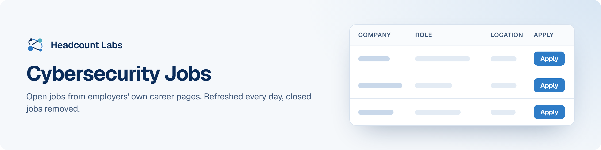

# Cybersecurity Jobs

Security engineer, security analyst and cybersecurity jobs at US employers.

**11 open jobs** · 11 new since the last update · 400 removed because they closed or left the employer's board · updated November 7, 2026 at 4:47 AM EST

This list is built and refreshed every day by [Headcount Labs](https://headcountlabs.com/?utm_source=github&utm_medium=job-list&utm_campaign=cybersecurity-jobs), which reads jobs straight from employers' own career pages and job boards. Every job here was still listed on its source board when we last read that board, within the past 3 days, and was posted in the past 30 days. Copies of the same job are merged into one row, and jobs that close are removed at the next update.

Want this data in your own app or agent? Use the [Headcount Labs jobs API](https://headcountlabs.com/docs/?utm_source=github&utm_medium=job-list&utm_campaign=cybersecurity-jobs) (free tier), the [MCP server](https://headcountlabs.com/mcp/?utm_source=github&utm_medium=job-list&utm_campaign=cybersecurity-jobs) for Claude, ChatGPT and other AI assistants, or the [public dataset subsets](https://huggingface.co/HeadcountLabs) on Hugging Face (the full dataset is coming soon).

**Full dataset.** A bigger, one-off snapshot dated 2026-10-19 (all matching jobs, not only the open jobs below) is on Hugging Face: [Tech and software jobs](https://huggingface.co/datasets/HeadcountLabs/tech-jobs). It loads with `datasets.load_dataset` and is under the Open Database License (ODbL) 1.0.

**Columns.** *Apply* opens the original posting on the employer's site. *Details* opens the job on Headcount Labs, with every posting we found for it. *Remote* shows what the employer states; a dash means the posting doesn't say. *Pay* is the range the employer published.

## Posted in the last 7 days

| Company | Role | Location | Remote | Pay | Posted | Apply | Details |
| --- | --- | --- | --- | --- | --- | :---: | :---: |
| **NextEra Energy** | Senior Cybersecurity Architect | Miami, FL | — | — | Nov 7 |  | <a href="https://headcountlabs.com/catalog/jobs/7231bb20-1f4d-48e2-8e43-5a87062404a5?utm_source=github&utm_medium=job-list&utm_campaign=cybersecurity-jobs">via Headcount Labs</a> |
| **NextEra Energy** | Cybersecurity Architect | Juno Beach, FL | — | — | Nov 7 |  | <a href="https://headcountlabs.com/catalog/jobs/2f3d0356-89d3-4380-bd47-03cec65f6420?utm_source=github&utm_medium=job-list&utm_campaign=cybersecurity-jobs">via Headcount Labs</a> |
| **NextEra Energy** | Principal Cybersecurity Analyst | Palm Beach Gardens, FL | — | — | Nov 7 |  | <a href="https://headcountlabs.com/catalog/jobs/f40df102-571c-46f5-9312-a10a2c7f5950?utm_source=github&utm_medium=job-list&utm_campaign=cybersecurity-jobs">via Headcount Labs</a> |
| **Wilson Sonsini Goodrich &amp; Rosati, Professional Corporation** | Security Engineer | 

12 locations
Palo Alto, NY Austin Boston Boulder Century City New York Los Angeles Salt Lake City San Diego San Francisco Seattle Washington, DC
 | Remote | $117k–$158k/yr | Nov 6 |  | <a href="https://headcountlabs.com/catalog/jobs/333364ad-212e-4459-b0ad-4e2fe4333ef9?utm_source=github&utm_medium=job-list&utm_campaign=cybersecurity-jobs">via Headcount Labs</a> |
| **The University of Texas at Austin** | Cybersecurity Analyst II | United States | — | $78k/yr | Nov 6 |  | <a href="https://headcountlabs.com/catalog/jobs/54eb2987-7431-4126-96a8-76eb22789bbc?utm_source=github&utm_medium=job-list&utm_campaign=cybersecurity-jobs">via Headcount Labs</a> |
| **NexGen Data Systems** | Senior Cybersecurity Engineer IV | San Diego, CA | — | — | Nov 6 |  | <a href="https://headcountlabs.com/catalog/jobs/5e8670e1-dfab-4ec0-8584-c7d7693205f6?utm_source=github&utm_medium=job-list&utm_campaign=cybersecurity-jobs">via Headcount Labs</a> |
| **ARCHARITHMS INC** | Cyber Engineer - Level 2 | Huntsville, AL | — | — | Nov 6 |  | <a href="https://headcountlabs.com/catalog/jobs/b9dcfb60-628d-4fe6-901f-c5a9ac758ee1?utm_source=github&utm_medium=job-list&utm_campaign=cybersecurity-jobs">via Headcount Labs</a> |
| **CareSource Management Services LLC** | 2027 Summer Internship Program - Cybersecurity | United States | Remote | $41k–$66k/yr | Nov 5 |  | <a href="https://headcountlabs.com/catalog/jobs/994ad2ab-4a3d-419e-aea7-1e47b1e7e9a0?utm_source=github&utm_medium=job-list&utm_campaign=cybersecurity-jobs">via Headcount Labs</a> |
| **CareSource** | 2027 Summer Internship Program - Cybersecurity | United States | — | $41k–$66k/yr | Nov 5 |  | <a href="https://headcountlabs.com/catalog/jobs/b0f1d12b-1877-4149-947e-9fa2c90cb5df?utm_source=github&utm_medium=job-list&utm_campaign=cybersecurity-jobs">via Headcount Labs</a> |
| **AltaMed Health Services Corp** | IT Security Analyst | Commerce, CA | Hybrid | $88k–$110k/yr | Nov 5 |  | <a href="https://headcountlabs.com/catalog/jobs/b7e8fe83-3f5a-418b-b206-b2210cc150a8?utm_source=github&utm_medium=job-list&utm_campaign=cybersecurity-jobs">via Headcount Labs</a> |
| **AltaMed Health Services Corp** | Senior IT Security Engineer | Commerce, CA | Hybrid | $111k–$138k/yr | Nov 5 |  | <a href="https://headcountlabs.com/catalog/jobs/f30782f3-db45-4f30-ae97-92fcca961edc?utm_source=github&utm_medium=job-list&utm_campaign=cybersecurity-jobs">via Headcount Labs</a> |

## Related data on Headcount Labs

- [Security analyst job postings dataset](https://headcountlabs.com/data/security-analyst-job-postings/)
- [US job market report: open jobs by state, top employers, pay and remote share](https://headcountlabs.com/reports/us-job-market/)

## More lists from Headcount Labs

[Software Engineering Internships](https://github.com/HeadcountLabs/software-engineering-internships) · [Data Science, AI and Machine Learning Internships](https://github.com/HeadcountLabs/data-science-ai-internships) · [Engineering Internships](https://github.com/HeadcountLabs/engineering-internships) · [Business, Finance and Marketing Internships](https://github.com/HeadcountLabs/business-finance-internships) · [Internships in the US](https://github.com/HeadcountLabs/internships) · [New Grad Software Engineer Jobs](https://github.com/HeadcountLabs/new-grad-software-engineer-jobs) · [Entry-Level and New Grad Jobs](https://github.com/HeadcountLabs/entry-level-jobs) · [Entry-Level Data Analyst Jobs](https://github.com/HeadcountLabs/entry-level-data-analyst-jobs) · [Remote Software Engineer Jobs](https://github.com/HeadcountLabs/remote-software-engineer-jobs) · [Remote Data, AI and Machine Learning Jobs](https://github.com/HeadcountLabs/remote-data-jobs) · [Remote Product Manager Jobs](https://github.com/HeadcountLabs/remote-product-manager-jobs) · [Remote Marketing Jobs](https://github.com/HeadcountLabs/remote-marketing-jobs) · [Remote Sales Jobs](https://github.com/HeadcountLabs/remote-sales-jobs) · [Remote Customer Support and Success Jobs](https://github.com/HeadcountLabs/remote-customer-support-jobs) · [Remote Healthcare Jobs](https://github.com/HeadcountLabs/remote-healthcare-jobs) · [Remote Finance and Accounting Jobs](https://github.com/HeadcountLabs/remote-finance-accounting-jobs) · [Remote Jobs in the US](https://github.com/HeadcountLabs/remote-jobs) · [AI and Machine Learning Engineer Jobs](https://github.com/HeadcountLabs/ai-ml-engineer-jobs) · [Data Engineer Jobs](https://github.com/HeadcountLabs/data-engineer-jobs) · [Product Manager Jobs](https://github.com/HeadcountLabs/product-manager-jobs) · [Registered Nurse Jobs](https://github.com/HeadcountLabs/registered-nurse-jobs) · [Software Jobs Paying $200k+](https://github.com/HeadcountLabs/high-paying-software-jobs) · [Tech and Software Jobs in the US](https://github.com/HeadcountLabs/tech-jobs) · [Jobs with Salary Listed in the US](https://github.com/HeadcountLabs/pay-transparency-jobs) · [San Francisco Bay Area Tech Jobs](https://github.com/HeadcountLabs/bay-area-tech-jobs) · [New York City Tech Jobs](https://github.com/HeadcountLabs/new-york-tech-jobs) · [Seattle Tech Jobs](https://github.com/HeadcountLabs/seattle-tech-jobs) · [Austin Tech Jobs](https://github.com/HeadcountLabs/austin-tech-jobs) · [Boston Tech Jobs](https://github.com/HeadcountLabs/boston-tech-jobs) · [Los Angeles Tech Jobs](https://github.com/HeadcountLabs/los-angeles-tech-jobs) · [Washington, DC Tech Jobs](https://github.com/HeadcountLabs/washington-dc-tech-jobs)

## Contributing

This README is generated, so edits to it are overwritten at the next update. If a job is closed, a link is broken or a detail is wrong, [open an issue](../../issues/new) with the link and we'll fix it in the data, which fixes it everywhere. Requests for new lists are welcome too.

## License

The list data is under the [Open Database License (ODbL) 1.0](LICENSE). Our own values in it are under the [Database Contents License (DbCL) 1.0](https://opendatacommons.org/licenses/dbcl/1-0/). Credit "Headcount Labs (https://headcountlabs.com)" when you reuse it. Job description text is the employer's own text and is not licensed by us. Takedown requests: [https://headcountlabs.com/remove/](https://headcountlabs.com/remove/). Location data includes data from OpenStreetMap contributors (ODbL) and Overture Maps. The same rows are in [`data/jobs.csv`](data/jobs.csv).

Generated by Headcount Labs from the jobs API on November 7, 2026 at 4:47 AM EST. At most 8 jobs per employer are shown in each list.
