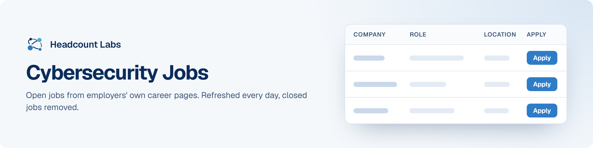

# Cybersecurity Jobs

Security engineer, security analyst and cybersecurity jobs at US employers.

**400 open jobs** · 26 new since the last update · 26 removed because they closed or left the employer's board · updated November 16, 2026 at 4:57 AM EST

This list is built and refreshed every day by [Headcount Labs](https://headcountlabs.com/?utm_source=github&utm_medium=job-list&utm_campaign=cybersecurity-jobs), which reads jobs straight from employers' own career pages and job boards. Every job here was still listed on its source board when we last read that board, within the past 3 days, and was posted in the past 30 days. Copies of the same job are merged into one row, and jobs that close are removed at the next update.

Want this data in your own app or agent? Use the [Headcount Labs jobs API](https://headcountlabs.com/docs/?utm_source=github&utm_medium=job-list&utm_campaign=cybersecurity-jobs) (free tier), the [MCP server](https://headcountlabs.com/mcp/?utm_source=github&utm_medium=job-list&utm_campaign=cybersecurity-jobs) for Claude, ChatGPT and other AI assistants, or the [public dataset subsets](https://huggingface.co/HeadcountLabs) on Hugging Face (the full dataset is coming soon).

**Full dataset.** A bigger, one-off snapshot dated 2026-10-19 (all matching jobs, not only the open jobs below) is on Hugging Face: [Tech and software jobs](https://huggingface.co/datasets/HeadcountLabs/tech-jobs). It loads with `datasets.load_dataset` and is under the Open Database License (ODbL) 1.0.

**Columns.** *Apply* opens the original posting on the employer's site. *Details* opens the job on Headcount Labs, with every posting we found for it. *Remote* shows what the employer states; a dash means the posting doesn't say. *Pay* is the range the employer published.

## Posted in the last 7 days

| Company | Role | Location | Remote | Pay | Posted | Apply | Details |
| --- | --- | --- | --- | --- | --- | :---: | :---: |
| **Detroit Defense** | Cyber Security Engineer (Splunk) ZT | Tampa, FL | — | — | Nov 16 |  | <a href="https://headcountlabs.com/catalog/jobs/56292f19-0db6-4332-95f5-2e4443fb1c69?utm_source=github&utm_medium=job-list&utm_campaign=cybersecurity-jobs">via Headcount Labs</a> |
| **Hanley Wood** | Associate Security Engineer - Arlington, VA | Arlington, VA | On-site | $100k–$105k/yr | Nov 15 |  | <a href="https://headcountlabs.com/catalog/jobs/e946b104-1db0-49bf-9c86-7e02f15bd540?utm_source=github&utm_medium=job-list&utm_campaign=cybersecurity-jobs">via Headcount Labs</a> |
| **Hanley Wood** | Associate Security Engineer - Richmond, VA | Richmond, VA | On-site | $100k–$105k/yr | Nov 15 |  | <a href="https://headcountlabs.com/catalog/jobs/cfc98ec3-3bf5-4af7-adc9-2f0d45eb71b9?utm_source=github&utm_medium=job-list&utm_campaign=cybersecurity-jobs">via Headcount Labs</a> |
| **Hanley Wood** | Security Engineer Intern - Arlington, VA | Arlington, VA | On-site | $40–$45/hr | Nov 15 |  | <a href="https://headcountlabs.com/catalog/jobs/9018dabd-540b-42d7-997b-1208b3dcd93b?utm_source=github&utm_medium=job-list&utm_campaign=cybersecurity-jobs">via Headcount Labs</a> |
| **Hanley Wood** | Security Engineer Intern - Richmond, VA | Richmond, VA | On-site | $40–$45/hr | Nov 15 |  | <a href="https://headcountlabs.com/catalog/jobs/3185a847-aba6-4bc5-802b-fa3d47b2dcc9?utm_source=github&utm_medium=job-list&utm_campaign=cybersecurity-jobs">via Headcount Labs</a> |
| **Diodes Incorporated** | Cyber Defense Analyst I (Junior Security Engineer) | Plano, TX | — | — | Nov 15 |  | <a href="https://headcountlabs.com/catalog/jobs/349f90df-8445-4768-9461-0377fe324108?utm_source=github&utm_medium=job-list&utm_campaign=cybersecurity-jobs">via Headcount Labs</a> |
| **UIC Government Services and the Bowhead Family of Companies** | Cyber Security Analyst | Vicksburg, MS | — | — | Nov 14 |  | <a href="https://headcountlabs.com/catalog/jobs/4ea2bb9d-37df-49c7-bb7b-59ee2cb7ce65?utm_source=github&utm_medium=job-list&utm_campaign=cybersecurity-jobs">via Headcount Labs</a> |
| **Toyota Tsusho Systems** | Product Cybersecurity Engineer | Plano, TX | Hybrid | — | Nov 14 |  | <a href="https://headcountlabs.com/catalog/jobs/d84b9ade-a2ae-43fa-95b3-89f5b8a714a3?utm_source=github&utm_medium=job-list&utm_campaign=cybersecurity-jobs">via Headcount Labs</a> |
| **The Boeing Company** | Cybersecurity – Information System Security Officer (ISSO) | Layton, UT | On-site | $99k–$135k/yr | Nov 14 |  | <a href="https://headcountlabs.com/catalog/jobs/4014644c-2e85-4c9c-9922-5b302b314662?utm_source=github&utm_medium=job-list&utm_campaign=cybersecurity-jobs">via Headcount Labs</a> |
| **ServiceNow, Inc.** | Information Security Analyst Intern | San Diego, CA | — | $45.79/hr | Nov 14 |  | <a href="https://headcountlabs.com/catalog/jobs/bce0b0bd-8846-4060-9144-76496b1f514b?utm_source=github&utm_medium=job-list&utm_campaign=cybersecurity-jobs">via Headcount Labs</a> |
| **ServiceNow, Inc.** | AI Security Engineer Intern | San Diego, CA | — | $62.89/hr | Nov 14 |  | <a href="https://headcountlabs.com/catalog/jobs/e696b488-1ec4-44c0-ac18-7980d622d70d?utm_source=github&utm_medium=job-list&utm_campaign=cybersecurity-jobs">via Headcount Labs</a> |
| **ServiceNow, Inc.** | Security Engineer Intern | Kirkland, WA | — | $58.96/hr | Nov 14 |  | <a href="https://headcountlabs.com/catalog/jobs/f0adb715-b5b8-4423-87c6-f8410e1e52aa?utm_source=github&utm_medium=job-list&utm_campaign=cybersecurity-jobs">via Headcount Labs</a> |
| **ServiceNow, Inc.** | Staff Security Engineer (Compliance) - Moveworks | Mountain View, CA | — | $176k–$308k/yr | Nov 14 |  | <a href="https://headcountlabs.com/catalog/jobs/0a4f24cd-44d0-4ddd-bcb2-fdb382d66d74?utm_source=github&utm_medium=job-list&utm_campaign=cybersecurity-jobs">via Headcount Labs</a> |
| **ServiceNow, Inc.** | Senior Staff Security Engineer, AI Safeguards - Moveworks | Mountain View, CA | — | $201k–$352k/yr | Nov 14 |  | <a href="https://headcountlabs.com/catalog/jobs/715ed297-6452-496f-90ab-9ec892170467?utm_source=github&utm_medium=job-list&utm_campaign=cybersecurity-jobs">via Headcount Labs</a> |
| **Sandia National Laboratories** | R&amp;D Cybersecurity - Digital Assurance, Onsite | Livermore, CA | On-site | $122k–$238k/yr | Nov 14 |  | <a href="https://headcountlabs.com/catalog/jobs/8018e7ed-28cc-40d5-a8da-14ae71465e73?utm_source=github&utm_medium=job-list&utm_campaign=cybersecurity-jobs">via Headcount Labs</a> |
| **Sandia National Laboratories** | Senior/Principal Cybersecurity - Systems Security Engineering, Onsite | Livermore, CA | On-site | $140k–$281k/yr | Nov 14 |  | <a href="https://headcountlabs.com/catalog/jobs/f9303940-3715-4002-94db-2a31fad437f2?utm_source=github&utm_medium=job-list&utm_campaign=cybersecurity-jobs">via Headcount Labs</a> |
| **Nooksack Everson Site** | Junior Cyber Security Analyst | Deming, WA | — | $31.55–$33.48/hr | Nov 14 |  | <a href="https://headcountlabs.com/catalog/jobs/8bf972f1-8152-43a6-848b-47166b8ac34b?utm_source=github&utm_medium=job-list&utm_campaign=cybersecurity-jobs">via Headcount Labs</a> |
| **MSC Industrial Supply Co.** | Admin, Cybersecurity III | Davidson, NC | — | $85k–$134k/yr | Nov 14 |  | <a href="https://headcountlabs.com/catalog/jobs/39d3cb7e-8e93-46de-9cbe-a05079cb86c4?utm_source=github&utm_medium=job-list&utm_campaign=cybersecurity-jobs">via Headcount Labs</a> |
| **Hu-Friedy Manufacturing** | Cybersecurity Manager | Northbrook, IL | — | $150k/yr | Nov 14 |  | <a href="https://headcountlabs.com/catalog/jobs/d17cd1f4-8fbe-45bf-aae1-63f9091d105a?utm_source=github&utm_medium=job-list&utm_campaign=cybersecurity-jobs">via Headcount Labs</a> |
| **Hu-Friedy** | Cybersecurity Manager | Northbrook, IL | — | $150k/yr | Nov 14 |  | <a href="https://headcountlabs.com/catalog/jobs/91d3562a-1c22-4452-a4cc-37331a3d6b88?utm_source=github&utm_medium=job-list&utm_campaign=cybersecurity-jobs">via Headcount Labs</a> |
| **HII** | Embedded Systems Security Engineer - 27932 * | Dayton Wright-Patterson AFB | — | $98k–$135k/yr | Nov 14 |  | <a href="https://headcountlabs.com/catalog/jobs/4ca8c69a-78d2-4ecc-9bf8-bb4aa02e760b?utm_source=github&utm_medium=job-list&utm_campaign=cybersecurity-jobs">via Headcount Labs</a> |
| **HII** | Information Systems Security Engineer (ISSE) | Springfield, VA | — | $105k–$165k/yr | Nov 14 |  | <a href="https://headcountlabs.com/catalog/jobs/1eb15a52-d380-4d93-a6a6-c7a02913f0b4?utm_source=github&utm_medium=job-list&utm_campaign=cybersecurity-jobs">via Headcount Labs</a> |
| **Costar Group** | Associate Security Engineer - Richmond, VA | Richmond, VA | On-site | $100k–$105k/yr | Nov 14 |  | <a href="https://headcountlabs.com/catalog/jobs/d51a87af-abde-411e-9536-b86c7d560289?utm_source=github&utm_medium=job-list&utm_campaign=cybersecurity-jobs">via Headcount Labs</a> |
| **Costar Group** | Security Engineer Intern - Richmond, VA | Richmond, VA | On-site | $40–$45/hr | Nov 14 |  | <a href="https://headcountlabs.com/catalog/jobs/7f6ea155-aa58-47ff-9ff4-ee6666ea7421?utm_source=github&utm_medium=job-list&utm_campaign=cybersecurity-jobs">via Headcount Labs</a> |
| **Costar Group** | Associate Security Engineer - Arlington, VA | Arlington, VA | On-site | $100k–$105k/yr | Nov 14 |  | <a href="https://headcountlabs.com/catalog/jobs/53926937-28d5-4203-897d-f36c94eddf76?utm_source=github&utm_medium=job-list&utm_campaign=cybersecurity-jobs">via Headcount Labs</a> |
| **Costar Group** | Security Engineer Intern - Arlington, VA | Arlington, VA | On-site | $40–$45/hr | Nov 14 |  | <a href="https://headcountlabs.com/catalog/jobs/45d0deea-b601-48b9-bf9d-d1e9b1cb979f?utm_source=github&utm_medium=job-list&utm_campaign=cybersecurity-jobs">via Headcount Labs</a> |
| **Anduril Industries** | Platform Software Security Engineer, Air Defense | Irvine, CA | — | $167k–$222k/yr | Nov 14 |  | <a href="https://headcountlabs.com/catalog/jobs/a8a0f3d0-95d1-4a8a-ab1f-9ca48d4f8f5b?utm_source=github&utm_medium=job-list&utm_campaign=cybersecurity-jobs">via Headcount Labs</a> |
| **ABB** | Head of Cyber Security | 

9 locations
Bangalore Cleveland, OH Genova Hangzhou Krakow Malmo Mannheim Minden Vaesteras
 | Hybrid | — | Nov 14 |  | <a href="https://headcountlabs.com/catalog/jobs/d3dceb9a-6a73-4bc8-b3a1-85c9d6cb909b?utm_source=github&utm_medium=job-list&utm_campaign=cybersecurity-jobs">via Headcount Labs</a> |
| **Xtreme Solutions Corporate** | Cybersecurity Account Executive | Atlanta, GA | — | $80k–$250k/yr | Nov 13 |  | <a href="https://headcountlabs.com/catalog/jobs/00ac3fec-0171-4420-9785-0d0316abb32d?utm_source=github&utm_medium=job-list&utm_campaign=cybersecurity-jobs">via Headcount Labs</a> |
| **Williams Adley** | Associate, Cybersecurity Risk Services (Entry Level) | Washington, DC | Hybrid | $65k–$68k/yr | Nov 13 |  | <a href="https://headcountlabs.com/catalog/jobs/543d1d80-56b4-402f-aa4d-486cbee4b7ec?utm_source=github&utm_medium=job-list&utm_campaign=cybersecurity-jobs">via Headcount Labs</a> |
| **VTG** | Cyber Incident Risk Manager | McLean, VA | On-site | $130k–$195k/yr | Nov 13 |  | <a href="https://headcountlabs.com/catalog/jobs/1f5d3785-2c9d-460e-ab2c-c43d56815a13?utm_source=github&utm_medium=job-list&utm_campaign=cybersecurity-jobs">via Headcount Labs</a> |
| **VSP** | Information Security Engineer | United States | Remote | $72k–$125k/yr | Nov 13 |  | <a href="https://headcountlabs.com/catalog/jobs/477410b6-83f5-4f6d-b4a8-b120bc3d6d2d?utm_source=github&utm_medium=job-list&utm_campaign=cybersecurity-jobs">via Headcount Labs</a> |
| **URM Stores Inc.** | Security Engineer II – Network &amp; Firewall Security | Spokane, WA | — | $102k–$125k/yr | Nov 13 |  | <a href="https://headcountlabs.com/catalog/jobs/3bcff2d1-2c36-4496-a70d-6a4f6e143afa?utm_source=github&utm_medium=job-list&utm_campaign=cybersecurity-jobs">via Headcount Labs</a> |
| **United Services Automobile Asn** | Senior IT Change Coordinator - Cybersecurity | United States | — | $103k–$198k/yr | Nov 13 |  | <a href="https://headcountlabs.com/catalog/jobs/0129872d-70eb-496c-8390-343435813332?utm_source=github&utm_medium=job-list&utm_campaign=cybersecurity-jobs">via Headcount Labs</a> |
| **True Talent Solutions Partners** | Senior Security Engineer | San Francisco, CA | On-site | $190k–$250k/yr | Nov 13 |  | <a href="https://headcountlabs.com/catalog/jobs/b26403ac-69e0-42fe-b20a-1ab7274d310f?utm_source=github&utm_medium=job-list&utm_campaign=cybersecurity-jobs">via Headcount Labs</a> |
| **Travelers Indemnity Co** | Cyber Senior Claim Counsel | 

2 locations
Hartford, CT United States
 | Hybrid | $143k–$236k/yr | Nov 13 |  | <a href="https://headcountlabs.com/catalog/jobs/e69d75f1-551e-4fbb-aec6-d93be341290b?utm_source=github&utm_medium=job-list&utm_campaign=cybersecurity-jobs">via Headcount Labs</a> |
| **The Northern Trust Company** | Senior Manager, Cyber Security Administration: PAM Operations | 

2 locations
Tempe, AZ Chicago, IL
 | — | $131k–$222k/yr | Nov 13 |  | <a href="https://headcountlabs.com/catalog/jobs/6262257e-8523-462d-8643-a46650de0714?utm_source=github&utm_medium=job-list&utm_campaign=cybersecurity-jobs">via Headcount Labs</a> |
| **The Haskell Company** | IAM Security Analyst | Jacksonville, FL | — | — | Nov 13 |  | <a href="https://headcountlabs.com/catalog/jobs/750d3a04-5c72-45cf-8f82-77a293f292f7?utm_source=github&utm_medium=job-list&utm_campaign=cybersecurity-jobs">via Headcount Labs</a> |
| **The Elevance Health Companies, Inc.** | Security Analyst Senior | United States | — | $103k–$170k/yr | Nov 13 |  | <a href="https://headcountlabs.com/catalog/jobs/19ac4f79-82df-4f4f-a701-552bb70f8e96?utm_source=github&utm_medium=job-list&utm_campaign=cybersecurity-jobs">via Headcount Labs</a> |
| **The Children's Hospital of Philadelphia** | Sr Manager - Cyber Defense | Philadelphia- Cira Centre | — | $143k–$189k/yr | Nov 13 |  | <a href="https://headcountlabs.com/catalog/jobs/666c73db-28a6-440d-83ce-36455f0b3964?utm_source=github&utm_medium=job-list&utm_campaign=cybersecurity-jobs">via Headcount Labs</a> |
| **The Boeing Company** | Cybersecurity – Associate Information System Security Officer (ISSO) | Berkeley, MO | On-site | $87k–$117k/yr | Nov 13 |  | <a href="https://headcountlabs.com/catalog/jobs/0e64621d-4747-4286-956d-128b56bebe76?utm_source=github&utm_medium=job-list&utm_campaign=cybersecurity-jobs">via Headcount Labs</a> |
| **The Boeing Company** | Cybersecurity - Senior Information System Security Manager (ISSM) | 

2 locations
Berkeley, MO Hazelwood, MO
 | On-site | $162k–$218k/yr | Nov 13 |  | <a href="https://headcountlabs.com/catalog/jobs/8f24b652-49b5-4625-89e3-73d703f8bf59?utm_source=github&utm_medium=job-list&utm_campaign=cybersecurity-jobs">via Headcount Labs</a> |
| **Texas Capital Bank** | Cyber Risk Mgmt Sr Analyst | Richardson, TX | — | — | Nov 13 |  | <a href="https://headcountlabs.com/catalog/jobs/74d90e6f-7639-4da0-8249-ab2a4d296b39?utm_source=github&utm_medium=job-list&utm_campaign=cybersecurity-jobs">via Headcount Labs</a> |
| **Talent Connection** | Host Security Engineer | Pleasanton, CA | Hybrid | $165k–$185k/yr | Nov 13 |  | <a href="https://headcountlabs.com/catalog/jobs/9e110da2-10bc-4fb1-8a50-ceb760824321?utm_source=github&utm_medium=job-list&utm_campaign=cybersecurity-jobs">via Headcount Labs</a> |
| **Syncreon Consulting** | Mainframe Security Analyst IV - ACF2, TSS, and RACF | Pittsburgh, PA | — | — | Nov 13 |  | <a href="https://headcountlabs.com/catalog/jobs/5bcc0dfe-6f14-470d-b794-91e98bb8a224?utm_source=github&utm_medium=job-list&utm_campaign=cybersecurity-jobs">via Headcount Labs</a> |
| **Syncreon Consulting** | GRC CYBERSECURITY - W2 position | Pittsburgh, PA | — | — | Nov 13 |  | <a href="https://headcountlabs.com/catalog/jobs/9cdf6912-96a8-44b0-8bf6-0adeccb3d44f?utm_source=github&utm_medium=job-list&utm_campaign=cybersecurity-jobs">via Headcount Labs</a> |
| **State Street** | Cyber Security Operations Center Analyst, Full-time Internship (Jan - June 2027) | Quincy, MA | — | — | Nov 13 |  | <a href="https://headcountlabs.com/catalog/jobs/b8b9e17d-a3e5-44df-a1e2-1fdc7fa2cd9e?utm_source=github&utm_medium=job-list&utm_campaign=cybersecurity-jobs">via Headcount Labs</a> |
| **Stanford Health Care** | IT Security Engineer | PALO ALTO, CA | Remote | $57.53–$76.22/hr | Nov 13 |  | <a href="https://headcountlabs.com/catalog/jobs/37c27e5c-6ab5-47c1-bdbb-60215245ab4e?utm_source=github&utm_medium=job-list&utm_campaign=cybersecurity-jobs">via Headcount Labs</a> |
| **SSB&amp;T** | Cyber Security Operations Center Analyst, Full-time Internship (Jan - June 2027) | Quincy, MA | — | — | Nov 13 |  | <a href="https://headcountlabs.com/catalog/jobs/c4069a03-39ea-440b-8b5a-0974de0a63e0?utm_source=github&utm_medium=job-list&utm_campaign=cybersecurity-jobs">via Headcount Labs</a> |
| **SRS Distribution Inc.** | Cyber Security TPRM | McKinney, TX | Remote | — | Nov 13 |  | <a href="https://headcountlabs.com/catalog/jobs/a5e0de93-edec-4db9-a01b-4e9447bfd0e0?utm_source=github&utm_medium=job-list&utm_campaign=cybersecurity-jobs">via Headcount Labs</a> |
| **SpaceXSI** | Government Cloud Security Engineer | 

4 locations
Austin, TX New York, NY Palo Alto, CA Washington, DC
 | — | $100k–$198k/yr | Nov 13 |  | <a href="https://headcountlabs.com/catalog/jobs/7f1d29cb-62e1-4d65-bcc2-35abffa4fffc?utm_source=github&utm_medium=job-list&utm_campaign=cybersecurity-jobs">via Headcount Labs</a> |
| **South Dakota State University Alumni &amp; Foundation** | IT and Cybersecurity Administrator | Brookings, SD | On-site | — | Nov 13 |  | <a href="https://headcountlabs.com/catalog/jobs/eb943a13-e9f9-44ec-9e30-84d64392411c?utm_source=github&utm_medium=job-list&utm_campaign=cybersecurity-jobs">via Headcount Labs</a> |
| **SMBC** | Cyber Security Analyst - Vice President | Charlotte, NC | — | — | Nov 13 |  | <a href="https://headcountlabs.com/catalog/jobs/7f323782-c863-4f52-907f-b2af4dee7165?utm_source=github&utm_medium=job-list&utm_campaign=cybersecurity-jobs">via Headcount Labs</a> |
| **ServiceNow, Inc.** | Principal Software Engineer &amp; Architect, Cyber Defense Engineering | Santa Clara, CA | — | $221k–$387k/yr | Nov 13 |  | <a href="https://headcountlabs.com/catalog/jobs/651733e5-dd89-47d0-aa52-f2dfb44f484c?utm_source=github&utm_medium=job-list&utm_campaign=cybersecurity-jobs">via Headcount Labs</a> |
| **ServiceNow** | Staff Security Engineer (Compliance) - Moveworks | Mountain View, CA | — | $176k–$308k/yr | Nov 13 |  | <a href="https://headcountlabs.com/catalog/jobs/6b541450-c175-4c8a-81a4-2120aaeeefa8?utm_source=github&utm_medium=job-list&utm_campaign=cybersecurity-jobs">via Headcount Labs</a> |
| **ServiceNow** | Sr Mgr, Sales (Cyber Security and Risk) | Atlanta, GA | Remote | — | Nov 13 |  | <a href="https://headcountlabs.com/catalog/jobs/6522b16a-7c23-47ab-9a47-334c5ece45ac?utm_source=github&utm_medium=job-list&utm_campaign=cybersecurity-jobs">via Headcount Labs</a> |
| **ServiceNow** | Senior Staff Security Engineer, AI Safeguards - Moveworks | Mountain View, CA | — | $201k–$352k/yr | Nov 13 |  | <a href="https://headcountlabs.com/catalog/jobs/3d298565-21c8-42f4-8b1b-c2e11d762ae2?utm_source=github&utm_medium=job-list&utm_campaign=cybersecurity-jobs">via Headcount Labs</a> |
| **ServiceNow** | Security Engineer Intern | Kirkland, WA | — | $58.96/hr | Nov 13 |  | <a href="https://headcountlabs.com/catalog/jobs/a3aa2e6c-43bc-4c2a-aed5-882d25e49562?utm_source=github&utm_medium=job-list&utm_campaign=cybersecurity-jobs">via Headcount Labs</a> |
| **ServiceNow** | Information Security Analyst Intern | San Diego, CA | — | $45.79/hr | Nov 13 |  | <a href="https://headcountlabs.com/catalog/jobs/a280c178-fca8-4853-8682-2565a7ccfcfb?utm_source=github&utm_medium=job-list&utm_campaign=cybersecurity-jobs">via Headcount Labs</a> |
| **ServiceNow** | AI Security Engineer Intern | San Diego, CA | — | $62.89/hr | Nov 13 |  | <a href="https://headcountlabs.com/catalog/jobs/9f7255fd-445d-41ae-bcc4-f00a7671a5db?utm_source=github&utm_medium=job-list&utm_campaign=cybersecurity-jobs">via Headcount Labs</a> |
| **ServiceNow** | Principal Software Engineer &amp; Architect, Cyber Defense Engineering | Santa Clara, CA | — | $221k–$387k/yr | Nov 13 |  | <a href="https://headcountlabs.com/catalog/jobs/73bba1c9-933d-4fb2-8d81-46d828ea4576?utm_source=github&utm_medium=job-list&utm_campaign=cybersecurity-jobs">via Headcount Labs</a> |
| **Service Center** | Cyber Security Analyst | Grand Rapids, MI | On-site | — | Nov 13 |  | <a href="https://headcountlabs.com/catalog/jobs/9190eda2-aea1-4762-8461-4c24da61e1d5?utm_source=github&utm_medium=job-list&utm_campaign=cybersecurity-jobs">via Headcount Labs</a> |
| **Schreiber Foods, Inc.** | IT Security Analyst - Identity &amp; Security Engineering | Green Bay, WI | Hybrid | — | Nov 13 |  | <a href="https://headcountlabs.com/catalog/jobs/17551f28-28b0-4beb-aecb-5493d6dd5f88?utm_source=github&utm_medium=job-list&utm_campaign=cybersecurity-jobs">via Headcount Labs</a> |
| **SAIC** | Cybersecurity Engineer - Cloud | 

3 locations
Beale AFB, CA Chantilly, VA Flexwork, CO
 | — | $160k–$200k/yr | Nov 13 |  | <a href="https://headcountlabs.com/catalog/jobs/e1486f32-9bfa-463c-8529-f55c67fd6330?utm_source=github&utm_medium=job-list&utm_campaign=cybersecurity-jobs">via Headcount Labs</a> |
| **SAIC** | Cybersecurity Engineer - DSOP | 

2 locations
Beale AFB, CA Chantilly, VA
 | — | $160k–$200k/yr | Nov 13 |  | <a href="https://headcountlabs.com/catalog/jobs/a6d50eb4-1bfe-460a-93bf-f03717e28327?utm_source=github&utm_medium=job-list&utm_campaign=cybersecurity-jobs">via Headcount Labs</a> |
| **SAIC** | Cybersecurity Spec Team Mgr | Reston, VA | On-site | — | Nov 13 |  | <a href="https://headcountlabs.com/catalog/jobs/dccde8cb-2555-49f6-914d-e19b5b0f35b5?utm_source=github&utm_medium=job-list&utm_campaign=cybersecurity-jobs">via Headcount Labs</a> |
| **Saber Community Support and Development Office** | Senior Security Engineer | Beachwood, OH | — | — | Nov 13 | <a href="https://apply-jobs.apploi.com/job/2015696?utm_campaign=integration&amp;utm_medium=job-board-search&amp;utm_source=company_profile_page&amp;language=en&amp;ajs_event=LOAD_JOB_PAGE&amp;ajs_aid=3f617530-4530-11e9-a2ca-7e775511d9e3&amp;ajs_prop_search_fetch_id=8e4f5137075f4576826329dedca20986&amp;ajs_prop_keyword=&amp;ajs_prop_page=1&amp;ajs_prop_city_center=Unselected&amp;ajs_prop_language=en&amp;ajs_prop_search_order=22&amp;ajs_prop_job_id=2015696&amp;ajs_prop_doc_type=job&amp;ajs_prop_job_location_lat=41.4613906&amp;ajs_prop_job_location_lon=-81.5089276&amp;ajs_prop_boosted=0&amp;ajs_prop_utm_source=company_profile_page&amp;ajs_prop_utm_medium=job-board-search&amp;ajs_prop_utm_campaign=integration"></a> | <a href="https://headcountlabs.com/catalog/jobs/cc3cf042-5645-45c6-8b8e-1130bf2aee43?utm_source=github&utm_medium=job-list&utm_campaign=cybersecurity-jobs">via Headcount Labs</a> |
| **SA Photonics** | Senior Cyber Security Engineer (Systems Architect) | Washington, DC | On-site | $94k–$198k/yr | Nov 13 |  | <a href="https://headcountlabs.com/catalog/jobs/67ad12b4-b873-4fc8-8038-220a7d88e4b2?utm_source=github&utm_medium=job-list&utm_campaign=cybersecurity-jobs">via Headcount Labs</a> |
| **SA Photonics** | Cyber Lead | Washington, DC | On-site | $121k–$266k/yr | Nov 13 |  | <a href="https://headcountlabs.com/catalog/jobs/55dccfd3-8c5d-4944-8cc7-65cec7dbc14b?utm_source=github&utm_medium=job-list&utm_campaign=cybersecurity-jobs">via Headcount Labs</a> |
| **SA Photonics** | Information Technology/Cyber Security Analyst | Fayetteville, NC | On-site | $72k–$150k/yr | Nov 13 |  | <a href="https://headcountlabs.com/catalog/jobs/4e55248b-9931-424e-ae6a-fccc088525d2?utm_source=github&utm_medium=job-list&utm_campaign=cybersecurity-jobs">via Headcount Labs</a> |
| **SA Photonics** | Sr. Staff Information Systems Security Engineer (ISSE) | Chantilly, VA | On-site | $121k–$266k/yr | Nov 13 |  | <a href="https://headcountlabs.com/catalog/jobs/28ba88ad-21c3-4cb2-ba17-342b646c2e9c?utm_source=github&utm_medium=job-list&utm_campaign=cybersecurity-jobs">via Headcount Labs</a> |
| **Ryan Consulting Group** | CMMC Cybersecurity Consultant | United States | Remote | $100/hr | Nov 13 |  | <a href="https://headcountlabs.com/catalog/jobs/34c3b939-94fa-4b52-89a7-30e722a3c386?utm_source=github&utm_medium=job-list&utm_campaign=cybersecurity-jobs">via Headcount Labs</a> |
| **Rule4** | Cybersecurity Engineer | Boulder, CO | Remote | $85k–$125k/yr | Nov 13 |  | <a href="https://headcountlabs.com/catalog/jobs/ebf20974-eecc-4edb-853a-c117c0055203?utm_source=github&utm_medium=job-list&utm_campaign=cybersecurity-jobs">via Headcount Labs</a> |
| **Recruiting From Scratch** | Senior Security Engineer, Product &amp; Platform | San Francisco, CA | Remote | $220k–$280k/yr | Nov 13 |  | <a href="https://headcountlabs.com/catalog/jobs/30dbade4-2094-4796-a9d5-38691d25dab3?utm_source=github&utm_medium=job-list&utm_campaign=cybersecurity-jobs">via Headcount Labs</a> |
| **RDR Inc** | Information Systems Security Engineer (ISSE) | Chantilly, VA | — | — | Nov 13 |  | <a href="https://headcountlabs.com/catalog/jobs/b6dcc5e8-ec93-4518-b8e4-1fe37e494f0f?utm_source=github&utm_medium=job-list&utm_campaign=cybersecurity-jobs">via Headcount Labs</a> |
| **Rainmaker Technology Corporation** | Senior Security Engineer | El Segundo, CA | — | — | Nov 13 |  | <a href="https://headcountlabs.com/catalog/jobs/01bfd7d3-85ae-4958-a356-648c92faeb7d?utm_source=github&utm_medium=job-list&utm_campaign=cybersecurity-jobs">via Headcount Labs</a> |
| **Quest Diagnostics** | Senior Cyber Incident Manager | Secaucus, NJ | Hybrid | — | Nov 13 |  | <a href="https://headcountlabs.com/catalog/jobs/084d0b91-c9e3-4825-9f01-3c8053532d65?utm_source=github&utm_medium=job-list&utm_campaign=cybersecurity-jobs">via Headcount Labs</a> |
| **Qualified Health PBC** | Senior Security Engineer, AI &amp; Healthcare | Palo Alto, CA | Hybrid | — | Nov 13 |  | <a href="https://headcountlabs.com/catalog/jobs/89c8f6aa-290e-4eb0-bdf5-05d8497a4e90?utm_source=github&utm_medium=job-list&utm_campaign=cybersecurity-jobs">via Headcount Labs</a> |
| **PWC US** | Cybersecurity Consulting Associate - Winter 2027 | 

14 locations
IL-Rosemont, IL CA-Los Angeles GA-Atlanta IL-Chicago MN-Minneapolis DC-Washington MA-Boston NY-New York TX-Dallas CA-San Francisco CA-Silicon Valley PA-Philadelphia +2 more
 | — | $61k–$100k/yr | Nov 13 |  | <a href="https://headcountlabs.com/catalog/jobs/6b5231f2-e6de-479e-908d-2decdec38bd3?utm_source=github&utm_medium=job-list&utm_campaign=cybersecurity-jobs">via Headcount Labs</a> |
| **Purple Cow** | Clinical Engineering Cyber Specialist | Far Rockaway, NY | — | — | Nov 13 |  | <a href="https://headcountlabs.com/catalog/jobs/56d532d7-d8bc-4b67-8e8b-d599134eb0ec?utm_source=github&utm_medium=job-list&utm_campaign=cybersecurity-jobs">via Headcount Labs</a> |
| **PricewaterhouseCoopers Advisory Services LLC** | Cybersecurity Consulting Associate - Winter 2027 | 

6 locations
Rosemont, IL Washington, DC Illinois Dallas, TX Houston, TX Seattle, WA
 | — | $61k–$100k/yr | Nov 13 |  | <a href="https://headcountlabs.com/catalog/jobs/f4a3a6a1-3881-49f3-ae4f-58fbda7c7fb4?utm_source=github&utm_medium=job-list&utm_campaign=cybersecurity-jobs">via Headcount Labs</a> |
| **PitchBook Data** | Senior Cybersecurity Engineer | Seattle, WA | On-site | $187k/yr | Nov 13 |  | <a href="https://headcountlabs.com/catalog/jobs/35e9c019-a3ef-49eb-877d-2ed33b468c73?utm_source=github&utm_medium=job-list&utm_campaign=cybersecurity-jobs">via Headcount Labs</a> |
| **PGTEK** | Security Engineer, Vulnerability Management (ACAS/Tenable.sc) - Secret clearance | 

5 locations
Fort Meade, MD Mechanicsburg, PA Montgomery, AL Ogden, UT Oklahoma City, OK
 | On-site | — | Nov 13 |  | <a href="https://headcountlabs.com/catalog/jobs/e1352498-6356-4174-8635-569a712849c6?utm_source=github&utm_medium=job-list&utm_campaign=cybersecurity-jobs">via Headcount Labs</a> |
| **Perplexity** | Member of Technical Staff (Software Engineer, Cybersecurity Products) | 

5 locations
San Francisco, CA United States London Belgrade New York City, NY
 | Remote | $220k–$405k/yr | Nov 13 |  | <a href="https://headcountlabs.com/catalog/jobs/eb1efca1-0068-449c-8cba-4406683bfb6e?utm_source=github&utm_medium=job-list&utm_campaign=cybersecurity-jobs">via Headcount Labs</a> |
| **Peraton** | Senior Information Systems Security Engineer - Security Control Assessor (SCA) | 

2 locations
Quantico, VA Washington, DC
 | — | $135k–$216k/yr | Nov 13 |  | <a href="https://headcountlabs.com/catalog/jobs/a09ab98e-a074-440f-9677-4b136db86a82?utm_source=github&utm_medium=job-list&utm_campaign=cybersecurity-jobs">via Headcount Labs</a> |
| **Peraton** | Senior Cybersecurity Internal Controls Administrator | Radford, VA | Remote | $112k–$179k/yr | Nov 13 |  | <a href="https://headcountlabs.com/catalog/jobs/628229f8-186a-4e6d-b6de-50d5cfa99b6b?utm_source=github&utm_medium=job-list&utm_campaign=cybersecurity-jobs">via Headcount Labs</a> |
| **Peraton** | Senior Cybersecurity Network Defense Administrator | 

2 locations
Radford, VA United States
 | Remote | $112k–$179k/yr | Nov 13 |  | <a href="https://headcountlabs.com/catalog/jobs/05a0a043-4d8a-4e5d-9f71-b0e331f56bab?utm_source=github&utm_medium=job-list&utm_campaign=cybersecurity-jobs">via Headcount Labs</a> |
| **PepsiCo** | Cybersecurity Director - IAM Emerging Tech &amp; Solution Design | Plano, TX | — | $132k–$262k/yr | Nov 13 |  | <a href="https://headcountlabs.com/catalog/jobs/6ce3332a-0d69-4381-8c44-bc788fc04f22?utm_source=github&utm_medium=job-list&utm_campaign=cybersecurity-jobs">via Headcount Labs</a> |
| **Opto-Knowledge Systems Inc** | Product Security Engineer | United States | Remote | $154k–$210k/yr | Nov 13 |  | <a href="https://headcountlabs.com/catalog/jobs/09667a8c-bdd0-4f02-ac23-7b4e015e87bc?utm_source=github&utm_medium=job-list&utm_campaign=cybersecurity-jobs">via Headcount Labs</a> |
| **Offsec Services** | Senior Cybersecurity Content Engineer | 

4 locations
United States North America Europe EMEA Region (Europe Middle East Africa)
 | — | — | Nov 13 |  | <a href="https://headcountlabs.com/catalog/jobs/c01909f1-512b-44ee-ae59-c92ea688f6ec?utm_source=github&utm_medium=job-list&utm_campaign=cybersecurity-jobs">via Headcount Labs</a> |
| **NOV** | ICS Network/Security Engineer | Houston, TX | Hybrid | — | Nov 13 |  | <a href="https://headcountlabs.com/catalog/jobs/faa36bac-7843-4ab0-a7e5-7b2cb6ee9d8a?utm_source=github&utm_medium=job-list&utm_campaign=cybersecurity-jobs">via Headcount Labs</a> |
| **NORTHROP GRUMMAN SYSTEMS CORPORATION** | Industrial Security Analyst - Level 2 or 3 | Colorado Springs, CO | On-site | $69k–$103k/yr | Nov 13 |  | <a href="https://headcountlabs.com/catalog/jobs/b656465c-5f25-4130-a40d-056204fbb599?utm_source=github&utm_medium=job-list&utm_campaign=cybersecurity-jobs">via Headcount Labs</a> |
| **NORTHROP GRUMMAN SYSTEMS CORPORATION** | Cyber Systems Engineer 2/3 | San Diego, CA | Hybrid | $96k–$144k/yr | Nov 13 |  | <a href="https://headcountlabs.com/catalog/jobs/99c20d15-dd87-451b-b7f6-50b47c2d7a23?utm_source=github&utm_medium=job-list&utm_campaign=cybersecurity-jobs">via Headcount Labs</a> |
| **Northrop Grumman** | Principal Cyber Intelligence Analyst | Jessup, MD | — | $104k–$155k/yr | Nov 13 |  | <a href="https://headcountlabs.com/catalog/jobs/ba068423-1862-436f-965d-2da65d2845fd?utm_source=github&utm_medium=job-list&utm_campaign=cybersecurity-jobs">via Headcount Labs</a> |
| **nLIGHT** | Sr. Cybersecurity Analyst | Longmont, CO | On-site | $100k–$130k/yr | Nov 13 |  | <a href="https://headcountlabs.com/catalog/jobs/04130d0d-4fe8-42ca-8824-e3f6f76d7c7c?utm_source=github&utm_medium=job-list&utm_campaign=cybersecurity-jobs">via Headcount Labs</a> |
| **Nightwing Intelligence Solutions, LLC** | Principal Cyber Mobile CNO Engineer | Sterling, VA | — | $99k–$206k/yr | Nov 13 |  | <a href="https://headcountlabs.com/catalog/jobs/b6fbc993-df93-4299-9f74-eda4cb9bf281?utm_source=github&utm_medium=job-list&utm_campaign=cybersecurity-jobs">via Headcount Labs</a> |
| **Nightwing Intelligence Solutions, LLC** | Offensive Cyber Operations AI Principal Investigator | 

10 locations
San Antonio, TX Annapolis Junction, MD Arlington, VA El Segundo, CA Greenville, SC Huntsville, AL Indialantic, FL Palm Bay, FL Texas Sterling, VA
 | — | — | Nov 13 |  | <a href="https://headcountlabs.com/catalog/jobs/51d5a7e3-5524-4e30-8f08-ac6c8a750049?utm_source=github&utm_medium=job-list&utm_campaign=cybersecurity-jobs">via Headcount Labs</a> |
| **Nightwing Intelligence Solutions, LLC** | Senior Principal Cyber Mobile CNO Engineer | Sterling, VA | — | $122k–$253k/yr | Nov 13 |  | <a href="https://headcountlabs.com/catalog/jobs/341625c3-6913-49ef-8a72-6e40a6140f0e?utm_source=github&utm_medium=job-list&utm_campaign=cybersecurity-jobs">via Headcount Labs</a> |
| **NHA** | Cyber Security Analyst | Grand Rapids, MI | On-site | — | Nov 13 |  | <a href="https://headcountlabs.com/catalog/jobs/1496e88e-283e-4ea6-80d7-e6de7136becb?utm_source=github&utm_medium=job-list&utm_campaign=cybersecurity-jobs">via Headcount Labs</a> |
| **MS Services Group, Inc.** | Vice President, Lead Cybersecurity Engineer | Alpharetta, GA | — | $185k/yr | Nov 13 |  | <a href="https://headcountlabs.com/catalog/jobs/b8e6d2da-9398-456c-9ba4-49edbd47bb50?utm_source=github&utm_medium=job-list&utm_campaign=cybersecurity-jobs">via Headcount Labs</a> |
| **MS Services Group, Inc.** | Director, Lead Cybersecurity Engineer | Alpharetta, GA | — | $191k/yr | Nov 13 |  | <a href="https://headcountlabs.com/catalog/jobs/386a1800-1e3c-4afa-9212-f2e71316be6f?utm_source=github&utm_medium=job-list&utm_campaign=cybersecurity-jobs">via Headcount Labs</a> |
| **Molina Healthcare** | Cybersecurity Internship (Remote) – Summer 2027 (Undergraduate) | United States | Remote | $8.33–$18.05/hr | Nov 13 |  | <a href="https://headcountlabs.com/catalog/jobs/d624ad72-a628-456f-b44c-1327210b2c90?utm_source=github&utm_medium=job-list&utm_campaign=cybersecurity-jobs">via Headcount Labs</a> |
| **Micron** | Principal, AI Security Engineer | Boise, ID | On-site | — | Nov 13 |  | <a href="https://headcountlabs.com/catalog/jobs/c5e9cc94-e8f2-401f-baf4-b8bf1bc1b53a?utm_source=github&utm_medium=job-list&utm_campaign=cybersecurity-jobs">via Headcount Labs</a> |
| **MCKESSON** | Senior Information Security Analyst, Vulnerability Disclosure and External Attack Surface Management | 

2 locations
Irving, TX Alpharetta, GA
 | — | $122k–$204k/yr | Nov 13 |  | <a href="https://headcountlabs.com/catalog/jobs/dc54e23e-adc5-483b-85ac-64224c3c378d?utm_source=github&utm_medium=job-list&utm_campaign=cybersecurity-jobs">via Headcount Labs</a> |
| **MCK McKesson Corporation** | Senior Information Security Analyst, Vulnerability Disclosure and External Attack Surface Management | 

2 locations
Irving, TX Alpharetta, GA
 | Hybrid | $122k–$204k/yr | Nov 13 |  | <a href="https://headcountlabs.com/catalog/jobs/e2bdee2b-6ec3-4961-a275-54ea506e2ddd?utm_source=github&utm_medium=job-list&utm_campaign=cybersecurity-jobs">via Headcount Labs</a> |
| **McDonald** | Director of Global Cybersecurity Architecture and Engineering | 

2 locations
Chicago, IL United States
 | — | $200k–$250k/yr | Nov 13 |  | <a href="https://headcountlabs.com/catalog/jobs/1825a3c9-382c-411a-95fb-48f4ed3777fe?utm_source=github&utm_medium=job-list&utm_campaign=cybersecurity-jobs">via Headcount Labs</a> |
| **Marvin Group** | INFORMATION SECURITY ANALYST II | Inglewood, CA | On-site | $90k–$120k/yr | Nov 13 |  | <a href="https://headcountlabs.com/catalog/jobs/805e4cc9-1bf2-48b5-89d5-38aa143601b6?utm_source=github&utm_medium=job-list&utm_campaign=cybersecurity-jobs">via Headcount Labs</a> |
| **Lumen Technologies** | Senior Systems Security Engineer | Oregon | Remote | $83k–$111k/yr | Nov 13 |  | <a href="https://headcountlabs.com/catalog/jobs/8ada447a-38c8-4de5-8604-a6cc5de3a8df?utm_source=github&utm_medium=job-list&utm_campaign=cybersecurity-jobs">via Headcount Labs</a> |
| **Lumen** | Senior Systems Security Engineer | Oregon | Remote | $83k–$111k/yr | Nov 13 |  | <a href="https://headcountlabs.com/catalog/jobs/ab4b5b6c-fca5-46b6-a00e-ac67d489e65d?utm_source=github&utm_medium=job-list&utm_campaign=cybersecurity-jobs">via Headcount Labs</a> |
| **LTS** | Cybersecurity Analyst | United States | Remote | — | Nov 13 |  | <a href="https://headcountlabs.com/catalog/jobs/4ff07de9-4d99-42a3-8198-37499dda8837?utm_source=github&utm_medium=job-list&utm_campaign=cybersecurity-jobs">via Headcount Labs</a> |
| **LOGC2** | Operational Technology (OT) Security Engineer | United States | Remote | $120k–$130k/yr | Nov 13 |  | <a href="https://headcountlabs.com/catalog/jobs/0c6d059e-4463-47c1-828b-ffede4af6067?utm_source=github&utm_medium=job-list&utm_campaign=cybersecurity-jobs">via Headcount Labs</a> |
| **LOGC2** | Cybersecurity Engineer- DMLSS | PHILADELPHIA, PA | Remote | $130k–$140k/yr | Nov 13 |  | <a href="https://headcountlabs.com/catalog/jobs/5eee2d57-4236-4310-b29f-017074169c43?utm_source=github&utm_medium=job-list&utm_campaign=cybersecurity-jobs">via Headcount Labs</a> |
| **Livermore Valley Joint Unified Schools** | Network and Cybersecurity Manager #1495 | Livermore | — | $112k–$158k/mo | Nov 13 |  | <a href="https://headcountlabs.com/catalog/jobs/969de39e-669f-4ce7-8f3f-ba104e11808f?utm_source=github&utm_medium=job-list&utm_campaign=cybersecurity-jobs">via Headcount Labs</a> |
| **Lewis Brisbois** | Cyber/Data Privacy Associate | 

5 locations
Washington, DC Ridgeland, MS Wayne, PA Atlanta, GA New Orleans, LA
 | — | — | Nov 13 |  | <a href="https://headcountlabs.com/catalog/jobs/e5b8b288-b0ce-4efb-b5f5-bd3730780010?utm_source=github&utm_medium=job-list&utm_campaign=cybersecurity-jobs">via Headcount Labs</a> |
| **Leidos** | Cybersecurity Engineer / Information System Security Engineer (ISSE) – DoD Healthcare | United States | Remote | $87k–$157k/yr | Nov 13 |  | <a href="https://headcountlabs.com/catalog/jobs/bb3c8d59-a0b2-42a2-97e9-6954fe05762c?utm_source=github&utm_medium=job-list&utm_campaign=cybersecurity-jobs">via Headcount Labs</a> |
| **Leidos** | Senior Cybersecurity Analyst | Alexandria, VA | — | $108k–$195k/yr | Nov 13 |  | <a href="https://headcountlabs.com/catalog/jobs/93c4e1d5-7435-4422-aea0-57c47aaa346a?utm_source=github&utm_medium=job-list&utm_campaign=cybersecurity-jobs">via Headcount Labs</a> |
| **Leidos** | Cyber Security Administrator | Tucson, AZ | — | $87k–$157k/yr | Nov 13 |  | <a href="https://headcountlabs.com/catalog/jobs/5a5df4e8-967f-46a4-910c-7141004d73ad?utm_source=github&utm_medium=job-list&utm_campaign=cybersecurity-jobs">via Headcount Labs</a> |
| **Leidos** | Cyber Command Senior Director | Odenton, MD | — | $154k–$278k/yr | Nov 13 |  | <a href="https://headcountlabs.com/catalog/jobs/3a6fcc40-6b7f-43e6-b3b9-df6fb6831e03?utm_source=github&utm_medium=job-list&utm_campaign=cybersecurity-jobs">via Headcount Labs</a> |
| **Legrand Group** | Sr. Cybersecurity Governance and Compliance Specialist | Reno, NV | On-site | — | Nov 13 |  | <a href="https://headcountlabs.com/catalog/jobs/24b4a017-5491-4f23-8808-2b2603c6697e?utm_source=github&utm_medium=job-list&utm_campaign=cybersecurity-jobs">via Headcount Labs</a> |
| **LED FastStart** | GDIT Summer Internship Program – Summer 2027 Cybersecurity Associate Internship | Bossier City, LA | — | $19.55–$26.45/hr | Nov 13 |  | <a href="https://headcountlabs.com/catalog/jobs/9e5f1855-b91a-4994-bdf2-812bd401bc6a?utm_source=github&utm_medium=job-list&utm_campaign=cybersecurity-jobs">via Headcount Labs</a> |
| **LE0010 Stanford Health Care** | IT Security Engineer | United States | Remote | $57.53–$76.22/hr | Nov 13 |  | <a href="https://headcountlabs.com/catalog/jobs/4b7989e8-1a69-4ce3-ac69-31a625e4ee54?utm_source=github&utm_medium=job-list&utm_campaign=cybersecurity-jobs">via Headcount Labs</a> |
| **Klaviyo** | Senior Security Engineer - Detection &amp; Response | Boston, MA | — | $142k–$212k/yr | Nov 13 |  | <a href="https://headcountlabs.com/catalog/jobs/73068db0-e69c-4f71-8ff8-9d6618603920?utm_source=github&utm_medium=job-list&utm_campaign=cybersecurity-jobs">via Headcount Labs</a> |
| **JPMC** | Lead Cybersecurity Architect, AI/Agentic Security | 

4 locations
Chicago, IL Plano, TX Seattle, WA Palo Alto, CA
 | On-site | — | Nov 13 |  | <a href="https://headcountlabs.com/catalog/jobs/94880b8c-ef2f-4d46-8cfb-65c27bf53355?utm_source=github&utm_medium=job-list&utm_campaign=cybersecurity-jobs">via Headcount Labs</a> |
| **JPMC** | Cyber Operations Product Strategy Lead | Wilmington, DE | On-site | $157k–$260k/yr | Nov 13 |  | <a href="https://headcountlabs.com/catalog/jobs/058b36f3-d3a0-4981-848f-f80505c52e98?utm_source=github&utm_medium=job-list&utm_campaign=cybersecurity-jobs">via Headcount Labs</a> |
| **Jobgether** | Security Engineer (SOC 2 / HIPAA) &#124; GovTech | United States | Remote | $15k–$18k/yr | Nov 13 |  | <a href="https://headcountlabs.com/catalog/jobs/9ff1a281-a58f-4be5-b795-7323e00a9e72?utm_source=github&utm_medium=job-list&utm_campaign=cybersecurity-jobs">via Headcount Labs</a> |
| **Jobgether** | CyberSecurity Engineer III | United States | Remote | $120k–$180k/yr | Nov 13 |  | <a href="https://headcountlabs.com/catalog/jobs/31e52510-527f-4935-a7f9-d286f978ab52?utm_source=github&utm_medium=job-list&utm_campaign=cybersecurity-jobs">via Headcount Labs</a> |
| **Jobgether** | Senior Engineer, Cyber Engineering | United States | Remote | $160k–$175k/yr | Nov 13 |  | <a href="https://headcountlabs.com/catalog/jobs/2aa0c76c-12df-48c7-9072-c8417e30af06?utm_source=github&utm_medium=job-list&utm_campaign=cybersecurity-jobs">via Headcount Labs</a> |
| **JCS Solutions LLC** | Growth and Capture Manager, Federal Cybersecurity | Alabama | On-site | — | Nov 13 |  | <a href="https://headcountlabs.com/catalog/jobs/cf2184d5-051d-4422-b9ec-c22daa0b5188?utm_source=github&utm_medium=job-list&utm_campaign=cybersecurity-jobs">via Headcount Labs</a> |
| **itD Tech** | Security Engineer (6389) | San Jose, CA | On-site | $44–$45/hr | Nov 13 |  | <a href="https://headcountlabs.com/catalog/jobs/e55bc3f6-a534-477d-b284-bee16fe806ef?utm_source=github&utm_medium=job-list&utm_campaign=cybersecurity-jobs">via Headcount Labs</a> |
| **IQUASAR LLC** | Cybersecurity Data Engineer | Adelphi, MD | — | $140k–$160k/yr | Nov 13 |  | <a href="https://headcountlabs.com/catalog/jobs/751ad1ed-2d97-414c-9eab-0a2ccffa5b13?utm_source=github&utm_medium=job-list&utm_campaign=cybersecurity-jobs">via Headcount Labs</a> |
| **Intertek USA** | Senior Cyber and AI Sales Representative | 

2 locations
United States Boxborough, MA
 | Remote | — | Nov 13 |  | <a href="https://headcountlabs.com/catalog/jobs/0a2ad237-b56e-4333-a9c6-5bc980d28f5b?utm_source=github&utm_medium=job-list&utm_campaign=cybersecurity-jobs">via Headcount Labs</a> |
| **Intertek Global** | Senior Cyber and AI Sales Representative | United States | Remote | — | Nov 13 |  | <a href="https://headcountlabs.com/catalog/jobs/d0d5ba27-763c-417e-9437-9f87f50571b9?utm_source=github&utm_medium=job-list&utm_campaign=cybersecurity-jobs">via Headcount Labs</a> |
| **Insight Enterprises, Inc.** | Senior Cisco Security Engineer | United States | — | — | Nov 13 |  | <a href="https://headcountlabs.com/catalog/jobs/c0e8a181-df03-4fe3-a0c5-9c9ccf7319eb?utm_source=github&utm_medium=job-list&utm_campaign=cybersecurity-jobs">via Headcount Labs</a> |
| **Infirmary Health** | IT Security Analyst | Mobile, AL | — | — | Nov 13 |  | <a href="https://headcountlabs.com/catalog/jobs/c8e9db67-d01e-47c7-8dd4-4018e47485af?utm_source=github&utm_medium=job-list&utm_campaign=cybersecurity-jobs">via Headcount Labs</a> |
| **Infinisource Consulting Solutions** | Cyber Security Architect (Air Force experience a plus) | 

2 locations
United States Maryland
 | Remote | — | Nov 13 |  | <a href="https://headcountlabs.com/catalog/jobs/666c07ef-6804-4e2f-91ab-5dff56cdec0f?utm_source=github&utm_medium=job-list&utm_campaign=cybersecurity-jobs">via Headcount Labs</a> |
| **Infinisource Consulting Solutions** | Air Force GPS Engineer Cyber Security | Bethesda, MD | — | — | Nov 13 |  | <a href="https://headcountlabs.com/catalog/jobs/2de12329-636c-4401-a467-88fbd4e2f095?utm_source=github&utm_medium=job-list&utm_campaign=cybersecurity-jobs">via Headcount Labs</a> |
| **Infinisource Consulting Solutions** | GPS Engineer Cyber Security | Atlantic City, NJ | — | — | Nov 13 |  | <a href="https://headcountlabs.com/catalog/jobs/ff46c1af-8847-4d1d-9dab-9414b6bb284d?utm_source=github&utm_medium=job-list&utm_campaign=cybersecurity-jobs">via Headcount Labs</a> |
| **HUMAN** | Cyber Security Analyst | Chicago | — | $105k–$125k/yr | Nov 13 |  | <a href="https://headcountlabs.com/catalog/jobs/f826ae71-38a4-4e38-b234-1e42ae48efcc?utm_source=github&utm_medium=job-list&utm_campaign=cybersecurity-jobs">via Headcount Labs</a> |
| **HUMAN** | Cyber Security Analyst (PST) | United States | On-site | $105k–$125k/yr | Nov 13 |  | <a href="https://headcountlabs.com/catalog/jobs/7fa9cbd2-7a4d-4e45-956f-3018694684ec?utm_source=github&utm_medium=job-list&utm_campaign=cybersecurity-jobs">via Headcount Labs</a> |
| **HII** | Enterprise Cybersecurity Manager | Springfield, VA | — | $133k–$165k/yr | Nov 13 |  | <a href="https://headcountlabs.com/catalog/jobs/4e5b4c33-5f59-47a4-b33c-9df3fc753513?utm_source=github&utm_medium=job-list&utm_campaign=cybersecurity-jobs">via Headcount Labs</a> |
| **GD Information Technology, Inc.** | Personnel Security Analyst - TS/SCI w/Poly | Chantilly, VA | — | $71k–$86k/yr | Nov 13 |  | <a href="https://headcountlabs.com/catalog/jobs/f7f194a4-7475-4e75-801c-41b4c20485d0?utm_source=github&utm_medium=job-list&utm_campaign=cybersecurity-jobs">via Headcount Labs</a> |
| **GD Information Technology, Inc.** | Network Security Engineer Sr Principal - TS/SCI w/ Poly | McLean, VA | On-site | $153k–$207k/yr | Nov 13 |  | <a href="https://headcountlabs.com/catalog/jobs/cd649c35-371f-4d7e-97a3-9fb93e4be4e3?utm_source=github&utm_medium=job-list&utm_campaign=cybersecurity-jobs">via Headcount Labs</a> |
| **GD Information Technology, Inc.** | Cyber Policy Analyst - TS/SCI/Polygraph Required | Herndon, VA | — | $187k–$253k/yr | Nov 13 |  | <a href="https://headcountlabs.com/catalog/jobs/b3579263-f16c-4de7-83d2-b356ce9f1e50?utm_source=github&utm_medium=job-list&utm_campaign=cybersecurity-jobs">via Headcount Labs</a> |
| **Fiserv** | Director, AI - Cyber Security I | 

3 locations
Alpharetta, GA Berkeley Heights, NJ Columbus, OH
 | On-site | $128k–$204k/yr | Nov 13 |  | <a href="https://headcountlabs.com/catalog/jobs/92e9a805-3b8f-44df-bfab-3e46d65e9261?utm_source=github&utm_medium=job-list&utm_campaign=cybersecurity-jobs">via Headcount Labs</a> |
| **FirstEnergy Service Company** | Cyber Security Operations Analyst - Cyber Security &amp; TSOC | Akron, OH | On-site | — | Nov 13 |  | <a href="https://headcountlabs.com/catalog/jobs/62be750c-d518-4ffb-b231-b7bceb084072?utm_source=github&utm_medium=job-list&utm_campaign=cybersecurity-jobs">via Headcount Labs</a> |
| **FirstEnergy Corp** | Cyber Security Systems Administrator - Cyber Security &amp; TSOC - Akron FirstEnergy Headquarters | Akron, OH | On-site | — | Nov 13 |  | <a href="https://headcountlabs.com/catalog/jobs/186febe2-be3f-4e54-ab26-7a1949d84382?utm_source=github&utm_medium=job-list&utm_campaign=cybersecurity-jobs">via Headcount Labs</a> |
| **First National Technology Solutions** | Senior Information Security Engineer | United States | — | $90k–$148k/yr | Nov 13 |  | <a href="https://headcountlabs.com/catalog/jobs/11163c31-05df-429f-a107-f0b7616f6328?utm_source=github&utm_medium=job-list&utm_campaign=cybersecurity-jobs">via Headcount Labs</a> |
| **Fanatics Betting &amp; Gaming** | Senior Security Engineer (Remote) | New York, NY | Remote | $128k–$160k/yr | Nov 13 |  | <a href="https://headcountlabs.com/catalog/jobs/3d1310c4-eb10-487f-b4ff-81b8c7c6c99c?utm_source=github&utm_medium=job-list&utm_campaign=cybersecurity-jobs">via Headcount Labs</a> |
| **EWOR GmbH** | Cybersecurity Co-Founder / CPO (100 % remote) (m/f/d) | 

2 locations
Dallas, TX San Antonio, TX
 | Remote | — | Nov 13 |  | <a href="https://headcountlabs.com/catalog/jobs/a484cd66-94b3-48d9-8c29-84a14bc9095b?utm_source=github&utm_medium=job-list&utm_campaign=cybersecurity-jobs">via Headcount Labs</a> |
| **EWOR GmbH** | Cybersecurity Co-Founder / Head of Growth (100 % remote) (m/f/d) | 

2 locations
San Antonio, TX Dallas, TX
 | Remote | — | Nov 13 |  | <a href="https://headcountlabs.com/catalog/jobs/a03963e3-2444-49aa-a8c8-4d04bee55001?utm_source=github&utm_medium=job-list&utm_campaign=cybersecurity-jobs">via Headcount Labs</a> |
| **EWOR GmbH** | Cybersecurity Co-Founder / CPTO (100 % remote) (m/f/d) | 

4 locations
Washington, DC Fayetteville, NC Raleigh, NC Tampa, FL
 | Remote | — | Nov 13 |  | <a href="https://headcountlabs.com/catalog/jobs/90f7d6b5-589a-47cc-b99f-cdb467aa9006?utm_source=github&utm_medium=job-list&utm_campaign=cybersecurity-jobs">via Headcount Labs</a> |
| **EWOR GmbH** | Cybersecurity Technical Sales (100 % remote) (m/f/d) | 

3 locations
Raleigh, NC Tampa, FL Fayetteville, NC
 | Remote | — | Nov 13 |  | <a href="https://headcountlabs.com/catalog/jobs/8833ddd5-3cb9-4bb2-bce9-b1a7450bcdc0?utm_source=github&utm_medium=job-list&utm_campaign=cybersecurity-jobs">via Headcount Labs</a> |
| **EWOR GmbH** | Cybersecurity Co-Founder / CMO (100 % remote) (m/f/d) | 

2 locations
Tulsa, OK Washington, DC
 | Remote | — | Nov 13 |  | <a href="https://headcountlabs.com/catalog/jobs/55f06c41-88ca-474f-974b-f2b97cf58204?utm_source=github&utm_medium=job-list&utm_campaign=cybersecurity-jobs">via Headcount Labs</a> |
| **EWOR GmbH** | Cybersecurity Co-Founder / Head of Sales (100 % remote) (m/f/d) | 

2 locations
San Antonio, TX Dallas, TX
 | Remote | — | Nov 13 |  | <a href="https://headcountlabs.com/catalog/jobs/3f2062eb-beec-48f3-a8f2-f5cf343b7918?utm_source=github&utm_medium=job-list&utm_campaign=cybersecurity-jobs">via Headcount Labs</a> |
| **EWOR GmbH** | Cybersecurity Co-Founder / Head of Product (100 % remote) (m/f/d) | 

2 locations
Tulsa, OK Washington, DC
 | Remote | — | Nov 13 |  | <a href="https://headcountlabs.com/catalog/jobs/39a22b49-320d-4205-93d6-5cb8dc9471d7?utm_source=github&utm_medium=job-list&utm_campaign=cybersecurity-jobs">via Headcount Labs</a> |
| **EWOR GmbH** | Cybersecurity Co-Founder / CCO (100 % remote) (m/f/d) | Tulsa, OK | Remote | — | Nov 13 |  | <a href="https://headcountlabs.com/catalog/jobs/dfcd8c7d-586b-43c8-bf54-0206f52eea61?utm_source=github&utm_medium=job-list&utm_campaign=cybersecurity-jobs">via Headcount Labs</a> |
| **DTCC** | Cyber Security Engineering Senior Associate (Zscaler) | 

3 locations
Tampa, FL Dallas, TX Jersey City, NJ
 | — | $75k–$150k/yr | Nov 13 |  | <a href="https://headcountlabs.com/catalog/jobs/5990869d-eca3-4aa8-ad26-9043eb1786f7?utm_source=github&utm_medium=job-list&utm_campaign=cybersecurity-jobs">via Headcount Labs</a> |
| **DTCC** | Cyber Security Engineering Senior Associate (Crowdstrike Endpoint Security) | 

2 locations
United States Coppell, TX
 | — | $75k–$150k/yr | Nov 13 |  | <a href="https://headcountlabs.com/catalog/jobs/5630c0e0-8d14-49d1-a0fc-a7e06c79e30c?utm_source=github&utm_medium=job-list&utm_campaign=cybersecurity-jobs">via Headcount Labs</a> |
| **Default - DO NOT USE** | Cyber Risk Management Analyst | 

2 locations
Brooklyn, NY United States
 | — | $125k–$128k/yr | Nov 13 |  | <a href="https://headcountlabs.com/catalog/jobs/ed574aa8-5a4f-4e1e-ad2b-18a271626fd9?utm_source=github&utm_medium=job-list&utm_campaign=cybersecurity-jobs">via Headcount Labs</a> |
| **Default - DO NOT USE** | Cybersecurity Assessor | United States | — | $120k–$135k/yr | Nov 13 |  | <a href="https://headcountlabs.com/catalog/jobs/c9551b0b-ecca-4be0-82ac-df006e48280d?utm_source=github&utm_medium=job-list&utm_campaign=cybersecurity-jobs">via Headcount Labs</a> |
| **Default - DO NOT USE** | Cybersecurity Analyst | 

2 locations
United States Brooklyn, NY
 | Hybrid | $120k–$130k/yr | Nov 13 |  | <a href="https://headcountlabs.com/catalog/jobs/ab237421-ec39-4023-96eb-db1cf05dc460?utm_source=github&utm_medium=job-list&utm_campaign=cybersecurity-jobs">via Headcount Labs</a> |
| **Default - DO NOT USE** | Project Manager (Cybersecurity) | United States | Hybrid | $120k–$150k/yr | Nov 13 |  | <a href="https://headcountlabs.com/catalog/jobs/0e923fd7-a425-4935-956f-0e4ec2aad695?utm_source=github&utm_medium=job-list&utm_campaign=cybersecurity-jobs">via Headcount Labs</a> |
| **DC Water** | Senior Analyst, Cyber Security - (26-IT-601015-087) | Washington, DC | Hybrid | $125k–$145k/yr | Nov 13 |  | <a href="https://headcountlabs.com/catalog/jobs/dfd65399-e720-4216-98de-d80bb058eedc?utm_source=github&utm_medium=job-list&utm_campaign=cybersecurity-jobs">via Headcount Labs</a> |
| **Darktrace Inc** | Cybersecurity Product Marketing Manager | United States | Remote | — | Nov 13 |  | <a href="https://headcountlabs.com/catalog/jobs/873bf232-bd46-44dc-b71b-9d629958964b?utm_source=github&utm_medium=job-list&utm_campaign=cybersecurity-jobs">via Headcount Labs</a> |
| **CYBERMAXX, LLC** | Cybersecurity Analyst | United States | Remote | $70k–$80k/yr | Nov 13 |  | <a href="https://headcountlabs.com/catalog/jobs/91483c19-ec05-46ef-b1e1-b7b7f6ed30a7?utm_source=github&utm_medium=job-list&utm_campaign=cybersecurity-jobs">via Headcount Labs</a> |
| **Curri** | Senior Security Engineer | United States | Remote | $178k–$215k/yr | Nov 13 |  | <a href="https://headcountlabs.com/catalog/jobs/af87834d-8f96-477f-8760-f8ec72f071a6?utm_source=github&utm_medium=job-list&utm_campaign=cybersecurity-jobs">via Headcount Labs</a> |
| **CoStar Realty Information, Inc.** | Associate Security Engineer - Arlington, VA | Arlington, VA | — | $100k–$105k/yr | Nov 13 |  | <a href="https://headcountlabs.com/catalog/jobs/a46b4aab-f2d9-40c0-af54-1192665b52c4?utm_source=github&utm_medium=job-list&utm_campaign=cybersecurity-jobs">via Headcount Labs</a> |
| **CoStar Realty Information, Inc.** | Security Engineer Intern - Arlington, VA | Arlington, VA | — | $40–$45/hr | Nov 13 |  | <a href="https://headcountlabs.com/catalog/jobs/705067ad-2195-4283-b0f1-bddbbfa1f0ab?utm_source=github&utm_medium=job-list&utm_campaign=cybersecurity-jobs">via Headcount Labs</a> |
| **CoStar Realty Information, Inc.** | Security Engineer Intern - Richmond, VA | Richmond, VA | — | $40–$45/hr | Nov 13 |  | <a href="https://headcountlabs.com/catalog/jobs/5e6eb443-d58e-421b-aa62-aa249ed2267f?utm_source=github&utm_medium=job-list&utm_campaign=cybersecurity-jobs">via Headcount Labs</a> |
| **CoStar Realty Information, Inc.** | Associate Security Engineer - Richmond, VA | Richmond, VA | — | $100k–$105k/yr | Nov 13 |  | <a href="https://headcountlabs.com/catalog/jobs/2e7639d3-14c0-40fa-be4d-b8eeb1d8d0ee?utm_source=github&utm_medium=job-list&utm_campaign=cybersecurity-jobs">via Headcount Labs</a> |
| **Core Group Resources** | IT Infrastructure &amp; Security Engineer | North Kingstown, RI | On-site | $150k/yr | Nov 13 |  | <a href="https://headcountlabs.com/catalog/jobs/780f0815-59aa-411a-bee8-f301dccbe82c?utm_source=github&utm_medium=job-list&utm_campaign=cybersecurity-jobs">via Headcount Labs</a> |
| **Continental** | Regional Senior Cybersecurity Coordinator | Rock Hill, SC | Hybrid | — | Nov 13 |  | <a href="https://headcountlabs.com/catalog/jobs/b0a2c334-6236-4101-b120-bf20f4ae6977?utm_source=github&utm_medium=job-list&utm_campaign=cybersecurity-jobs">via Headcount Labs</a> |
| **Connections Academy** | Pennwood Cyber Charter School - Elementary Teacher | York, PA | Remote | — | Nov 13 |  | <a href="https://headcountlabs.com/catalog/jobs/27889c66-453f-46ca-b02f-14ff771bcc86?utm_source=github&utm_medium=job-list&utm_campaign=cybersecurity-jobs">via Headcount Labs</a> |
| **CompQsoft Inc. - ACTIVE** | Cybersecurity Analyst | 

2 locations
Brooklyn, NY United States
 | — | $125k–$130k/yr | Nov 13 |  | <a href="https://headcountlabs.com/catalog/jobs/eab7f3a2-7710-4d63-a8e9-a1543c713250?utm_source=github&utm_medium=job-list&utm_campaign=cybersecurity-jobs">via Headcount Labs</a> |
| **CompQsoft Inc. - ACTIVE** | Cyber Risk Management Analyst | 

2 locations
United States Brooklyn, NY
 | Hybrid | $120k–$128k/yr | Nov 13 |  | <a href="https://headcountlabs.com/catalog/jobs/cfe5eed4-57f1-401e-9c26-2adce986b4db?utm_source=github&utm_medium=job-list&utm_campaign=cybersecurity-jobs">via Headcount Labs</a> |
| **CompQsoft Inc. - ACTIVE** | Cybersecurity Assessor | United States | — | $120k–$135k/yr | Nov 13 |  | <a href="https://headcountlabs.com/catalog/jobs/54e34607-02ae-4582-8528-9b7b39dc7ae0?utm_source=github&utm_medium=job-list&utm_campaign=cybersecurity-jobs">via Headcount Labs</a> |
| **CompQsoft Inc. - ACTIVE** | Project Manager (Cybersecurity) | United States | Hybrid | $120k–$150k/yr | Nov 13 |  | <a href="https://headcountlabs.com/catalog/jobs/0c5a9af0-0385-4988-ba93-e9f5e65420c2?utm_source=github&utm_medium=job-list&utm_campaign=cybersecurity-jobs">via Headcount Labs</a> |
| **Command Alkon Inc** | Security Analyst I | 

25 locations
Dallas, TX Concord, NH Hartford, CT Harleysville, PA Oklahoma City, OK Jacksonville, FL Jackson, MS New Orleans, LA Indianapolis, IN Madison, WI Boise, ID Detroit, MI +13 more
 | Remote | — | Nov 13 |  | <a href="https://headcountlabs.com/catalog/jobs/6105087f-f3fe-4d12-914e-1bd0263cb56f?utm_source=github&utm_medium=job-list&utm_campaign=cybersecurity-jobs">via Headcount Labs</a> |
| **COGNIZANT TECH SOLUTIONS A** | Network Security Engineer – Palo Alto | Joplin, MO | Remote | — | Nov 13 |  | <a href="https://headcountlabs.com/catalog/jobs/ac8b4942-78d1-4899-9062-ecc0d2c3744a?utm_source=github&utm_medium=job-list&utm_campaign=cybersecurity-jobs">via Headcount Labs</a> |
| **Clarity Innovations** | Senior Cybersecurity Engineer | MacDill AFB, FL | — | $94k–$159k/yr | Nov 13 |  | <a href="https://headcountlabs.com/catalog/jobs/101ad542-1c51-4ae0-90ff-4cbe92cdd81a?utm_source=github&utm_medium=job-list&utm_campaign=cybersecurity-jobs">via Headcount Labs</a> |
| **Children’s Hospital of Philadelphia** | Sr Manager - Cyber Defense | Philadelphia, PA | — | $143k–$189k/yr | Nov 13 |  | <a href="https://headcountlabs.com/catalog/jobs/a038f238-dfb9-42c1-ab81-1d0ac34ee55c?utm_source=github&utm_medium=job-list&utm_campaign=cybersecurity-jobs">via Headcount Labs</a> |
| **Chenega Corporation** | Cybersecurity Specialist | Rome, NY | — | $120k/yr | Nov 13 |  | <a href="https://headcountlabs.com/catalog/jobs/cc6f8309-c7ea-4603-a357-2ab11b324f97?utm_source=github&utm_medium=job-list&utm_campaign=cybersecurity-jobs">via Headcount Labs</a> |
| **Chase-** | Lead Cybersecurity Architect, AI/Agentic Security | 

4 locations
Chicago, IL Plano, TX Seattle, WA Palo Alto, CA
 | On-site | — | Nov 13 |  | <a href="https://headcountlabs.com/catalog/jobs/a47c7f39-c833-493e-895d-510c59fd1fdb?utm_source=github&utm_medium=job-list&utm_campaign=cybersecurity-jobs">via Headcount Labs</a> |
| **Chase-** | Cyber Operations Product Strategy Lead | Wilmington, DE | On-site | $157k–$260k/yr | Nov 13 |  | <a href="https://headcountlabs.com/catalog/jobs/3eaed19c-8a33-4d94-8621-ffa31adaae24?utm_source=github&utm_medium=job-list&utm_campaign=cybersecurity-jobs">via Headcount Labs</a> |
| **Charles Schwab Inc.** | AI Application Security Engineer | 

3 locations
Southlake, TX Austin, TX Phoenix, AZ
 | — | $130k–$160k/yr | Nov 13 |  | <a href="https://headcountlabs.com/catalog/jobs/f0c12adf-b439-482c-80e6-574369db2481?utm_source=github&utm_medium=job-list&utm_campaign=cybersecurity-jobs">via Headcount Labs</a> |
| **Carnegie Mellon University** | Cybersecurity Engineer Intern (Spring 2027) | Pittsburgh, PA | — | — | Nov 13 |  | <a href="https://headcountlabs.com/catalog/jobs/9595288f-0935-42b5-9874-3d068ee7ccb3?utm_source=github&utm_medium=job-list&utm_campaign=cybersecurity-jobs">via Headcount Labs</a> |
| **Carnegie Mellon University** | Cyber AI Engineering Intern (Spring 2027) | Pittsburgh, PA | — | — | Nov 13 |  | <a href="https://headcountlabs.com/catalog/jobs/4340cb2e-d5a3-44d6-a1eb-918d56dd3f8b?utm_source=github&utm_medium=job-list&utm_campaign=cybersecurity-jobs">via Headcount Labs</a> |
| **By Light Professional IT Services LLC** | Information Security Analyst | Scott AFB, IL | — | — | Nov 13 |  | <a href="https://headcountlabs.com/catalog/jobs/dc1c76fe-4d5b-42f4-9807-3816ace11bd6?utm_source=github&utm_medium=job-list&utm_campaign=cybersecurity-jobs">via Headcount Labs</a> |
| **Builders Mutual** | Cybersecurity Manager | Raleigh, NC | — | — | Nov 13 |  | <a href="https://headcountlabs.com/catalog/jobs/3b6663d0-e96e-4029-b5d9-1e64f490d9a3?utm_source=github&utm_medium=job-list&utm_campaign=cybersecurity-jobs">via Headcount Labs</a> |
| **Bowhead** | Cyber Security Analyst | Vicksburg, MS | — | — | Nov 13 |  | <a href="https://headcountlabs.com/catalog/jobs/a62e1be9-cf36-4d37-86da-5758ddc50e57?utm_source=github&utm_medium=job-list&utm_campaign=cybersecurity-jobs">via Headcount Labs</a> |
| **Boeing** | Cybersecurity – Associate Information System Security Officer (ISSO) | Berkeley, MO | — | $87k–$117k/yr | Nov 13 |  | <a href="https://headcountlabs.com/catalog/jobs/cceb0fe9-dbad-4b3d-b6fa-4745349a9679?utm_source=github&utm_medium=job-list&utm_campaign=cybersecurity-jobs">via Headcount Labs</a> |
| **Boeing** | Cybersecurity - Senior Information System Security Manager (ISSM) | 

2 locations
Berkeley, MO Hazelwood, MO
 | — | $162k–$218k/yr | Nov 13 |  | <a href="https://headcountlabs.com/catalog/jobs/3251c8d8-e473-4123-808c-a62930a5b41a?utm_source=github&utm_medium=job-list&utm_campaign=cybersecurity-jobs">via Headcount Labs</a> |
| **BNY** | Senior Director, Information Security Manager (Cyber GRC Controls Risk Management) | New York, NY | On-site | $136k–$350k/yr | Nov 13 |  | <a href="https://headcountlabs.com/catalog/jobs/4aad94fe-9a8d-4592-9e82-4362c4007f6b?utm_source=github&utm_medium=job-list&utm_campaign=cybersecurity-jobs">via Headcount Labs</a> |
| **Bayer** | Senior Principal, Cyber Regulatory Intelligence &amp; AI Governance | Washington, DC | On-site | $177k–$266k/yr | Nov 13 |  | <a href="https://headcountlabs.com/catalog/jobs/d0113169-d61e-4b2c-92ce-30a8f1086f7f?utm_source=github&utm_medium=job-list&utm_campaign=cybersecurity-jobs">via Headcount Labs</a> |
| **BAE Systems** | Cyber Threat Intelligence Analyst | Quantico, VA | — | $97k–$165k/yr | Nov 13 |  | <a href="https://headcountlabs.com/catalog/jobs/eb364e88-272c-4d95-98d2-3be9f834ca5a?utm_source=github&utm_medium=job-list&utm_campaign=cybersecurity-jobs">via Headcount Labs</a> |
| **BAE Systems** | Tech Project Manager (Cyber/IT Focus) | 

3 locations
Lexington Park, MD Spring Lake, NC Chesapeake, VA
 | — | $118k–$201k/yr | Nov 13 |  | <a href="https://headcountlabs.com/catalog/jobs/4b9cc4c3-8217-450c-81e4-efadc33d090b?utm_source=github&utm_medium=job-list&utm_campaign=cybersecurity-jobs">via Headcount Labs</a> |
| **B10 Wells Fargo Bank, N. A.** | Senior Information Security Engineer - Ping Directory | 

5 locations
MINNEAPOLIS, MN CHANDLER, AZ CHARLOTTE, NC COLUMBUS, OH IRVING, TX
 | — | $100k–$179k/yr | Nov 13 |  | <a href="https://headcountlabs.com/catalog/jobs/ae5f6bfc-7f86-47f0-a96e-c4b021c50231?utm_source=github&utm_medium=job-list&utm_campaign=cybersecurity-jobs">via Headcount Labs</a> |
| **Avanade Inc. Company** | Intelligent Cyber Defense Senior Manager | 

40 locations
Dallas, TX Los Angeles, CA Sacramento, CA San Diego, CA San Francisco, CA San Jose, CA Sunnyvale, CA Texas Miami, FL Orlando, FL Tampa, FL Atlanta, GA +28 more
 | Hybrid | $169k–$200k/yr | Nov 13 |  | <a href="https://headcountlabs.com/catalog/jobs/4ed20ebf-2f89-4f2f-bf86-d5f77dc534fb?utm_source=github&utm_medium=job-list&utm_campaign=cybersecurity-jobs">via Headcount Labs</a> |
| **Auto-Owners Insurance Company** | Application Security Engineer | 

2 locations
Lansing, MI Grand Rapids, MI
 | — | — | Nov 13 |  | <a href="https://headcountlabs.com/catalog/jobs/6b76dd85-2c44-4df7-8695-f86e89c303dd?utm_source=github&utm_medium=job-list&utm_campaign=cybersecurity-jobs">via Headcount Labs</a> |
| **Augustine Consulting, Inc.** | Cybersecurity Engineer - Level IV | 

2 locations
Hamilton, NJ Fayetteville, NC
 | On-site | $126k–$186k/yr | Nov 13 |  | <a href="https://headcountlabs.com/catalog/jobs/3f65dae9-e594-47d4-8e2b-edfe162b7ed7?utm_source=github&utm_medium=job-list&utm_campaign=cybersecurity-jobs">via Headcount Labs</a> |
| **Astrion** | Junior Information System Security Engineer | Huntsville, AL | On-site | — | Nov 13 |  | <a href="https://headcountlabs.com/catalog/jobs/b81e3342-0717-4772-86d6-c334bada3476?utm_source=github&utm_medium=job-list&utm_campaign=cybersecurity-jobs">via Headcount Labs</a> |
| **Arm** | SoC Functional Safety and Cybersecurity Manager | Austin, TX | — | $198k–$268k/yr | Nov 13 |  | <a href="https://headcountlabs.com/catalog/jobs/b6aa1316-811a-444a-be56-18fa2cf80c7a?utm_source=github&utm_medium=job-list&utm_campaign=cybersecurity-jobs">via Headcount Labs</a> |
| **Anduril Industries** | Senior Software Security Engineer | 

4 locations
Costa Mesa, CA Seattle, WA Washington, DC Boston, MA
 | — | $191k–$254k/yr | Nov 13 |  | <a href="https://headcountlabs.com/catalog/jobs/fabd14ff-00d1-4e56-a300-116c2c7be807?utm_source=github&utm_medium=job-list&utm_campaign=cybersecurity-jobs">via Headcount Labs</a> |
| **American Electric Power** | Cybersecurity Architecture Manager | 

2 locations
Columbus, OH Austin, TX
 | On-site | $137k–$178k/yr | Nov 13 |  | <a href="https://headcountlabs.com/catalog/jobs/48e01dae-73e7-4c7e-9e1b-58f5b425449a?utm_source=github&utm_medium=job-list&utm_campaign=cybersecurity-jobs">via Headcount Labs</a> |
| **American Electric Power** | Cybersecurity Intern - Summer 2027 | Columbus, OH | — | — | Nov 13 |  | <a href="https://headcountlabs.com/catalog/jobs/b7a7d82e-bfc2-42a9-bee4-632494d3ca50?utm_source=github&utm_medium=job-list&utm_campaign=cybersecurity-jobs">via Headcount Labs</a> |
| **Alumni** | Lead Cybersecurity Architect, AI/Agentic Security | Chicago, IL | — | — | Nov 13 |  | <a href="https://headcountlabs.com/catalog/jobs/913033fe-7e06-497f-8419-d93e2c66181c?utm_source=github&utm_medium=job-list&utm_campaign=cybersecurity-jobs">via Headcount Labs</a> |
| **Allstate Insurance Co.** | Director, Third-Party Cyber Defense | USA -, IL | Remote | — | Nov 13 |  | <a href="https://headcountlabs.com/catalog/jobs/d1855dc9-a29a-435c-959e-c6ee98306f08?utm_source=github&utm_medium=job-list&utm_campaign=cybersecurity-jobs">via Headcount Labs</a> |
| **AEP Service Corporation** | Cybersecurity Architecture Manager | 

2 locations
Columbus, OH Austin, TX
 | On-site | $137k–$178k/yr | Nov 13 |  | <a href="https://headcountlabs.com/catalog/jobs/8b957cc2-4e10-4ce0-a1a6-2806b3bdffd2?utm_source=github&utm_medium=job-list&utm_campaign=cybersecurity-jobs">via Headcount Labs</a> |
| **ACHIEVEMENT CENTER FOR CHILDREN** | Information Technology Infrastructure and Security Engineer | Westlake, OH | — | $58k–$72k/yr | Nov 13 |  | <a href="https://headcountlabs.com/catalog/jobs/a5560711-bae0-4ea2-af79-558522247f34?utm_source=github&utm_medium=job-list&utm_campaign=cybersecurity-jobs">via Headcount Labs</a> |
| **Accenture Federal Services** | Cyber Enterprise Asset Engineer&#124; St. Louis, MO (Onsite or Weekly Travel Required) | St. Louis, MO | On-site | $110k–$224k/yr | Nov 13 |  | <a href="https://headcountlabs.com/catalog/jobs/26ee757f-a5a3-437d-9058-41b827d37115?utm_source=github&utm_medium=job-list&utm_campaign=cybersecurity-jobs">via Headcount Labs</a> |
| **Abacus Technology** | Information Systems Security Engineer (ISSE) | Hanscom AFB, MA | — | $181k–$200k/yr | Nov 13 |  | <a href="https://headcountlabs.com/catalog/jobs/87968054-d142-4c57-adaf-9ed35c33a192?utm_source=github&utm_medium=job-list&utm_campaign=cybersecurity-jobs">via Headcount Labs</a> |
| **48forty Solutions** | Cybersecurity Manager | Houston, TX | — | $130k–$145k/yr | Nov 13 |  | <a href="https://headcountlabs.com/catalog/jobs/9a55c606-ac07-4217-88b1-4c8d1d61fb58?utm_source=github&utm_medium=job-list&utm_campaign=cybersecurity-jobs">via Headcount Labs</a> |
| **(Mosaic Shared Services) Millennium Healthcare Management Serv LLC** | Cyber Security Architect | Contingent | Remote | $131k–$197k/yr | Nov 13 |  | <a href="https://headcountlabs.com/catalog/jobs/efc29ba6-84aa-4c0c-8c4a-671154a230bd?utm_source=github&utm_medium=job-list&utm_campaign=cybersecurity-jobs">via Headcount Labs</a> |
| **(Do Not Use) Xtreme Solutions Inc** | Cybersecurity Account Executive | Atlanta, GA | — | $80k–$250k/yr | Nov 13 |  | <a href="https://headcountlabs.com/catalog/jobs/fc339c50-d252-4735-bfb9-d72233a11f95?utm_source=github&utm_medium=job-list&utm_campaign=cybersecurity-jobs">via Headcount Labs</a> |
| **WM** | Operational Technology (OT) Cybersecurity Analyst | Bannockburn, IL | — | $87k–$107k/yr | Nov 12 |  | <a href="https://headcountlabs.com/catalog/jobs/cbcd88db-8bc6-4713-aebf-b8758ddf6487?utm_source=github&utm_medium=job-list&utm_campaign=cybersecurity-jobs">via Headcount Labs</a> |
| **Wipro Limited** | Senior Director - Cyber Advisory, Risk and Compliance | New York | — | — | Nov 12 |  | <a href="https://headcountlabs.com/catalog/jobs/1815628c-a811-4b65-b9e9-c7fb9f27b385?utm_source=github&utm_medium=job-list&utm_campaign=cybersecurity-jobs">via Headcount Labs</a> |
| **Washington Regional Medical System** | Security Analyst - Identity Access Management (Salaried, Full time) | Fayetteville, AR | — | — | Nov 12 |  | <a href="https://headcountlabs.com/catalog/jobs/453da4e9-a85e-4436-b4b1-264bc0a4644d?utm_source=github&utm_medium=job-list&utm_campaign=cybersecurity-jobs">via Headcount Labs</a> |
| **WASHINGTON REGIONAL MEDICAL CENTER** | Security Analyst - Identity Access Management (Salaried, Full time) | Fayetteville, AR | — | — | Nov 12 |  | <a href="https://headcountlabs.com/catalog/jobs/2c6b238e-a8f4-46c2-ae91-db3777efa7f9?utm_source=github&utm_medium=job-list&utm_campaign=cybersecurity-jobs">via Headcount Labs</a> |
| **Venture Global LNG Inc** | Engineer, Cybersecurity | Arlington, VA | — | $130k–$155k/yr | Nov 12 |  | <a href="https://headcountlabs.com/catalog/jobs/b4f2e2f6-c286-4c92-8a6b-296d67856e9f?utm_source=github&utm_medium=job-list&utm_campaign=cybersecurity-jobs">via Headcount Labs</a> |
| **Tyonek Native Corporation** | Cyber Warfare Instructor / Developer - Journeyman | Hurlburt Field, FL | — | — | Nov 12 |  | <a href="https://headcountlabs.com/catalog/jobs/fa1893bd-6859-48a7-ba03-6bb6c88561b1?utm_source=github&utm_medium=job-list&utm_campaign=cybersecurity-jobs">via Headcount Labs</a> |
| **Torch Technologies, Inc.** | Cybersecurity, Journeyman ISSO | Maxwell AFB, AL | — | — | Nov 12 |  | <a href="https://headcountlabs.com/catalog/jobs/7f11fabe-0881-4da9-9391-f63c7f634b68?utm_source=github&utm_medium=job-list&utm_campaign=cybersecurity-jobs">via Headcount Labs</a> |
| **The Northern Trust Company** | Senior Lead, Application Security Analyst | Tempe, AZ | Hybrid | $109k–$185k/yr | Nov 12 |  | <a href="https://headcountlabs.com/catalog/jobs/3bd3acb2-aa90-436b-baaf-6377fe1b2c04?utm_source=github&utm_medium=job-list&utm_campaign=cybersecurity-jobs">via Headcount Labs</a> |
| **The Northern Trust Company** | Head of Cyber Data Governance &amp; Strategy | Chicago, IL | — | $137k–$240k/yr | Nov 12 |  | <a href="https://headcountlabs.com/catalog/jobs/2077f874-c041-489c-be9e-924b570dbe2a?utm_source=github&utm_medium=job-list&utm_campaign=cybersecurity-jobs">via Headcount Labs</a> |
| **The Northern Trust Company** | Application Security Analyst | Tempe, AZ | Hybrid | $70k–$112k/yr | Nov 12 |  | <a href="https://headcountlabs.com/catalog/jobs/eca1a4ff-6cad-4a35-a1b2-d07551e63368?utm_source=github&utm_medium=job-list&utm_campaign=cybersecurity-jobs">via Headcount Labs</a> |
| **The Northern Trust Company** | Application Security Engineer | Tempe, AZ | Hybrid | $70k–$112k/yr | Nov 12 |  | <a href="https://headcountlabs.com/catalog/jobs/b6044d40-42da-4431-a799-617759206165?utm_source=github&utm_medium=job-list&utm_campaign=cybersecurity-jobs">via Headcount Labs</a> |
| **The Elevance Health Companies, Inc.** | Information Security Analyst Senior | United States | — | $108k–$162k/yr | Nov 12 |  | <a href="https://headcountlabs.com/catalog/jobs/05c3b051-2865-449c-94fa-1f12044d95b3?utm_source=github&utm_medium=job-list&utm_campaign=cybersecurity-jobs">via Headcount Labs</a> |
| **The Boeing Company** | Cybersecurity - Information System Security Manager (ISSM) | Fairfax, VA | On-site | $140k–$190k/yr | Nov 12 |  | <a href="https://headcountlabs.com/catalog/jobs/9d176472-adfe-4f19-b722-0b65ccd6fac3?utm_source=github&utm_medium=job-list&utm_campaign=cybersecurity-jobs">via Headcount Labs</a> |
| **TEKsystems** | Sr. Information Security Analyst CISSP CyberArk | Anaheim, CA | Hybrid | $55–$86/hr | Nov 12 |  | <a href="https://headcountlabs.com/catalog/jobs/9b20a4e8-fb6b-4ee1-a362-7c504407a323?utm_source=github&utm_medium=job-list&utm_campaign=cybersecurity-jobs">via Headcount Labs</a> |
| **TEKsystems** | OT Cybersecurity Assessment &amp; Deployment Specialist | Plano, TX | Hybrid | $70–$90/hr | Nov 12 |  | <a href="https://headcountlabs.com/catalog/jobs/78efc0ad-2810-4b27-8205-a5c8ada59eef?utm_source=github&utm_medium=job-list&utm_campaign=cybersecurity-jobs">via Headcount Labs</a> |
| **Tamayo Federal Solutions LLC** | Senior Cybersecurity Engineer (#CJ) | Virginia | — | $103k–$215k/yr | Nov 12 |  | <a href="https://headcountlabs.com/catalog/jobs/f27885ca-814a-407a-999c-8f88aad1e957?utm_source=github&utm_medium=job-list&utm_campaign=cybersecurity-jobs">via Headcount Labs</a> |
| **Sumitomo Mitsui Banking Corporation** | Cyber Controls Manager, VP | Charlotte, NC | — | — | Nov 12 |  | <a href="https://headcountlabs.com/catalog/jobs/f610a179-3e69-4f32-bf0e-118ea1a41e57?utm_source=github&utm_medium=job-list&utm_campaign=cybersecurity-jobs">via Headcount Labs</a> |
| **Sumitomo Mitsui Banking Corporation** | Cyber Security Analyst - Vice President | Charlotte, NC | — | — | Nov 12 |  | <a href="https://headcountlabs.com/catalog/jobs/ed18bb18-cabf-4105-ac96-cda9df786414?utm_source=github&utm_medium=job-list&utm_campaign=cybersecurity-jobs">via Headcount Labs</a> |
| **Strategic Sight Consulting** | Penetration Tester-Cyber Engineer | Aberdeen, MD | On-site | $100k–$185k/yr | Nov 12 |  | <a href="https://headcountlabs.com/catalog/jobs/0efaa373-5de2-46f7-995c-48f7dd79864d?utm_source=github&utm_medium=job-list&utm_campaign=cybersecurity-jobs">via Headcount Labs</a> |
| **Strategic Sight Consulting** | Cyber Reverse Engineer | Aberdeen, MD | On-site | $80k–$140k/yr | Nov 12 |  | <a href="https://headcountlabs.com/catalog/jobs/038f86ac-88c1-4cb1-9c7b-a71b5109379a?utm_source=github&utm_medium=job-list&utm_campaign=cybersecurity-jobs">via Headcount Labs</a> |
| **Stantec** | Senior Cybersecurity Professional | 

6 locations
Denver, CA Sacramento, CA Pasadena, CA Denver, WA Seattle, WA Denver, CO
 | — | $135k–$202k/yr | Nov 12 |  | <a href="https://headcountlabs.com/catalog/jobs/d84b48a3-ab73-41e0-b647-978567aeccf5?utm_source=github&utm_medium=job-list&utm_campaign=cybersecurity-jobs">via Headcount Labs</a> |
| **Simplot** | Security Analyst III | Boise, ID | — | — | Nov 12 |  | <a href="https://headcountlabs.com/catalog/jobs/4eb25e1c-a8d8-4652-aefc-25ca2edfbabd?utm_source=github&utm_medium=job-list&utm_campaign=cybersecurity-jobs">via Headcount Labs</a> |
| **Sherwin-Williams** | Cybersecurity Security Operations Center Manager | Cleveland, OH | Remote | $131k–$170k/yr | Nov 12 |  | <a href="https://headcountlabs.com/catalog/jobs/9bec710d-d8da-4ae7-8a1b-f2455b40b3d6?utm_source=github&utm_medium=job-list&utm_campaign=cybersecurity-jobs">via Headcount Labs</a> |
| **ServiceNow, Inc.** | Cyber Account Executive | New York, NY | — | $127k–$210k/yr | Nov 12 |  | <a href="https://headcountlabs.com/catalog/jobs/fc1e9bac-4871-4165-a7e3-d723420315d8?utm_source=github&utm_medium=job-list&utm_campaign=cybersecurity-jobs">via Headcount Labs</a> |
| **ServiceNow, Inc.** | Cyber Account Executive (California) | San Diego, CA | — | $114k–$189k/yr | Nov 12 |  | <a href="https://headcountlabs.com/catalog/jobs/d85cb69d-f20c-4d0e-8759-2ebacff9375b?utm_source=github&utm_medium=job-list&utm_campaign=cybersecurity-jobs">via Headcount Labs</a> |
| **Semper Valens Solutions** | Cybersecurity Systems Sustainment Engineer - JCHK | Lackland Air Force Base, TX | — | — | Nov 12 |  | <a href="https://headcountlabs.com/catalog/jobs/d671deef-3387-4fa6-a468-9ab16d8d0851?utm_source=github&utm_medium=job-list&utm_campaign=cybersecurity-jobs">via Headcount Labs</a> |
| **SA Photonics** | Senior Proposal Solution Architect - Electronic Warfare (C5ISR &amp; Cyber) | 

6 locations
Sterling, VA Aberdeen Proving Ground, MD Reston, VA Huntsville, AL Chantilly, VA Annapolis Junction, MD
 | On-site | $115k–$252k/yr | Nov 12 |  | <a href="https://headcountlabs.com/catalog/jobs/bffd8e5e-3686-49ad-aa64-956bed64f44f?utm_source=github&utm_medium=job-list&utm_campaign=cybersecurity-jobs">via Headcount Labs</a> |
| **SA Photonics** | Cyber Engineering Manager | Florham Park, NJ | On-site | $132k–$290k/yr | Nov 12 |  | <a href="https://headcountlabs.com/catalog/jobs/815b8ca6-bb5e-4945-8120-40331347f630?utm_source=github&utm_medium=job-list&utm_campaign=cybersecurity-jobs">via Headcount Labs</a> |
| **RVO Health** | Security Engineer | United States | Remote | $100k–$130k/yr | Nov 12 |  | <a href="https://headcountlabs.com/catalog/jobs/3ad09dec-ba6e-4ea6-8835-c10cdf84a961?utm_source=github&utm_medium=job-list&utm_campaign=cybersecurity-jobs">via Headcount Labs</a> |
| **Runpod** | Full Stack Security Engineer (Application &amp; Product) | United States | Remote | — | Nov 12 |  | <a href="https://headcountlabs.com/catalog/jobs/e06282eb-857f-44de-833a-315a5a3a2c74?utm_source=github&utm_medium=job-list&utm_campaign=cybersecurity-jobs">via Headcount Labs</a> |
| **RTX** | Senior Principal Cyber Researcher - AI Security/GPU | cedar rapids, IA | — | $132k–$252k/yr | Nov 12 |  | <a href="https://headcountlabs.com/catalog/jobs/d8b74f8b-5aaf-4755-b11a-eadcf1b5ab46?utm_source=github&utm_medium=job-list&utm_campaign=cybersecurity-jobs">via Headcount Labs</a> |
| **Riot Platforms, Inc.** | Senior Engineer, Cyber Engineering | 

2 locations
United States Austin, TX
 | Remote | $160k–$175k/yr | Nov 12 |  | <a href="https://headcountlabs.com/catalog/jobs/56fc14d3-a12b-4f41-ab74-8d13c4bd3244?utm_source=github&utm_medium=job-list&utm_campaign=cybersecurity-jobs">via Headcount Labs</a> |
| **Rho** | Staff Security Engineer | United States | On-site | — | Nov 12 |  | <a href="https://headcountlabs.com/catalog/jobs/e0af2316-5717-4fbd-939a-89977aeac091?utm_source=github&utm_medium=job-list&utm_campaign=cybersecurity-jobs">via Headcount Labs</a> |
| **Remitly, Inc.** | Security Engineer 2, Detection &amp; Response | Seattle, WA | — | $168k–$210k/yr | Nov 12 |  | <a href="https://headcountlabs.com/catalog/jobs/8947f0b0-3b1b-4ca4-b2fc-76cdb59c9008?utm_source=github&utm_medium=job-list&utm_campaign=cybersecurity-jobs">via Headcount Labs</a> |
| **QBE Insurance** | Senior Underwriter - Cyber &amp; Technology E&amp;O | Chicago, IL | Hybrid | $109k–$164k/yr | Nov 12 |  | <a href="https://headcountlabs.com/catalog/jobs/38101856-88e6-468a-9897-a423e4d7f4f8?utm_source=github&utm_medium=job-list&utm_campaign=cybersecurity-jobs">via Headcount Labs</a> |
| **Publix** | Principal Cybersecurity Analyst- Penetration Tester (Hybrid) | Lakeland, FL | Hybrid | $10k–$16k | Nov 12 |  | <a href="https://headcountlabs.com/catalog/jobs/31503a03-a8d2-4bff-a8c6-8aca49e90552?utm_source=github&utm_medium=job-list&utm_campaign=cybersecurity-jobs">via Headcount Labs</a> |
| **PricewaterhouseCoopers Advisory Services LLC** | Cyber Defense &amp; Resilience - Incident Response - Senior Associate | 

4 locations
New York Washington, NY Cleveland, NY Dallas, NY
 | — | $77k–$202k/yr | Nov 12 |  | <a href="https://headcountlabs.com/catalog/jobs/6953d427-4169-4465-ac36-1c0e625c949a?utm_source=github&utm_medium=job-list&utm_campaign=cybersecurity-jobs">via Headcount Labs</a> |
| **Phoenix Operations Group** | Cloud Platform &amp; Cybersecurity Engineer | Springfield, VA | — | — | Nov 12 |  | <a href="https://headcountlabs.com/catalog/jobs/fbb9e81d-dbed-4812-b6ce-428ef213d489?utm_source=github&utm_medium=job-list&utm_campaign=cybersecurity-jobs">via Headcount Labs</a> |
| **Phoenix Operations Group** | Senior Cybersecurity Engineer | Charleston, SC | — | — | Nov 12 |  | <a href="https://headcountlabs.com/catalog/jobs/dc31cfbf-7c63-4e26-b829-ff48eea4042c?utm_source=github&utm_medium=job-list&utm_campaign=cybersecurity-jobs">via Headcount Labs</a> |
| **Peraton** | Cyber Systems Administrator | Suffolk, VA | On-site | $80k–$128k/yr | Nov 12 |  | <a href="https://headcountlabs.com/catalog/jobs/5d81fecc-937a-4648-8431-a65d1fef03c5?utm_source=github&utm_medium=job-list&utm_campaign=cybersecurity-jobs">via Headcount Labs</a> |
| **Myers and Stauffer** | Information Security Analyst I | 

3 locations
Indianapolis, IN Kansas City, MO Frankfort, KY
 | Hybrid | — | Nov 12 |  | <a href="https://headcountlabs.com/catalog/jobs/8795fac0-457a-4397-beb4-b23a1d01e5f0?utm_source=github&utm_medium=job-list&utm_campaign=cybersecurity-jobs">via Headcount Labs</a> |
| **MSC Industrial Supply Co.** | Sr Cybersecurity Engineer | Davidson, NC | — | $110k–$172k/yr | Nov 12 |  | <a href="https://headcountlabs.com/catalog/jobs/02b87905-042f-4f30-93e5-9972f86ddb78?utm_source=github&utm_medium=job-list&utm_campaign=cybersecurity-jobs">via Headcount Labs</a> |
| **Military Spouse Jobs &amp; VetJobs** | Data Security Engineer - Adelphi, MD | Adelphi, MD | — | — | Nov 12 |  | <a href="https://headcountlabs.com/catalog/jobs/0209ad5c-e58b-4d06-88a0-1ab7a263b10a?utm_source=github&utm_medium=job-list&utm_campaign=cybersecurity-jobs">via Headcount Labs</a> |
| **Lowes** | Lead Security Engineer, IAM (Workforce Authentication) | Charlotte, NC | — | — | Nov 12 |  | <a href="https://headcountlabs.com/catalog/jobs/0e7edb95-b0f7-4f17-82ea-cc1ce85e703b?utm_source=github&utm_medium=job-list&utm_campaign=cybersecurity-jobs">via Headcount Labs</a> |
| **LOGC2** | Cybersecurity Incident Response &amp; Threat Detection Analyst | Columbus, OH | — | $100k–$110k/yr | Nov 12 |  | <a href="https://headcountlabs.com/catalog/jobs/90ed4a68-cbe4-46a0-88de-c3423f2344b6?utm_source=github&utm_medium=job-list&utm_campaign=cybersecurity-jobs">via Headcount Labs</a> |
| **Lee County Government** | Project Manager, Cybersecurity | Fort Myers, FL | — | $100k–$145k/yr | Nov 12 |  | <a href="https://headcountlabs.com/catalog/jobs/e4111ae8-b44a-403d-812b-27d5afa09ffd?utm_source=github&utm_medium=job-list&utm_campaign=cybersecurity-jobs">via Headcount Labs</a> |
| **Larson Financial Holdings, LLC** | Senior Cybersecurity Engineer | St. Louis, MO | — | — | Nov 12 |  | <a href="https://headcountlabs.com/catalog/jobs/b4faa80d-4a77-4088-8aa7-56e2821ddf83?utm_source=github&utm_medium=job-list&utm_campaign=cybersecurity-jobs">via Headcount Labs</a> |
| **LangChain** | Application Security Engineer | San Francisco, CA | On-site | — | Nov 12 |  | <a href="https://headcountlabs.com/catalog/jobs/3dafcf8d-4831-4d1c-a77b-08960ac5284a?utm_source=github&utm_medium=job-list&utm_campaign=cybersecurity-jobs">via Headcount Labs</a> |
| **L3Harris, Inc** | Specialist, Cyber Intelligence | Palm Bay, FL | — | — | Nov 12 |  | <a href="https://headcountlabs.com/catalog/jobs/af08d086-0619-492b-ae71-0c311fb23d62?utm_source=github&utm_medium=job-list&utm_campaign=cybersecurity-jobs">via Headcount Labs</a> |
| **L3Harris, Inc** | Cyber Intelligence Manager (ISSM) | San Diego, CA | — | $127k–$236k/yr | Nov 12 |  | <a href="https://headcountlabs.com/catalog/jobs/f1d45f15-bff4-4af7-a5ab-71086e2ec984?utm_source=github&utm_medium=job-list&utm_campaign=cybersecurity-jobs">via Headcount Labs</a> |
| **Jobgether** | Senior Security Engineer, Offensive Security &amp; Remediation | United States | Remote | $180k–$195k/yr | Nov 12 |  | <a href="https://headcountlabs.com/catalog/jobs/76addeb3-04c2-4b86-ab9c-2bfd6b1cd210?utm_source=github&utm_medium=job-list&utm_campaign=cybersecurity-jobs">via Headcount Labs</a> |
| **Illinois Secretary of State** | IS Specialist I - Security/Cyber Threats | Springfield, IL | On-site | $6k–$11k/mo | Nov 12 |  | <a href="https://headcountlabs.com/catalog/jobs/696f82b3-7e6c-4268-a83c-3cacb5a5d708?utm_source=github&utm_medium=job-list&utm_campaign=cybersecurity-jobs">via Headcount Labs</a> |
| **HUMAN** | Cyber Detection Analyst | New York, NY | Hybrid | $70k–$90k/yr | Nov 12 |  | <a href="https://headcountlabs.com/catalog/jobs/d7973230-437b-472f-bb96-972c09b4b328?utm_source=github&utm_medium=job-list&utm_campaign=cybersecurity-jobs">via Headcount Labs</a> |
| **Govcio LLC** | Senior Network Security Engineer | United States | Remote | $120k–$140k/yr | Nov 12 |  | <a href="https://headcountlabs.com/catalog/jobs/c6bd8575-4d7d-4530-b473-b8ab131b4cc4?utm_source=github&utm_medium=job-list&utm_campaign=cybersecurity-jobs">via Headcount Labs</a> |
| **Govcio LLC** | Jr. Cybersecurity Associate | San Antonio, TX | On-site | $65k–$75k/yr | Nov 12 |  | <a href="https://headcountlabs.com/catalog/jobs/8236e04c-a663-433b-ad17-aba7b0fa24ce?utm_source=github&utm_medium=job-list&utm_campaign=cybersecurity-jobs">via Headcount Labs</a> |
| **FTI Consulting, Inc.** | Consultant, Cybersecurity | 

6 locations
Washington, DC Atlanta, GA Chicago, IL Los Angeles, CA New York, NY San Francisco, CA
 | Hybrid | $78k/yr | Nov 12 |  | <a href="https://headcountlabs.com/catalog/jobs/f389bfcd-4c7c-42d0-b9d0-3d9c5e7db8f9?utm_source=github&utm_medium=job-list&utm_campaign=cybersecurity-jobs">via Headcount Labs</a> |
| **Ford Motor Company** | Network Security Engineer | United States | — | $99k–$166k/yr | Nov 12 |  | <a href="https://headcountlabs.com/catalog/jobs/136579a1-cf7c-495e-86b8-def0efb39024?utm_source=github&utm_medium=job-list&utm_campaign=cybersecurity-jobs">via Headcount Labs</a> |
| **Ford Model-e U.S.** | Network Security Engineer | United States | Remote | $99k–$166k/yr | Nov 12 |  | <a href="https://headcountlabs.com/catalog/jobs/311d1f2e-cd39-472b-8801-01e684c5a2da?utm_source=github&utm_medium=job-list&utm_campaign=cybersecurity-jobs">via Headcount Labs</a> |
| **Ford Global** | Network Security Engineer | 

2 locations
United States Dearborn, MI
 | Remote | $99k–$166k/yr | Nov 12 |  | <a href="https://headcountlabs.com/catalog/jobs/a269d8b4-5850-45eb-a4a0-360e724b5832?utm_source=github&utm_medium=job-list&utm_campaign=cybersecurity-jobs">via Headcount Labs</a> |
| **EPAM Systems** | Technology Consultant, Cybersecurity and AI Security | 

2 locations
United States New York, NY
 | Remote | — | Nov 12 |  | <a href="https://headcountlabs.com/catalog/jobs/e22d2d73-5729-4de1-b3f3-68c2c24fa75b?utm_source=github&utm_medium=job-list&utm_campaign=cybersecurity-jobs">via Headcount Labs</a> |
| **Data Systems Analysts, Inc.** | Cybersecurity Engineer – Application/Software Security (TS/SCI) | Charlottesville, VA | — | $140k–$170k/yr | Nov 12 |  | <a href="https://headcountlabs.com/catalog/jobs/1479c47e-3dc3-47f3-988f-085d06247885?utm_source=github&utm_medium=job-list&utm_campaign=cybersecurity-jobs">via Headcount Labs</a> |
| **Computer Task Group, Inc** | Senior Mainframe Security Engineer (RACF) | United States | Remote | $64–$69/hr | Nov 12 |  | <a href="https://headcountlabs.com/catalog/jobs/e48de9d1-8071-4132-b4b7-9a3e96dac482?utm_source=github&utm_medium=job-list&utm_campaign=cybersecurity-jobs">via Headcount Labs</a> |
| **Cintas** | Information Security Engineer II | Ohio | — | — | Nov 12 |  | <a href="https://headcountlabs.com/catalog/jobs/0ddac074-1827-400f-b877-1b691e6f03cb?utm_source=github&utm_medium=job-list&utm_campaign=cybersecurity-jobs">via Headcount Labs</a> |
| **Chase-** | Security Engineer III - Java/Observability | Plano, TX | On-site | — | Nov 12 |  | <a href="https://headcountlabs.com/catalog/jobs/52ec1015-dded-48b1-a714-7c46f7efa2bc?utm_source=github&utm_medium=job-list&utm_campaign=cybersecurity-jobs">via Headcount Labs</a> |
| **Chase-** | Lead Security Engineer | 

2 locations
Wilmington, DE Plano, TX
 | On-site | $138k–$185k/yr | Nov 12 |  | <a href="https://headcountlabs.com/catalog/jobs/d6f385a9-88f8-4c0a-8303-c798b7797543?utm_source=github&utm_medium=job-list&utm_campaign=cybersecurity-jobs">via Headcount Labs</a> |
| **Chase-** | Cyber Intelligence Vice President | Washington, DC | On-site | $157k–$260k/yr | Nov 12 |  | <a href="https://headcountlabs.com/catalog/jobs/c04f9272-4579-429c-8ff1-e54167d31b9c?utm_source=github&utm_medium=job-list&utm_campaign=cybersecurity-jobs">via Headcount Labs</a> |
| **Chase-** | U.S. Private Bank, J.P. Morgan Private Advisory – Senior Cyber Advisor, Executive Director (New York, Miami, Dallas, Los Angeles) | 

4 locations
New York, NY Los Angeles, CA Miami, FL Dallas, TX
 | On-site | — | Nov 12 |  | <a href="https://headcountlabs.com/catalog/jobs/03c36618-4cfc-4158-8f65-40a93feecd22?utm_source=github&utm_medium=job-list&utm_campaign=cybersecurity-jobs">via Headcount Labs</a> |
| **Boeing** | Cybersecurity - Information System Security Manager (ISSM) | Fairfax, VA | — | $140k–$190k/yr | Nov 12 |  | <a href="https://headcountlabs.com/catalog/jobs/3dd2daea-7f6d-4dbf-b25b-298aab73559d?utm_source=github&utm_medium=job-list&utm_campaign=cybersecurity-jobs">via Headcount Labs</a> |
| **Bering Straits Native Corp** | Cybersecurity Incident Response Manager | Washington DC, DC | Remote | $150k/yr | Nov 12 |  | <a href="https://headcountlabs.com/catalog/jobs/f6c58302-2018-4351-8e17-97179e266e0e?utm_source=github&utm_medium=job-list&utm_campaign=cybersecurity-jobs">via Headcount Labs</a> |
| **BE / RenXTech** | Cybersecurity SME (23257) | Chantilly, VA | — | $80–$83/hr | Nov 12 |  | <a href="https://headcountlabs.com/catalog/jobs/5b969a6d-bc9e-414e-b798-3d50918b710b?utm_source=github&utm_medium=job-list&utm_campaign=cybersecurity-jobs">via Headcount Labs</a> |
| **BDO USA Experienced** | Experienced Associate, Cyber | 

10 locations
Atlanta, GA Dallas, TX Houston, TX McLean, VA Minneapolis, MN New York, NY Washington, DC Pittsburgh, PA Nashville, TN Chicago, IL
 | On-site | $75k–$85k/yr | Nov 12 |  | <a href="https://headcountlabs.com/catalog/jobs/3c836154-73e0-4209-b4fd-39c6df538685?utm_source=github&utm_medium=job-list&utm_campaign=cybersecurity-jobs">via Headcount Labs</a> |
| **Baxter Healthcare Corporation** | Corporate Counsel - Digital Law, Cybersecurity, AI, &amp; Privacy | 

2 locations
Deerfield, IL United States
 | On-site | $192k–$264k/yr | Nov 12 |  | <a href="https://headcountlabs.com/catalog/jobs/450c6b3d-0f20-41f0-ab54-0046dfcb761e?utm_source=github&utm_medium=job-list&utm_campaign=cybersecurity-jobs">via Headcount Labs</a> |
| **Baxter** | Corporate Counsel - Digital Law, Cybersecurity, AI, &amp; Privacy | 

3 locations
Deerfield, IL Illinois United States
 | — | $192k–$264k/yr | Nov 12 |  | <a href="https://headcountlabs.com/catalog/jobs/c0592df4-1dbd-444a-a4cb-31f69133515c?utm_source=github&utm_medium=job-list&utm_campaign=cybersecurity-jobs">via Headcount Labs</a> |
| **BAE Systems** | Cyber Eng Sr Prin II | Sterling, VA | — | — | Nov 12 |  | <a href="https://headcountlabs.com/catalog/jobs/f7065736-f9b6-4c78-a7ea-5811a892996e?utm_source=github&utm_medium=job-list&utm_campaign=cybersecurity-jobs">via Headcount Labs</a> |
| **BAE Systems** | Cyber Anst Sr Prin II | 

2 locations
Sterling, VA Hill AFB, UT
 | — | — | Nov 12 |  | <a href="https://headcountlabs.com/catalog/jobs/32019573-334e-49b3-a236-eb4e91bbf838?utm_source=github&utm_medium=job-list&utm_campaign=cybersecurity-jobs">via Headcount Labs</a> |
| **AUSGAR Technologies Inc** | Senior Cybersecurity Engineer - 26-024 - Hybrid | San Diego, CA | Hybrid | $150k–$180k/yr | Nov 12 |  | <a href="https://headcountlabs.com/catalog/jobs/542eae0b-da6c-4494-a205-76fabc0ce763?utm_source=github&utm_medium=job-list&utm_campaign=cybersecurity-jobs">via Headcount Labs</a> |
| **August Schell** | Cybersecurity Data Engineer | Adelphi, MD | Hybrid | $150k–$180k/yr | Nov 12 |  | <a href="https://headcountlabs.com/catalog/jobs/7f016958-7ae1-4f30-98c6-33e0200237f8?utm_source=github&utm_medium=job-list&utm_campaign=cybersecurity-jobs">via Headcount Labs</a> |
| **AstraZeneca Pharmaceuticals LP Company** | Director, Cyber Security Detection Engineering | Gaithersburg, MD | — | $169k–$254k/yr | Nov 12 |  | <a href="https://headcountlabs.com/catalog/jobs/90107220-5fa0-4b11-8568-a31b722f62a5?utm_source=github&utm_medium=job-list&utm_campaign=cybersecurity-jobs">via Headcount Labs</a> |
| **AstraZeneca** | Director, Cyber Security Detection Engineering | Gaithersburg, MD | — | $169k–$254k/yr | Nov 12 |  | <a href="https://headcountlabs.com/catalog/jobs/0e6c14c2-cc37-4365-8cb5-8005f1c8d7c4?utm_source=github&utm_medium=job-list&utm_campaign=cybersecurity-jobs">via Headcount Labs</a> |
| **AnaVation** | Information Systems Security Engineer (ISSE) | United States | On-site | — | Nov 12 |  | <a href="https://headcountlabs.com/catalog/jobs/c1c57b52-4ca1-41fe-931c-629f93c9c57a?utm_source=github&utm_medium=job-list&utm_campaign=cybersecurity-jobs">via Headcount Labs</a> |
| **Agile Defense** | Cyber Security Specialist – Associate (Cybersecurity) | Fort Huachuca, AZ | On-site | $80k–$93k/yr | Nov 12 |  | <a href="https://headcountlabs.com/catalog/jobs/6f86c367-01ec-4b2e-8045-d0b72c9522cc?utm_source=github&utm_medium=job-list&utm_campaign=cybersecurity-jobs">via Headcount Labs</a> |
| **Agile Defense** | Cyber Security Specialist – Intermediate (Cybersecurity) | Fort Huachuca, AZ | On-site | $80k–$93k/yr | Nov 12 |  | <a href="https://headcountlabs.com/catalog/jobs/976cbe66-2edc-4d6a-ad0e-34b0a51644ca?utm_source=github&utm_medium=job-list&utm_campaign=cybersecurity-jobs">via Headcount Labs</a> |
| **Agile Defense** | Cybersecurity Team Lead | Springfield, VA | On-site | $170k–$180k/yr | Nov 12 |  | <a href="https://headcountlabs.com/catalog/jobs/5d278a3e-c8a5-4524-9b36-7d10eb2c3776?utm_source=github&utm_medium=job-list&utm_campaign=cybersecurity-jobs">via Headcount Labs</a> |
| **AEP Texas Company, Inc.** | Cybersecurity Intern - Summer 2027 | Columbus, OH | — | — | Nov 12 |  | <a href="https://headcountlabs.com/catalog/jobs/71f408b2-79f4-4b0d-bd8b-435042409d3b?utm_source=github&utm_medium=job-list&utm_campaign=cybersecurity-jobs">via Headcount Labs</a> |
| **Zeta Global** | Principal Infrastructure Security Engineer | 

2 locations
United States San Francisco, CA
 | Remote | $220k–$240k/yr | Nov 11 |  | <a href="https://headcountlabs.com/catalog/jobs/9a352124-bd12-4e24-a374-52e190344c7e?utm_source=github&utm_medium=job-list&utm_campaign=cybersecurity-jobs">via Headcount Labs</a> |
| **Xona Space Systems** | Senior Cybersecurity Engineer | Burlingame, CA | Hybrid | $180k–$210k/yr | Nov 11 |  | <a href="https://headcountlabs.com/catalog/jobs/25212ed6-fd62-4406-a311-30a0480f7502?utm_source=github&utm_medium=job-list&utm_campaign=cybersecurity-jobs">via Headcount Labs</a> |
| **World Wide Technology** | Security Engineer (St. Louis) | St. Louis, MO | — | $92k–$138k/yr | Nov 11 |  | <a href="https://headcountlabs.com/catalog/jobs/adf7d022-c82a-4f65-8b78-c5e407605366?utm_source=github&utm_medium=job-list&utm_campaign=cybersecurity-jobs">via Headcount Labs</a> |
| **Weight Watchers** | Senior Security Engineer, Offensive Security &amp; Remediation | United States | Remote | $180k–$195k/yr | Nov 11 |  | <a href="https://headcountlabs.com/catalog/jobs/a46968bb-4cca-4303-9047-196fd34c5d42?utm_source=github&utm_medium=job-list&utm_campaign=cybersecurity-jobs">via Headcount Labs</a> |
| **USA DeBusk LLC** | Cybersecurity Engineer | Deer Park, TX | — | — | Nov 11 |  | <a href="https://headcountlabs.com/catalog/jobs/85fa4c5f-ab98-4cb9-bdbe-f20bb5c69af6?utm_source=github&utm_medium=job-list&utm_campaign=cybersecurity-jobs">via Headcount Labs</a> |
| **Trellix** | Lead Information Security Analyst | Atlanta, GA | — | $115k–$214k/yr | Nov 11 |  | <a href="https://headcountlabs.com/catalog/jobs/218ac6ea-8d40-4ad1-89c4-812cd3648694?utm_source=github&utm_medium=job-list&utm_campaign=cybersecurity-jobs">via Headcount Labs</a> |
| **The Mitre Corporation** | Principal Space Cyber Engineer | Albuquerque, NM | — | $173k–$259k/yr | Nov 11 |  | <a href="https://headcountlabs.com/catalog/jobs/6c0ef9e5-9a20-4de1-a15d-00202f6ead44?utm_source=github&utm_medium=job-list&utm_campaign=cybersecurity-jobs">via Headcount Labs</a> |
| **The Boeing Company** | Experienced Product Security Engineer (Software) ***Signing Bonus Potential*** | Berkeley, MO | On-site | $128k–$174k/yr | Nov 11 |  | <a href="https://headcountlabs.com/catalog/jobs/e473c5ef-8ccf-49b0-b2ab-bc5c2471519f?utm_source=github&utm_medium=job-list&utm_campaign=cybersecurity-jobs">via Headcount Labs</a> |
| **The Boeing Company** | Cybersecurity – Senior Information System Security Manager (ISSM) **Sign on Bonus Potential** | 

2 locations
Berkeley, MO Hazelwood, MO
 | On-site | $162k–$218k/yr | Nov 11 |  | <a href="https://headcountlabs.com/catalog/jobs/2fb2f408-abd2-4411-9509-f079e0406ec3?utm_source=github&utm_medium=job-list&utm_campaign=cybersecurity-jobs">via Headcount Labs</a> |
| **Schneider Electric** | Product Security Engineer II | 

2 locations
Andover, MA Kolding
 | — | — | Nov 11 |  | <a href="https://headcountlabs.com/catalog/jobs/528bc7e9-8258-4a57-b9a7-ff8ddb8c0f10?utm_source=github&utm_medium=job-list&utm_campaign=cybersecurity-jobs">via Headcount Labs</a> |
| **PwC US Consulting LLP** | AWS Security Engineer - Experience Associate | 

5 locations
Dallas, TX Miami, FL Tampa, FL Cleveland, OH Houston, TX
 | — | $80k–$90k/yr | Nov 11 |  | <a href="https://headcountlabs.com/catalog/jobs/fb836c8f-c71c-43d8-86f2-12154f4d1f3f?utm_source=github&utm_medium=job-list&utm_campaign=cybersecurity-jobs">via Headcount Labs</a> |
| **Point72** | Endpoint Security Engineer, Technology | New York, NY | — | $170k–$250k/yr | Nov 11 |  | <a href="https://headcountlabs.com/catalog/jobs/4667e5d5-62dc-41b2-948a-c03085ede239?utm_source=github&utm_medium=job-list&utm_campaign=cybersecurity-jobs">via Headcount Labs</a> |
| **Point72** | Data Security Engineer | New York, NY | — | $180k–$250k/yr | Nov 11 |  | <a href="https://headcountlabs.com/catalog/jobs/7bf94659-96d6-4a4d-8dad-22fc418aecb5?utm_source=github&utm_medium=job-list&utm_campaign=cybersecurity-jobs">via Headcount Labs</a> |
| **NextEra Energy** | Cybersecurity Manager BISO - Trade Floor &amp; Financial Services | Juno Beach, FL | — | — | Nov 11 |  | <a href="https://headcountlabs.com/catalog/jobs/4242cc2c-8eb9-4e25-b220-9ad326d9a1e3?utm_source=github&utm_medium=job-list&utm_campaign=cybersecurity-jobs">via Headcount Labs</a> |
| **Methodist Le Bonheur Healthcare** | Cybersecurity Operations Manager | Memphis, TN | — | — | Nov 11 |  | <a href="https://headcountlabs.com/catalog/jobs/1bd5551b-8b3d-4e58-b1be-b89ee75965da?utm_source=github&utm_medium=job-list&utm_campaign=cybersecurity-jobs">via Headcount Labs</a> |
| **LPL Financial** | Senior Analyst, Cybersecurity | Fort Mill, SC | — | $93k–$155k/yr | Nov 11 |  | <a href="https://headcountlabs.com/catalog/jobs/19b8353f-a73c-4ff1-823d-6434ce985f4a?utm_source=github&utm_medium=job-list&utm_campaign=cybersecurity-jobs">via Headcount Labs</a> |
| **Jobgether** | Cybersecurity Consultant | United States | Remote | — | Nov 11 |  | <a href="https://headcountlabs.com/catalog/jobs/ff79829d-45a4-4244-b4d3-0fd296050261?utm_source=github&utm_medium=job-list&utm_campaign=cybersecurity-jobs">via Headcount Labs</a> |
| **Jobgether** | Senior Cloud Security Engineer | United States | Remote | $128k–$339k/yr | Nov 11 |  | <a href="https://headcountlabs.com/catalog/jobs/d3470263-ee16-47d3-b7fd-51047e518db2?utm_source=github&utm_medium=job-list&utm_campaign=cybersecurity-jobs">via Headcount Labs</a> |
| **Jobgether** | Software Engineer, Cybersecurity Benchmarks | United States | Remote | $150k–$350k/yr | Nov 11 |  | <a href="https://headcountlabs.com/catalog/jobs/8efbe6f8-8deb-4ba5-80e0-3daa69c0d798?utm_source=github&utm_medium=job-list&utm_campaign=cybersecurity-jobs">via Headcount Labs</a> |
| **Jobgether** | AI Security Engineer, Detection and Response | United States | Remote | $151k–$178k/yr | Nov 11 |  | <a href="https://headcountlabs.com/catalog/jobs/8a04a887-bc42-43ba-a7b7-51066ad91b52?utm_source=github&utm_medium=job-list&utm_campaign=cybersecurity-jobs">via Headcount Labs</a> |
| **Greystar Management Services, LLC** | Director of Corporate Compliance, Data Privacy &amp; Cybersecurity | Texas | Remote | — | Nov 11 |  | <a href="https://headcountlabs.com/catalog/jobs/762facdc-575c-4285-9f60-3b0b14e21944?utm_source=github&utm_medium=job-list&utm_campaign=cybersecurity-jobs">via Headcount Labs</a> |
| **Flexport** | Security Engineer, Product Security | 

2 locations
United States San Francisco, CA
 | On-site | $131k–$202k/yr | Nov 11 |  | <a href="https://headcountlabs.com/catalog/jobs/ab2e259b-c085-4f5a-9ea2-ac0f6ff18a7c?utm_source=github&utm_medium=job-list&utm_campaign=cybersecurity-jobs">via Headcount Labs</a> |
| **Flexport** | Staff Security Engineer, Product Security | 

2 locations
San Francisco, CA United States
 | — | $221k–$271k/yr | Nov 11 |  | <a href="https://headcountlabs.com/catalog/jobs/f81dbc8a-efe8-40c0-a6f9-a30b3bdd0163?utm_source=github&utm_medium=job-list&utm_campaign=cybersecurity-jobs">via Headcount Labs</a> |
| **Elsevier Inc. Company** | Cyber Security Governance Program Manager | 

3 locations
Georgia Philadelphia, GA London
 | Hybrid | $105k–$175k/yr | Nov 11 |  | <a href="https://headcountlabs.com/catalog/jobs/6b5e6b28-a0e3-4bfb-b749-50021efa2ffa?utm_source=github&utm_medium=job-list&utm_campaign=cybersecurity-jobs">via Headcount Labs</a> |
| **Direct Counsel** | Privacy, Cybersecurity &amp; Data Strategy Associate | 

2 locations
San Francisco, CA Los Angeles
 | Hybrid | $260k–$435k/yr | Nov 11 |  | <a href="https://headcountlabs.com/catalog/jobs/dd60f6d9-fee6-4fed-9c09-fc9a238aafae?utm_source=github&utm_medium=job-list&utm_campaign=cybersecurity-jobs">via Headcount Labs</a> |
| **CrowdStrike Australia Pty Limited** | Sr. Security Engineer III (Remote) | Washington | Remote | — | Nov 11 |  | <a href="https://headcountlabs.com/catalog/jobs/0d778bf1-3739-4f87-a086-ac04ac78f5ab?utm_source=github&utm_medium=job-list&utm_campaign=cybersecurity-jobs">via Headcount Labs</a> |
| **Citi** | Cybersecurity Insider Threat, Director | 

2 locations
Tampa, FL New York, NY
 | — | $170k–$300k/yr | Nov 11 |  | <a href="https://headcountlabs.com/catalog/jobs/dbbc951f-d1ee-490e-b363-5126d941ad93?utm_source=github&utm_medium=job-list&utm_campaign=cybersecurity-jobs">via Headcount Labs</a> |
| **Carle Health** | Cybersecurity Engineer- Experience with Microsoft Defender, Purview, and Sentinel | Champaign, IL | — | $33.56/hr | Nov 11 |  | <a href="https://headcountlabs.com/catalog/jobs/6c60057f-0180-4f87-980d-382a9d355beb?utm_source=github&utm_medium=job-list&utm_campaign=cybersecurity-jobs">via Headcount Labs</a> |
| **BlackRock** | AI Cybersecurity Engineering Lead, Director | New York, NY | Hybrid | $215k–$275k/yr | Nov 11 |  | <a href="https://headcountlabs.com/catalog/jobs/ce7ab9b1-f358-4f56-8da5-badc32bd5724?utm_source=github&utm_medium=job-list&utm_campaign=cybersecurity-jobs">via Headcount Labs</a> |
| **BDO USA Experienced** | Experienced Manager, Cyber | 

8 locations
Minneapolis, MN Philadelphia, PA Pittsburgh, PA Nashville, TN Chicago, IL Houston, TX Cincinnati, OH New York, NY
 | Remote | $150k–$170k/yr | Nov 11 |  | <a href="https://headcountlabs.com/catalog/jobs/66ef4fd0-e02f-4b9f-adcf-1d9684c2caa0?utm_source=github&utm_medium=job-list&utm_campaign=cybersecurity-jobs">via Headcount Labs</a> |
| **BAE Systems** | Cyber Defense Full Stack Engineer | El Paso, TX | — | $79k–$135k/yr | Nov 11 |  | <a href="https://headcountlabs.com/catalog/jobs/f95c9a7e-c852-4832-baf2-71d734a72543?utm_source=github&utm_medium=job-list&utm_campaign=cybersecurity-jobs">via Headcount Labs</a> |
| **BAE Systems** | Cyber/IT Engineer Lead | 

2 locations
Chesapeake, VA Lexington Park, MD
 | — | $107k–$183k/yr | Nov 11 |  | <a href="https://headcountlabs.com/catalog/jobs/ec04588d-5d76-47b9-9cec-6fc0f42b5399?utm_source=github&utm_medium=job-list&utm_campaign=cybersecurity-jobs">via Headcount Labs</a> |
| **BAE Systems** | Cyber Security Engineer/ISSE | Sterling, VA | — | $150k–$254k/yr | Nov 11 |  | <a href="https://headcountlabs.com/catalog/jobs/d095870c-cbda-482b-a145-bfe065d013b8?utm_source=github&utm_medium=job-list&utm_campaign=cybersecurity-jobs">via Headcount Labs</a> |
| **BAE Systems** | Cybersecurity Analyst (ISSO) | Hill AFB, UT | — | $107k–$183k/yr | Nov 11 |  | <a href="https://headcountlabs.com/catalog/jobs/ca532704-1a50-4620-b318-93ace8d99237?utm_source=github&utm_medium=job-list&utm_campaign=cybersecurity-jobs">via Headcount Labs</a> |
| **American Electric Power** | Cyber Cloud Solution Engineer Lead/Staff | Columbus, OH | — | $116k–$178k/yr | Nov 11 |  | <a href="https://headcountlabs.com/catalog/jobs/99c14b35-0b78-49be-959c-0ed940ae1c42?utm_source=github&utm_medium=job-list&utm_campaign=cybersecurity-jobs">via Headcount Labs</a> |
| **Acceldata** | Security Engineer (Application Security) | Campbell, CA | On-site | — | Nov 11 |  | <a href="https://headcountlabs.com/catalog/jobs/7609a306-6179-410c-8957-ffdb08ff7259?utm_source=github&utm_medium=job-list&utm_campaign=cybersecurity-jobs">via Headcount Labs</a> |
| **95-2566122 First American Title Insurance Co** | IT Auditor Staff, Corporate Technology &amp; Cybersecurity (Hybrid) | Santa Ana, CA | Hybrid | $74k–$98k/yr | Nov 11 |  | <a href="https://headcountlabs.com/catalog/jobs/b25139a7-7b31-4905-aed0-97ce7c58a334?utm_source=github&utm_medium=job-list&utm_campaign=cybersecurity-jobs">via Headcount Labs</a> |
| **95-2566122 First American Title Insurance Co** | IT Audit Manager, Corporate Technology &amp; Cybersecurity (Hybrid) | Santa Ana, CA | Hybrid | $129k–$172k/yr | Nov 11 |  | <a href="https://headcountlabs.com/catalog/jobs/9063e234-5a59-45ea-9c32-1642fa57cb5e?utm_source=github&utm_medium=job-list&utm_campaign=cybersecurity-jobs">via Headcount Labs</a> |
| **95-2566122 First American Title Insurance Co** | Sr. IT Auditor, Corporate Technology &amp; Cybersecurity (Hybrid) | Santa Ana, CA | Hybrid | $98k–$130k/yr | Nov 11 |  | <a href="https://headcountlabs.com/catalog/jobs/02690f98-b799-4040-96d1-65997d1acea2?utm_source=github&utm_medium=job-list&utm_campaign=cybersecurity-jobs">via Headcount Labs</a> |
| **Zone 5 Technologies** | Software Cybersecurity Engineer V/VI | United States | Remote | $176k–$250k/yr | Nov 10 |  | <a href="https://headcountlabs.com/catalog/jobs/81e27300-ab83-4f9f-90ae-f8ff6b724e62?utm_source=github&utm_medium=job-list&utm_campaign=cybersecurity-jobs">via Headcount Labs</a> |
| **Zip Co Limited** | Senior Security Engineer I | United States | Remote | $122k–$150k/yr | Nov 10 |  | <a href="https://headcountlabs.com/catalog/jobs/8769f54f-6c66-436e-a3d6-6d3d42c02091?utm_source=github&utm_medium=job-list&utm_campaign=cybersecurity-jobs">via Headcount Labs</a> |
| **Wipfli Advisory LLC** | Cybersecurity Manager | Minneapolis, MN | — | $117k–$158k/yr | Nov 10 |  | <a href="https://headcountlabs.com/catalog/jobs/e81026ff-0c19-4b50-aaf1-2db617b9da27?utm_source=github&utm_medium=job-list&utm_campaign=cybersecurity-jobs">via Headcount Labs</a> |
| **US012 Marsh Agency LLC** | Client Manager – Executive Risk &amp; Cyber | United States | Hybrid | — | Nov 10 |  | <a href="https://headcountlabs.com/catalog/jobs/f7e85be4-a709-4710-9c09-f3d8f259ce7c?utm_source=github&utm_medium=job-list&utm_campaign=cybersecurity-jobs">via Headcount Labs</a> |
| **University of Washington** | Cybersecurity Specialist | Seattle, WA | — | $103k–$150k/yr | Nov 10 |  | <a href="https://headcountlabs.com/catalog/jobs/ea98386a-decf-4c06-9884-0e99202e6919?utm_source=github&utm_medium=job-list&utm_campaign=cybersecurity-jobs">via Headcount Labs</a> |
| **UM Corp (Enterprise)** | Security Analyst 1 | Miami, FL | On-site | — | Nov 10 |  | <a href="https://headcountlabs.com/catalog/jobs/e7d70e99-96cd-49db-a63b-690ab9aa02d7?utm_source=github&utm_medium=job-list&utm_campaign=cybersecurity-jobs">via Headcount Labs</a> |
| **The Elevance Health Companies, Inc.** | Security Analyst Sr | United States | Hybrid | $98k–$177k/yr | Nov 10 |  | <a href="https://headcountlabs.com/catalog/jobs/abe30b88-714f-4a7f-b393-8b1d927e7360?utm_source=github&utm_medium=job-list&utm_campaign=cybersecurity-jobs">via Headcount Labs</a> |
| **The Boeing Company** | Senior Product Security Engineer | 

2 locations
Berkeley, MO Hazelwood, MO
 | On-site | $162k–$220k/yr | Nov 10 |  | <a href="https://headcountlabs.com/catalog/jobs/f3209c47-9270-4839-b274-7f0059c027ca?utm_source=github&utm_medium=job-list&utm_campaign=cybersecurity-jobs">via Headcount Labs</a> |
| **Stantec** | Cyber Security Consultant | 

2 locations
Denver, CO United States
 | — | $135k–$202k/yr | Nov 10 |  | <a href="https://headcountlabs.com/catalog/jobs/54919b87-bf93-480b-8980-da5ac48157a8?utm_source=github&utm_medium=job-list&utm_campaign=cybersecurity-jobs">via Headcount Labs</a> |
| **Stanley Black &amp; Decker, Inc.** | Counsel – Privacy, Cybersecurity, AI &amp; Product Technology | United States | Remote | $118k–$181k/yr | Nov 10 |  | <a href="https://headcountlabs.com/catalog/jobs/024fdfe3-f3c2-49d3-92ae-7c69889afb9f?utm_source=github&utm_medium=job-list&utm_campaign=cybersecurity-jobs">via Headcount Labs</a> |
| **Snap Inc.** | Staff Security Engineer, Level 6, Application Security | 

3 locations
Bellevue, WA Palo Alto, CA Los Angeles, CA
 | — | $251k–$377k/yr | Nov 10 |  | <a href="https://headcountlabs.com/catalog/jobs/de8755ec-b1e6-4de1-9c6d-8b8b39af57ac?utm_source=github&utm_medium=job-list&utm_campaign=cybersecurity-jobs">via Headcount Labs</a> |
| **Snap Inc.** | Staff Security Engineer, Identity Access Management | 

4 locations
San Diego, CA Los Angeles, CA Palo Alto, CA Bellevue, WA
 | — | $251k–$377k/yr | Nov 10 |  | <a href="https://headcountlabs.com/catalog/jobs/1c2ce886-82fc-40be-96b8-cf222dbe9c4a?utm_source=github&utm_medium=job-list&utm_campaign=cybersecurity-jobs">via Headcount Labs</a> |
| **Snap Inc.** | Security Engineer, Level 4 | 

3 locations
Los Angeles, CA Bellevue, WA Palo Alto, CA
 | — | $157k–$235k/yr | Nov 10 |  | <a href="https://headcountlabs.com/catalog/jobs/67d91d92-377f-43f1-a905-6f645fa2bce8?utm_source=github&utm_medium=job-list&utm_campaign=cybersecurity-jobs">via Headcount Labs</a> |
| **Snap Inc.** | Security Engineer, Level 5, Detection &amp; Response | 

3 locations
Los Angeles, CA Bellevue, WA Palo Alto, CA
 | — | $209k–$313k/yr | Nov 10 |  | <a href="https://headcountlabs.com/catalog/jobs/157a514c-e684-4da7-968b-d6d96df4c4d0?utm_source=github&utm_medium=job-list&utm_campaign=cybersecurity-jobs">via Headcount Labs</a> |
| **Snap Inc.** | Security Engineer, Level 5, Offensive Security | 

2 locations
Los Angeles, CA Palo Alto, CA
 | — | $209k–$313k/yr | Nov 10 |  | <a href="https://headcountlabs.com/catalog/jobs/94384877-002f-4c52-aa6f-5bf8fc708516?utm_source=github&utm_medium=job-list&utm_campaign=cybersecurity-jobs">via Headcount Labs</a> |
| **Snap Inc.** | Security Engineer, Level 5, Production Security | 

3 locations
Los Angeles, CA Bellevue, WA Palo Alto, CA
 | — | $209k–$313k/yr | Nov 10 |  | <a href="https://headcountlabs.com/catalog/jobs/8357ec07-4153-42b4-bba8-0a5421bc420b?utm_source=github&utm_medium=job-list&utm_campaign=cybersecurity-jobs">via Headcount Labs</a> |
| **Sand Tech Holdings Limited** | Cloud Security Engineer | United States | — | — | Nov 10 |  | <a href="https://headcountlabs.com/catalog/jobs/afac8e38-2ef2-4270-8294-177f03d5e8ad?utm_source=github&utm_medium=job-list&utm_campaign=cybersecurity-jobs">via Headcount Labs</a> |
| **Rubrik** | Application Security Engineer | Palo Alto, CA | — | $124k–$186k/yr | Nov 10 |  | <a href="https://headcountlabs.com/catalog/jobs/c45d76fd-6cea-48a2-abc2-15e368eb960b?utm_source=github&utm_medium=job-list&utm_campaign=cybersecurity-jobs">via Headcount Labs</a> |
| **Rolls-Royce** | Advanced Cyber Unit Analyst – AI Specialist | Indianapolis, IN | — | $99k–$160k/yr | Nov 10 |  | <a href="https://headcountlabs.com/catalog/jobs/35cdf5c2-5e12-46d7-8dea-c7b0f5110512?utm_source=github&utm_medium=job-list&utm_campaign=cybersecurity-jobs">via Headcount Labs</a> |
| **PwC US Consulting LLP** | AWS Security Engineer - Senior Associate | 

5 locations
Dallas, TX Miami, FL Tampa, FL Cleveland, OH Houston, TX
 | — | $95k–$106k/yr | Nov 10 |  | <a href="https://headcountlabs.com/catalog/jobs/719936af-0c6b-40b7-8eaa-c73e5b86a942?utm_source=github&utm_medium=job-list&utm_campaign=cybersecurity-jobs">via Headcount Labs</a> |
| **Provident Bank** | Information Security Engineer - Woodbridge, NJ | Woodbridge | — | $77k–$110k/yr | Nov 10 |  | <a href="https://headcountlabs.com/catalog/jobs/d6392dc5-f3d9-4eeb-b64d-e12ea766b6a5?utm_source=github&utm_medium=job-list&utm_campaign=cybersecurity-jobs">via Headcount Labs</a> |
| **Merastar Insurance Company** | Senior Application Security Analyst | 

3 locations
Chicago, IL Dallas, TX Downers Grove, IL
 | — | $89k–$148k/yr | Nov 10 |  | <a href="https://headcountlabs.com/catalog/jobs/1d7b3c7e-7aeb-4a15-b1cf-3e77573f10a4?utm_source=github&utm_medium=job-list&utm_campaign=cybersecurity-jobs">via Headcount Labs</a> |
| **LaunchDarkly** | Security Analyst - Governance, Risk, and Compliance | United States | Remote | $153k–$210k/yr | Nov 10 |  | <a href="https://headcountlabs.com/catalog/jobs/22a40bbf-48f3-4e01-8da9-eb3f58852049?utm_source=github&utm_medium=job-list&utm_campaign=cybersecurity-jobs">via Headcount Labs</a> |
| **Kyndryl Nederland B.V.** | Early Career Consult Program – Cybersecurity Engineer | United States | Hybrid | — | Nov 10 |  | <a href="https://headcountlabs.com/catalog/jobs/fa22df20-1b94-4248-9d41-2793cb1291a1?utm_source=github&utm_medium=job-list&utm_campaign=cybersecurity-jobs">via Headcount Labs</a> |
| **IHG Hotels &amp; Resorts** | Manager, Information and Cyber Security - Incident Response | 

2 locations
United States Atlanta, GA
 | Hybrid | — | Nov 10 |  | <a href="https://headcountlabs.com/catalog/jobs/8999db2c-c7bb-4f37-ad61-f2c5b7aa5677?utm_source=github&utm_medium=job-list&utm_campaign=cybersecurity-jobs">via Headcount Labs</a> |
| **Hut 8** | Partner, Cybersecurity | Miami | — | — | Nov 10 |  | <a href="https://headcountlabs.com/catalog/jobs/fedba47d-4884-4ce4-af56-c02cdf3b2a2e?utm_source=github&utm_medium=job-list&utm_campaign=cybersecurity-jobs">via Headcount Labs</a> |
| **Hightower** | Cyber Security Associate (Contract) | Chicago, IL | On-site | $30–$35/hr | Nov 10 |  | <a href="https://headcountlabs.com/catalog/jobs/3c547563-9d23-4609-95a3-99133689fa53?utm_source=github&utm_medium=job-list&utm_campaign=cybersecurity-jobs">via Headcount Labs</a> |
| **General Dynamics Mission Systems, Inc** | Systems Intern (Cybersecurity and Linux Administration) | San Antonio, TX | On-site | — | Nov 10 |  | <a href="https://headcountlabs.com/catalog/jobs/a00b9728-8cff-4a15-a3ca-2fc56ef97cbe?utm_source=github&utm_medium=job-list&utm_campaign=cybersecurity-jobs">via Headcount Labs</a> |
| **Finix** | Offensive Security Engineer | San Francisco | On-site | $180k–$230k/yr | Nov 10 |  | <a href="https://headcountlabs.com/catalog/jobs/f2c9ef1e-9ed8-4011-accb-a24a6c92f69f?utm_source=github&utm_medium=job-list&utm_campaign=cybersecurity-jobs">via Headcount Labs</a> |
| **Epoch AI** | Software Engineer, Cybersecurity Benchmarks | United States | Remote | $150k–$350k/yr | Nov 10 |  | <a href="https://headcountlabs.com/catalog/jobs/bba3f7e1-60e9-4014-8039-b18e8e50d354?utm_source=github&utm_medium=job-list&utm_campaign=cybersecurity-jobs">via Headcount Labs</a> |
| **Epic Games** | Senior Security Engineer | Cary, NC | — | — | Nov 10 |  | <a href="https://headcountlabs.com/catalog/jobs/37841514-e08c-46b4-ad7f-a616b10f9d5c?utm_source=github&utm_medium=job-list&utm_campaign=cybersecurity-jobs">via Headcount Labs</a> |
| **DFNS** | Staff Product Security Engineer | 

2 locations
Paris San Francisco
 | — | $150k–$250k/yr | Nov 10 |  | <a href="https://headcountlabs.com/catalog/jobs/e6e297c5-ff6d-4196-bd78-7e7f31d07d05?utm_source=github&utm_medium=job-list&utm_campaign=cybersecurity-jobs">via Headcount Labs</a> |
| **DFNS** | Staff Corporate Security Engineer | 

3 locations
United States San Francisco Paris
 | — | $150k–$250k/yr | Nov 10 |  | <a href="https://headcountlabs.com/catalog/jobs/d71968ec-a47c-4314-b96c-a2508687161f?utm_source=github&utm_medium=job-list&utm_campaign=cybersecurity-jobs">via Headcount Labs</a> |
| **Dell Technologies** | Consultant, Cybersecurity Consulting | 

2 locations
Round Rock, TX Hopkinton, MA
 | On-site | $177k–$229k/yr | Nov 10 |  | <a href="https://headcountlabs.com/catalog/jobs/5b735462-57cd-4223-863e-f7eeefae3743?utm_source=github&utm_medium=job-list&utm_campaign=cybersecurity-jobs">via Headcount Labs</a> |
| **Dell Inc.** | Consultant, Cybersecurity Consulting | 

2 locations
Round Rock, TX Hopkinton, MA
 | On-site | — | Nov 10 |  | <a href="https://headcountlabs.com/catalog/jobs/faaa0171-7616-4515-ad6a-92e5e15fb3a8?utm_source=github&utm_medium=job-list&utm_campaign=cybersecurity-jobs">via Headcount Labs</a> |
| **Citi** | Cybersecurity Project Manager | Irving, TX | — | $139k–$208k/yr | Nov 10 |  | <a href="https://headcountlabs.com/catalog/jobs/0b58bda0-375b-4d81-8c88-2b3ec06922a4?utm_source=github&utm_medium=job-list&utm_campaign=cybersecurity-jobs">via Headcount Labs</a> |
| **Check Point Software Technologies** | Security Engineer | Minneapolis, MN | Remote | $150k–$175k/yr | Nov 10 |  | <a href="https://headcountlabs.com/catalog/jobs/840937c7-89c1-43d8-a7a1-401f3fe646d1?utm_source=github&utm_medium=job-list&utm_campaign=cybersecurity-jobs">via Headcount Labs</a> |
| **Chainguard** | Staff Product Security Engineer | United States | Remote | $205k–$231k/yr | Nov 10 |  | <a href="https://headcountlabs.com/catalog/jobs/b50f80ad-b4d8-456c-a8c9-b75059a4261a?utm_source=github&utm_medium=job-list&utm_campaign=cybersecurity-jobs">via Headcount Labs</a> |
| **CFGI** | Network/Cloud Infrastructure Security Engineer | United States | Hybrid | — | Nov 10 |  | <a href="https://headcountlabs.com/catalog/jobs/3f753d65-3c43-4f70-acbc-6c4d5319373e?utm_source=github&utm_medium=job-list&utm_campaign=cybersecurity-jobs">via Headcount Labs</a> |
| **Caliber Holdings LLC** | Senior Security Analyst, Governance, Risk, and Compliance | Lewisville, TX | — | — | Nov 10 |  | <a href="https://headcountlabs.com/catalog/jobs/fe74e41c-bd29-4be1-b37c-1544a52fc74a?utm_source=github&utm_medium=job-list&utm_campaign=cybersecurity-jobs">via Headcount Labs</a> |
| **Bespoke Technologies** | Cyber Security Analyst | Chantilly, VA | — | — | Nov 10 |  | <a href="https://headcountlabs.com/catalog/jobs/c96eae9b-7e02-4d8f-bf20-9ce7c3c747aa?utm_source=github&utm_medium=job-list&utm_campaign=cybersecurity-jobs">via Headcount Labs</a> |
| **Bespoke Technologies** | Cyber Security Project Engineer | Chantilly, VA | — | — | Nov 10 |  | <a href="https://headcountlabs.com/catalog/jobs/3e89f6a9-e1de-4c5b-900f-3bf98829c5a2?utm_source=github&utm_medium=job-list&utm_campaign=cybersecurity-jobs">via Headcount Labs</a> |
| **Bechtel Corporation** | Lead, Cybersecurity Risk and Compliance | Reston, VA | — | $123k–$204k/yr | Nov 10 |  | <a href="https://headcountlabs.com/catalog/jobs/8eb4980a-8337-4ed6-8054-17325a6a2ae9?utm_source=github&utm_medium=job-list&utm_campaign=cybersecurity-jobs">via Headcount Labs</a> |
| **Bechtel Corporation** | Cybersecurity Strategy and Program Enablement | Reston, VA | — | $123k–$178k/yr | Nov 10 |  | <a href="https://headcountlabs.com/catalog/jobs/bd581712-6c2c-4fb4-b338-deeda466514c?utm_source=github&utm_medium=job-list&utm_campaign=cybersecurity-jobs">via Headcount Labs</a> |
| **ASRC Federal Holding Company** | Cybersecurity Tools Engineer | Fort Meade, MD | Hybrid | $140k–$157k/yr | Nov 10 |  | <a href="https://headcountlabs.com/catalog/jobs/b8d41f37-5d48-4152-9500-a0032bdd1240?utm_source=github&utm_medium=job-list&utm_campaign=cybersecurity-jobs">via Headcount Labs</a> |
| **Arcfield** | Cyber Security Solutions Engineer | Chantilly, VA | — | — | Nov 10 |  | <a href="https://headcountlabs.com/catalog/jobs/1e5d6256-8d6d-4ed3-a8f0-928e9e7105a2?utm_source=github&utm_medium=job-list&utm_campaign=cybersecurity-jobs">via Headcount Labs</a> |
| **Anduril Industries** | 2027 New Grad Information Security Engineer | Costa Mesa, CA | — | $88k–$117k/yr | Nov 10 |  | <a href="https://headcountlabs.com/catalog/jobs/b3725877-36a3-4d3d-bf47-a7b6635b39ae?utm_source=github&utm_medium=job-list&utm_campaign=cybersecurity-jobs">via Headcount Labs</a> |
| **Agile Defense** | Cyber Threat Intelligence Analyst | Arlington, VA | On-site | $120k–$145k/yr | Nov 10 |  | <a href="https://headcountlabs.com/catalog/jobs/1d1dc4a6-b430-4d72-a664-1dd88958b975?utm_source=github&utm_medium=job-list&utm_campaign=cybersecurity-jobs">via Headcount Labs</a> |
| **AEP Service Corporation** | Cyber Cloud Solution Engineer Lead/Staff | Columbus, OH | Remote | $116k–$178k/yr | Nov 10 |  | <a href="https://headcountlabs.com/catalog/jobs/783d61db-05ac-472a-8675-d3c0edcdbfec?utm_source=github&utm_medium=job-list&utm_campaign=cybersecurity-jobs">via Headcount Labs</a> |
| **USA Aptiv US Services General Partnership** | Senior Manager, Enterprise Cybersecurity Compliance | United States | Remote | — | Nov 9 |  | <a href="https://headcountlabs.com/catalog/jobs/5a8c83cf-23b3-494e-9f34-21d82236b8ca?utm_source=github&utm_medium=job-list&utm_campaign=cybersecurity-jobs">via Headcount Labs</a> |
| **Upside** | Staff Application Security Engineer | 

3 locations
United States Chicago, IL Austin, TX
 | Remote | $235k–$245k/yr | Nov 9 |  | <a href="https://headcountlabs.com/catalog/jobs/844cdafc-001c-4aaf-a519-cd4cfa9a381a?utm_source=github&utm_medium=job-list&utm_campaign=cybersecurity-jobs">via Headcount Labs</a> |
| **True Zero Technologies** | Cyber Hunt Team Leader (R-00256) | Washington DC | Remote | — | Nov 9 |  | <a href="https://headcountlabs.com/catalog/jobs/a9c115b9-6f8b-48d7-8fb3-5fcacaa29c52?utm_source=github&utm_medium=job-list&utm_campaign=cybersecurity-jobs">via Headcount Labs</a> |
| **True Zero Technologies** | Cyber Hunt Senior Analyst (R-00255) | Washington DC | Remote | — | Nov 9 |  | <a href="https://headcountlabs.com/catalog/jobs/c905590f-7b24-424c-92cc-7cb8d9dc7584?utm_source=github&utm_medium=job-list&utm_campaign=cybersecurity-jobs">via Headcount Labs</a> |
| **The Northern Trust Company** | Senior Analyst, Cyber Security Threat Management | Naperville, IL | — | $74k–$118k/yr | Nov 9 |  | <a href="https://headcountlabs.com/catalog/jobs/42a9eef4-afe4-4391-a6f7-571ca0ce4b66?utm_source=github&utm_medium=job-list&utm_campaign=cybersecurity-jobs">via Headcount Labs</a> |
| **The Northern Trust Company** | Principal, Cyber Sec ThreatMgm | Chicago, IL | — | $137k–$234k/yr | Nov 9 |  | <a href="https://headcountlabs.com/catalog/jobs/d75ee6d9-7b68-45c0-a1ac-d1121c1b95bf?utm_source=github&utm_medium=job-list&utm_campaign=cybersecurity-jobs">via Headcount Labs</a> |
| **Scientific Research Corporation** | Sr Cyber Security Architect | Huntsville, AL | — | — | Nov 9 |  | <a href="https://headcountlabs.com/catalog/jobs/efe5aaeb-c03a-485d-9b33-468dd3be72aa?utm_source=github&utm_medium=job-list&utm_campaign=cybersecurity-jobs">via Headcount Labs</a> |
| **RTX** | Principal Embedded System Security Engineer (Onsite - Largo, FL) Secret clearance required | largo, FL | On-site | $108k–$204k/yr | Nov 9 |  | <a href="https://headcountlabs.com/catalog/jobs/359d6a12-0650-4a8f-8478-9bbb92adc4d4?utm_source=github&utm_medium=job-list&utm_campaign=cybersecurity-jobs">via Headcount Labs</a> |
| **ROLLING HILLS CASINO** | IT Security Engineer | CORNING, CA | — | $83k–$132k/yr | Nov 9 |  | <a href="https://headcountlabs.com/catalog/jobs/0356247a-33aa-4931-935f-27d64d31da88?utm_source=github&utm_medium=job-list&utm_campaign=cybersecurity-jobs">via Headcount Labs</a> |
| **ROCHESTER GAS &amp; ELEC CORP** | Senior Cyber Operations Analyst | Rochester, NY | On-site | $106k–$132k/yr | Nov 9 |  | <a href="https://headcountlabs.com/catalog/jobs/02392fc1-b0fa-4ab5-8890-f079250713c7?utm_source=github&utm_medium=job-list&utm_campaign=cybersecurity-jobs">via Headcount Labs</a> |
| **Ramp** | Senior Security Engineer, Identity | New York | Hybrid | $175k–$241k/yr | Nov 9 |  | <a href="https://headcountlabs.com/catalog/jobs/bde22d7c-e777-4347-8301-19ddd06f8bc0?utm_source=github&utm_medium=job-list&utm_campaign=cybersecurity-jobs">via Headcount Labs</a> |
| **NextEra Energy** | Senior Cybersecurity Analyst | Juno Beach, FL | On-site | — | Nov 9 |  | <a href="https://headcountlabs.com/catalog/jobs/8600f9f5-1c8f-43fb-8e35-daa1dd68e227?utm_source=github&utm_medium=job-list&utm_campaign=cybersecurity-jobs">via Headcount Labs</a> |
| **News Corp** | Cyber Security Analyst (Technical Solutions Delivery) | NEW YORK, NY | Hybrid | $80k–$110k/yr | Nov 9 |  | <a href="https://headcountlabs.com/catalog/jobs/2aa1a489-eb92-4272-96e2-220a7706c176?utm_source=github&utm_medium=job-list&utm_campaign=cybersecurity-jobs">via Headcount Labs</a> |
| **MCK McKesson Corporation** | Senior Cybersecurity Analyst | 

2 locations
Scottsdale, AZ United States
 | Remote | $122k–$204k/yr | Nov 9 |  | <a href="https://headcountlabs.com/catalog/jobs/be0c036a-47c6-4dc4-8a2b-40ae0e54cd82?utm_source=github&utm_medium=job-list&utm_campaign=cybersecurity-jobs">via Headcount Labs</a> |

## Related data on Headcount Labs

- [Security analyst job postings dataset](https://headcountlabs.com/data/security-analyst-job-postings/)
- [US job market report: open jobs by state, top employers, pay and remote share](https://headcountlabs.com/reports/us-job-market/)

## More lists from Headcount Labs

[Software Engineering Internships](https://github.com/HeadcountLabs/software-engineering-internships) · [Data Science, AI and Machine Learning Internships](https://github.com/HeadcountLabs/data-science-ai-internships) · [Engineering Internships](https://github.com/HeadcountLabs/engineering-internships) · [Business, Finance and Marketing Internships](https://github.com/HeadcountLabs/business-finance-internships) · [Internships in the US](https://github.com/HeadcountLabs/internships) · [New Grad Software Engineer Jobs](https://github.com/HeadcountLabs/new-grad-software-engineer-jobs) · [Entry-Level and New Grad Jobs](https://github.com/HeadcountLabs/entry-level-jobs) · [Entry-Level Data Analyst Jobs](https://github.com/HeadcountLabs/entry-level-data-analyst-jobs) · [Remote Software Engineer Jobs](https://github.com/HeadcountLabs/remote-software-engineer-jobs) · [Remote Data, AI and Machine Learning Jobs](https://github.com/HeadcountLabs/remote-data-jobs) · [Remote Product Manager Jobs](https://github.com/HeadcountLabs/remote-product-manager-jobs) · [Remote Marketing Jobs](https://github.com/HeadcountLabs/remote-marketing-jobs) · [Remote Sales Jobs](https://github.com/HeadcountLabs/remote-sales-jobs) · [Remote Customer Support and Success Jobs](https://github.com/HeadcountLabs/remote-customer-support-jobs) · [Remote Healthcare Jobs](https://github.com/HeadcountLabs/remote-healthcare-jobs) · [Remote Finance and Accounting Jobs](https://github.com/HeadcountLabs/remote-finance-accounting-jobs) · [Remote Jobs in the US](https://github.com/HeadcountLabs/remote-jobs) · [AI and Machine Learning Engineer Jobs](https://github.com/HeadcountLabs/ai-ml-engineer-jobs) · [Data Engineer Jobs](https://github.com/HeadcountLabs/data-engineer-jobs) · [Product Manager Jobs](https://github.com/HeadcountLabs/product-manager-jobs) · [Registered Nurse Jobs](https://github.com/HeadcountLabs/registered-nurse-jobs) · [Software Jobs Paying $200k+](https://github.com/HeadcountLabs/high-paying-software-jobs) · [Tech and Software Jobs in the US](https://github.com/HeadcountLabs/tech-jobs) · [Jobs with Salary Listed in the US](https://github.com/HeadcountLabs/pay-transparency-jobs) · [San Francisco Bay Area Tech Jobs](https://github.com/HeadcountLabs/bay-area-tech-jobs) · [New York City Tech Jobs](https://github.com/HeadcountLabs/new-york-tech-jobs) · [Seattle Tech Jobs](https://github.com/HeadcountLabs/seattle-tech-jobs) · [Austin Tech Jobs](https://github.com/HeadcountLabs/austin-tech-jobs) · [Boston Tech Jobs](https://github.com/HeadcountLabs/boston-tech-jobs) · [Los Angeles Tech Jobs](https://github.com/HeadcountLabs/los-angeles-tech-jobs) · [Washington, DC Tech Jobs](https://github.com/HeadcountLabs/washington-dc-tech-jobs)

## Contributing

This README is generated, so edits to it are overwritten at the next update. If a job is closed, a link is broken or a detail is wrong, [open an issue](../../issues/new) with the link and we'll fix it in the data, which fixes it everywhere. Requests for new lists are welcome too.

## License

The list data is under the [Open Database License (ODbL) 1.0](LICENSE). Our own values in it are under the [Database Contents License (DbCL) 1.0](https://opendatacommons.org/licenses/dbcl/1-0/). Credit "Headcount Labs (https://headcountlabs.com)" when you reuse it. Job description text is the employer's own text and is not licensed by us. Takedown requests: [https://headcountlabs.com/remove/](https://headcountlabs.com/remove/). Location data includes data from OpenStreetMap contributors (ODbL) and Overture Maps. The same rows are in [`data/jobs.csv`](data/jobs.csv).

Generated by Headcount Labs from the jobs API on November 16, 2026 at 4:57 AM EST. At most 8 jobs per employer are shown in each list.
